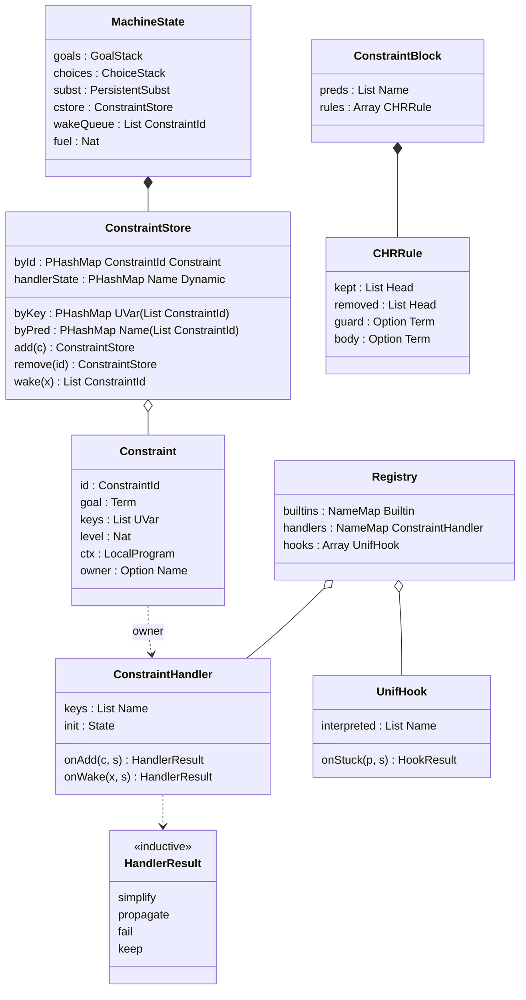
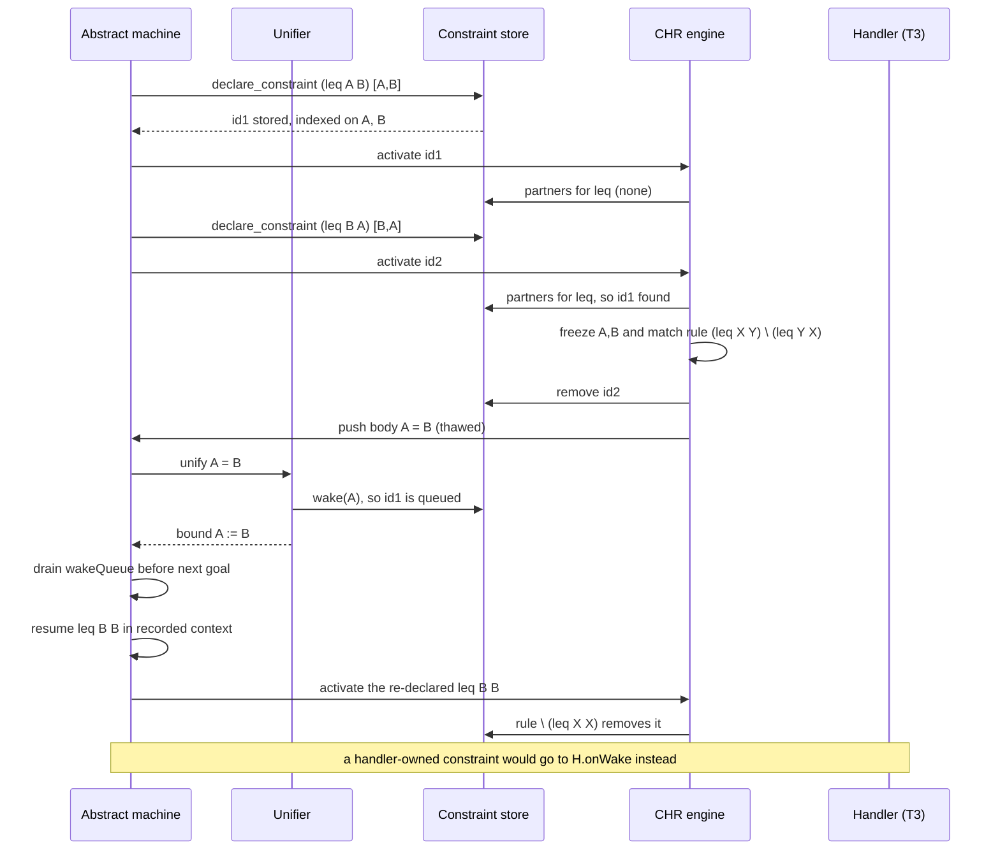

## Context

M1 (`add-elpi-core`) gives us an explicit abstract machine ([[decisions#Explicit abstract machine]]) whose state (goal stack, choice-point stack, cut barriers, fuel) is persistent ([[decisions#Persistent store]]). Unification variables live in [[components#Persistent substitution]] and carry their scope level. The [[components#Unifier]] already *detects* problems outside the [[glossary#Pattern fragment]], but M1 has nowhere to put them except a minimal suspension list, which M1 only uses to report them. The [[components#Solver registry]] knows a single tier: Lean builtins (T2).

The motivation is in proposal.md (Why). What shapes this design:

- [[constraints#Oracle is ELPI 1.18]]: resumption order, CHR firing order and residual output must match `elpi` 1.18 on the conformance corpus.
- [[constraints#Pattern unification is decidable]] / [[constraints#CIC unification is undecidable]]: anything outside the fragment is delayed, never guessed.
- [[constraints#Upstream ELPI is LGPL]]: the CHR engine is designed from the published semantics (the ELPI paper, the CHR literature, oracle behaviour), not from upstream source.
- [[decisions#Monad-generic core and packaging]]: the constraint store and CHR engine belong to the MetaM-free core and are generic over `Backtrackable m`.

## Goals / Non-Goals

**Goals:**
- One mechanism for delayed goals, whether they come from `declare_constraint`, from stuck unification or from a T4 hook that answers suspend.
- Backtracking of constraints and handler state comes for free from persistence: no undo code and no trail.
- CHR semantics that match ELPI 1.18 exactly on the conformance corpus, including the order rules fire in.
- Typed, attribute-registered extension points for T3 and T4 that work in every embedding (MetaM, pure runtime, CLI).

**Non-Goals:**
- A full CHR compiler with join ordering, RETE-style partial matches or a propagation history. ELPI 1.18 has none of these.
- Confluence or termination checking of CHR programs. Termination stays the program's responsibility, as upstream, and fuel is the backstop.
- A built-in arithmetic solver. The `"lia"` handler in the scenarios is a test fixture, not a shipped library.
- Changing what M1 programs do when they never suspend.

## Decisions

### D1. The constraint store is a field of the persistent machine state
`Machine.State` gains `cstore : ConstraintStore`, a record of persistent maps:
- constraint id ↦ `Constraint`
- uvar ↦ the ids suspended on it (the wake index)
- predicate name ↦ ids (the CHR partner index)
- handler name ↦ handler state

A choice point already captures `State`, so backtracking restores the store in O(1). Records [[decisions#Persistent store]].
*Rejected:* a mutable store undone through a trail ([[alternatives#Mutable heap with trail]]). It makes every handler responsible for its own undo, which breaks the "Handler state backtracks with the store" scenario as soon as one handler forgets.

### D2. Waking goes through an explicit queue drained at goal boundaries
When the unifier binds a uvar `X`, it looks `X` up in the wake index and pushes the woken constraint ids onto `State.wakeQueue`; it never runs them itself. Before the machine pops the next goal it drains the queue: plain suspended goals are pushed as goals in their recorded context, constraints owned by a handler go to its `onWake`. This gives "resume before the next goal of the conjunction" (requirement *Delayed goals*) without host recursion, which keeps the stack-safety guarantees of [[decisions#Explicit abstract machine]].
*Rejected:* resuming inside the unifier. It nests unification inside goal solving on the host stack, the same problem [[alternatives#Recursive CPS interpreter]] was rejected for, and it interleaves bindings in an order the oracle does not use.

### D3. CHR is driven by the active constraint, with frozen variables
Each constraint added by `declare_constraint`, or re-added after a wake, becomes the *active* constraint. The [[components#CHR engine]] tries the rules of every `constraint` block that lists its predicate, in source order. For each rule it places the active constraint at each head position in turn and looks up partners for the other heads in the partner index, in insertion order. Before matching, the unification variables of the candidate constraints are replaced by fresh *frozen* constants. Head patterns are then matched one way, and the guard runs against the frozen terms in a nested machine run with its own choice points, so a guard that tries to bind a frozen variable fails. When the guard succeeds, the removed heads leave the store, the matched pattern variables are thawed back to the original uvars, and `Body` is pushed as a goal.

Matching only on the active constraint is what lets ELPI 1.18 do without a propagation history: a pair of kept constraints is only reconsidered when one of them is new. Records [[decisions#ELPI 1.18 dialect]].
*Rejected:* a propagation history as in classic CHR (it differs from the oracle on programs that re-add constraints), and unification-based head matching (it would let a rule assign store variables).

### D4. Constraints carry their scope
A `Constraint` stores the goal, its keys, the scope level of the innermost `pi` it was created under, and a snapshot of the local program at that point. The snapshot is cheap because the program is persistent. Resumption reinstates that context. A head `(Ctx ?- C)` binds `Ctx` to a reified list of the local clauses. When two heads come from different scopes, eigenvariables are compared by level: thawing only allows a pattern variable to stand for an eigenvariable visible from where the body runs, and the M1 scope check rejects the rest. Builds on [[glossary#Eigenvariable]] and [[glossary#Hereditary Harrop formula]].
*Rejected:* dropping the context when a goal suspends, which is wrong for any Coq-Elpi-style type checker that suspends under binders.

### D5. T3 handlers own constraints and keep typed state in the store
```lean
structure ConstraintHandler where
  keys   : List Name                       -- ELPI predicates owned
  State  : Type                            -- handler-private state
  [inst  : TypeName State]
  init   : State
  onAdd  : Constraint → Store → HandlerResult
  onWake : UVar → Store → HandlerResult

inductive HandlerResult
  | simplify (keep : List Constraint)
  | propagate (goals : List Goal)
  | fail
  | keep
```
The state is stored as a `Dynamic` under the handler's name in `cstore`, which is persistent per D1. `Store` is a read-only view that also offers `getState`/`setState` (the `setState` result is folded into the `HandlerResult`). A handler takes over its predicates completely: CHR blocks over the same predicate are rejected at load time, so there is never a question of which one fires first. Handler callbacks are pure, which is why they work in the pure runtime and in the CLI; one that needs Lean effects should be a T2 builtin that it propagates to. Records [[decisions#Tiered solver API]] and [[glossary#Constraint handler]].
*Rejected:* handlers with an `IO.Ref`, which does not backtrack, and handlers running in the host monad (`m`), which would tie T3 to MetaM and break [[decisions#Monad-generic core and packaging]].

### D6. T4 hooks sit behind pattern unification, never in front of it
The unifier returns `solved θ | failed | stuck p`. Hooks are consulted only on `stuck p`, in registration order: the first one that does not decline decides. A `.solved θ` answer is re-checked for occurs and scope violations before it is committed, a `.suspend` answer becomes a delayed goal keyed on the flexible heads of `p`, and with no hook the problem is suspended as in ELPI 1.18. A hook declares the symbols it treats as interpreted, and a rigid-rigid clash on one of them is reported as `stuck`, not `failed`. Records [[decisions#Tiered solver API]] and [[glossary#Unification hook]]. It is also the integration point that LF's defeq bridge reuses ([[decisions#LF as the dependent extension]]).
*Rejected:* hooks first (they could contradict a syntactic answer and diverge from the oracle), and hooks that override failure on uninterpreted symbols (unsound with respect to the program's signature).

### D7. Registration extends the M1 registry
`@[elpi_constraint_handler "name"]` and `@[elpi_unif_hook]` add entries to the same environment extension as `@[elpi_builtin]`, so solvers from imported modules are found without further setup. The CLI and the runtime library see the handlers and hooks compiled into the binary through the same table. Records [[decisions#Tiered solver API]].

### Structure



### A delayed goal woken and a CHR rule firing



### Termination

Three ways a run can fail to terminate. Each is bounded by the M1 fuel counter ([[glossary#Fuel]]), which reports a resource error rather than hanging:
- A propagation rule whose body re-adds an equivalent constraint. The idiom is a simpagation idempotence rule `rule (p X) \ (p X).` placed before it, exactly as upstream. The `leq` solver ships with one.
- A suspended goal that re-suspends on the same variable after waking. This is harmless, since it waits for the next binding, but a goal that binds its own key in a cycle loops.
- Handler `propagate` cycles. Each round of handler activity costs one unit of fuel, so they are bounded too.

## Risks / Trade-offs

- [The order rules fire in, or the order of partners, differs subtly from the oracle] → Corpus programs for each CHR feature (simplification, propagation, simpagation, guards, contexts, several blocks), compared answer by answer and residual by residual by the conformance harness. Divergences that cannot be fixed go into the known-divergence register with a reason.
- [Scanning partners is slow on big stores] → The predicate index (`byPred`) keeps the search per predicate. Indexing heads on their first argument is deferred, consistent with [[decisions#Staged language surface]].
- [Freezing and thawing get eigenvariable levels wrong] → Frozen constants carry the level of the uvar they replace, and property tests check that freeze followed by thaw is the identity.
- [`Dynamic` state of the wrong type after a handler is redefined in the same file] → On `TypeName` mismatch the handler state is re-initialised with `init`, and a warning is logged.
- [T4 hooks make answers depend on which modules are imported] → The CLI prints the active handlers and hooks in `--verbose` mode, and the conformance harness runs with no T3/T4 solvers registered, so the oracle comparison is never affected by them.
- Trade-off: pure T3 callbacks cannot call Lean directly. We accept this so that T3 works in every embedding. Effects go through T2 builtins named in `propagate` goals.

## Migration Plan

This change only adds behaviour. M1 programs that never suspend run unchanged, and the existing M1 suspension list is replaced by `cstore` under the same reporting path. Rolling back means reverting the change. No stored data changes format, because the environment extension only gains entries.

## Open Questions

- What exact textual format should handler-owned residual constraints use? The oracle has no T3, so we only need to pick one that is stable. This does not affect the specs.
