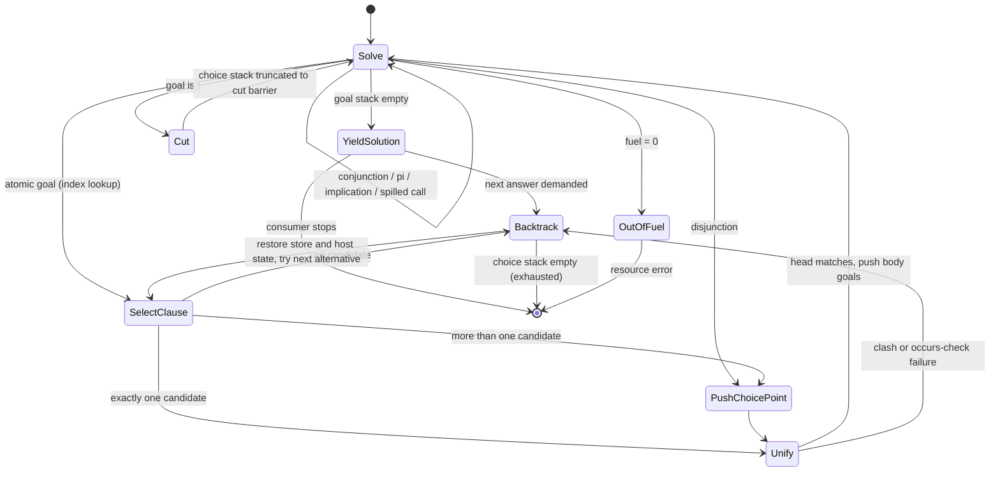
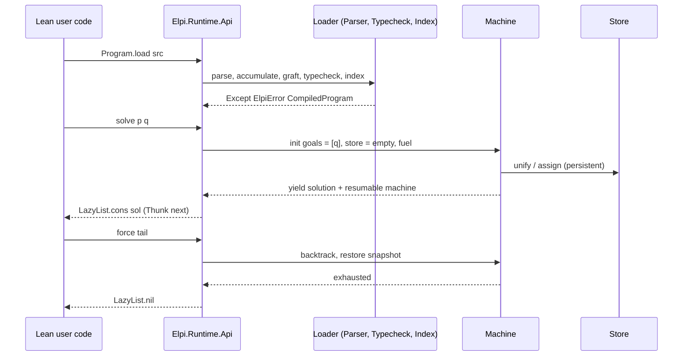
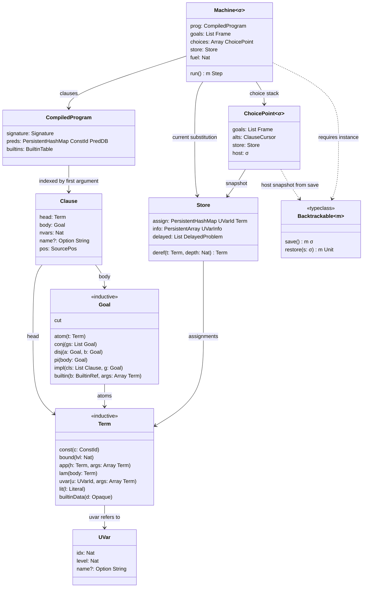

## Context

LeanElpi is greenfield: the repository has the knowledge graph (`tg.md/`), the OpenSpec setup and no engine code. See `proposal.md` (Why) for the motivation. This design fixes how milestone M1 builds the engine core and its three delivery forms (runtime library, CLI, compiled executables), within these constraints:

- The engine must reproduce ELPI 1.18 answers and answer order, checked black-box against the installed binary ([[constraints#Oracle is ELPI 1.18]], [[glossary#Oracle]]).
- Upstream ELPI is LGPL-2.1, so the implementation is clean-room: behaviour is taken from documentation, published papers and oracle runs, never from upstream sources ([[constraints#Upstream ELPI is LGPL]], [[decisions#Clean-room Apache license]]).
- Lean 4.35.0, no Mathlib ([[constraints#Lean toolchain 4.35]]). Everything this design needs (`Lean.PersistentHashMap`, `Lean.PersistentArray`, `Thunk`, `include_str`, `Std.HashMap`) is in core.
- Higher-order unification is undecidable in general, but Miller's pattern fragment is decidable with most general unifiers ([[constraints#CIC unification is undecidable]], [[constraints#Pattern unification is decidable]], [[glossary#Pattern fragment]]).
- MetaM cannot be called from compiled C or from a pure context, so the core must not depend on it ([[constraints#MetaM is not callable from C]]).

The components introduced here are described in [[architecture#Module map]] and [[components#Term store]], [[components#Parser]], [[components#Type checker]], [[components#Unifier]], [[components#Persistent substitution]], [[components#Clause index]], [[components#Abstract machine]], [[components#Core builtins]], [[components#Solver registry]], [[components#Standard library]], [[components#Runtime API]], [[components#Library resolver]], [[components#CLI]] and [[components#Conformance harness]]. The class structure below refines [[uml#Core class diagram]], the machine loop refines [[uml#Machine state diagram]], and the query path refines [[uml#Query sequence]].

## Goals / Non-Goals

**Goals:**

- One engine core (`Elpi/Core/`) that is pure Lean, MetaM-free and generic over a [[glossary#Host monad]], reused unchanged by the runtime library, the CLI, compiled executables and (in M3) the Lean integration.
- Answers identical to ELPI 1.18 for every program in the conformance corpus, including order, multiplicity and determinism.
- Backtracking cost independent of the amount of work being undone (persistent state, no trail replay).
- Recursion depth bounded by heap, not by the native stack; every run bounded by [[glossary#Fuel]].
- Solutions as lazy streams in pure code and in `IO`.

**Non-Goals:**

- Constraint handling: `declare_constraint`, CHR rules and wake-up on assignment are M2 (`add-elpi-constraints`). In M1 a program using `declare_constraint` or `constraint ... { }` is rejected at load time with an "unsupported in this milestone" error.
- Lean term reflection, quotations, `elpi_tactic`/`elpi_command`, Lean builtins such as `lean.infer` (M3, `add-lean-integration`).
- Deferred language features ([[decisions#Staged language surface]]): macros (`macro @x`), multi-argument and deep `:index(...)` directives (parsed, ignored with a warning, first-argument indexing kept), ELPI 2.x `func` and determinacy checking ([[alternatives#ELPI 2.x dialect]]), the upstream tracing protocol.
- Performance tuning beyond "no asymptotic regressions": no WAM-style compilation, no mutable heap.

## Decisions

### D1. Native Lean engine, oracle-checked, clean-room

Records [[decisions#Native Lean engine]], [[decisions#ELPI 1.18 dialect]] and [[decisions#Clean-room Apache license]]. The engine is written from scratch in Lean; the opam `elpi` 1.18.x binary is a test-only dependency used by the [[components#Conformance harness]].

Rejected: [[alternatives#OCaml FFI engine]] (two runtimes and GCs in one process, MetaM unreachable from OCaml callbacks), [[alternatives#Out-of-process engine]] (no shared terms, every builtin call becomes IPC), [[alternatives#Porting upstream under LGPL]] (license incompatible with Apache-2.0), [[alternatives#ELPI 2.x dialect]] (the installed oracle is 1.18).

### D2. Terms with de Bruijn levels and scoped unification variables

Records the term part of [[decisions#Explicit abstract machine]]. Bound variables and [[glossary#Eigenvariable]]s share one namespace of *levels*: a term living at depth `d` may mention levels `0 … d-1`. Entering `lam` or solving `pi x\ G` at depth `d` makes level `d` the new name, so `pi` needs no substitution at all, and a term built at depth `d` remains valid at any deeper depth without shifting (the property that makes levels preferable to indices for a goal-directed interpreter). Each [[glossary#Unification variable]] records its scope level `ℓ`: its assignment may only mention levels `< ℓ`. Assignments are stored as closed λ-abstractions relative to `ℓ`; instantiating `X a1 … an` at depth `d` β-reduces and relocates the inner binders from `ℓ…` to `d…` (a *move* operation).

```lean
namespace Elpi

/-- Interned global constant (predicate, constructor, builtin). -/
structure ConstId where
  idx : Nat
deriving BEq, Hashable, Repr

/-- Unification variable; its scope level lives in the store. -/
structure UVarId where
  idx : Nat
deriving BEq, Hashable, Repr

inductive Literal where
  | int (i : Int) | float (f : Float) | str (s : String)

/-- Host data carried through ELPI untouched (compared by handle). -/
structure Opaque where
  handle : Nat
  typeName : Lean.Name
  payload : NonScalar

inductive Term where
  | const (c : ConstId)
  | bound (lvl : Nat)                     -- de Bruijn level: λ-bound or eigenvariable
  | app (h : Term) (args : Array Term)    -- head is const or bound; never app/lam
  | lam (body : Term)                     -- binds level = current depth
  | uvar (u : UVarId) (args : Array Term) -- X applied to a spine
  | lit (l : Literal)
  | builtinData (d : Opaque)

structure UVarInfo where
  level : Nat                 -- scope level ℓ
  name? : Option String       -- source name, for printing answers

end Elpi
```

`Term` derives structural `BEq` and a cached `Hashable` (hash stored in `app` nodes), which makes α-equivalent terms equal by construction. Full hash-consing of terms reflected from `Expr` is an M3 concern ([[decisions#Lossless reflection with opaque levels]]).

### D3. Persistent substitution and host-state snapshots

Records [[decisions#Persistent store]]. The [[components#Persistent substitution]] is

```lean
structure Store where
  assign  : Lean.PersistentHashMap UVarId Term   -- X ↦ λ-closed term at X's level
  info    : Lean.PersistentArray UVarInfo        -- indexed by UVarId.idx
  nextVar : Nat
  delayed : List DelayedProblem                  -- see D5
```

Because the store is immutable and structurally shared, a [[glossary#Choice point]] simply keeps the `Store` value it was created with; backtracking is a pointer swap, with no trail and no undo log. The same choice point also keeps the host monad state obtained from `Backtrackable.save` (D6). Under MetaM this is `Meta.SavedState`, so metavariable assignments, the metavariable context and the message log are rewound together with ELPI bindings.

Rejected: [[alternatives#Mutable heap with trail]]. It is faster on deterministic code, but it needs `ST`/`IO` refs inside a pure API, and it cannot share one choice point with a host monad whose state is itself persistent (MetaM's `MetavarContext`) without two disagreeing undo mechanisms.

### D4. Explicit abstract machine with fuel and lazy answers

Records [[decisions#Explicit abstract machine]]. The [[components#Abstract machine]] is a first-order state transformer; the native stack never grows with ELPI recursion depth.

```lean
/-- A goal to solve, closed over the depth and local program it runs under. -/
structure Frame where
  goal    : Goal
  depth   : Nat             -- number of eigenvariables in scope
  locals  : LocalProgram    -- clauses added by `=>`
  cutTo   : Nat             -- choice-stack height to cut back to (cut barrier)

structure ChoicePoint (σ : Type) where
  goals   : List Frame      -- continuation (persistent list, O(1) to keep)
  alts    : ClauseCursor    -- remaining candidate clauses, or a builtin's remaining stream
  store   : Store
  host    : σ

structure Machine (σ : Type) where
  prog    : CompiledProgram
  goals   : List Frame
  choices : Array (ChoicePoint σ)
  store   : Store
  fuel    : Nat

inductive Step (σ : Type) where
  | yield (s : Solution) (resume : Machine σ)
  | exhausted
  | outOfFuel (m : Machine σ)
  | error (e : ElpiError)

def Machine.run [Monad m] [Backtrackable m σ] : Machine σ → m (Step σ)
```

A [[glossary#Cut]] in a clause body pops the choice stack back to the `cutTo` height recorded when the clause's predicate was called. This removes the predicate's remaining alternatives and every choice point to the left of `!`, but nothing below the call, so a cut never escapes the predicate. Disjunction `G1 ; G2` pushes a choice point whose alternative is `G2`. `D => G` pushes `G` with `locals` extended by `D` (locals are scoped by the frame, so they disappear when the frame is popped or backtracked). [[glossary#Spilling]] is compiled away at load time: `p {q X}` becomes `q X V, p V` with `V` fresh at the enclosing depth.

The stream of answers *is* the machine: `yield` returns the resumable machine, and asking for the next answer runs `Backtrack` on it. In pure code this unfolds into an `Elpi.LazyList` (`nil | cons (a : α) (tl : Thunk (LazyList α))`, defined in the core because Lean core has no lazy list). Running out of fuel is a separate `Step`, distinct from failure.



Rejected: [[alternatives#Recursive CPS interpreter]]. Success and failure continuations are elegant, but they consume native stack in proportion to recursion depth, make fuel and cut barriers implicit, and cannot be suspended into a value for lazy pure streams without closures that capture the host state.

Search is fixed depth-first with clause order, as in ELPI. A pluggable `Strategy` exists only for LF ([[decisions#LF as the dependent extension]]).

### D5. Pattern unification, occurs check, and the M1 delayed list

Records [[decisions#Explicit abstract machine]] (unifier part) and [[decisions#Staged language surface]] (what M1 does with non-pattern problems). The [[components#Unifier]] works on dereferenced terms at the current depth `d`:

1. **Rigid–rigid.** Same head (`const`, `bound`, literal) and same arity: unify arguments pairwise; otherwise fail. `lam` vs `lam`: descend at depth `d+1`. `lam` vs rigid: η-expand the rigid side.
2. **Flex–rigid, pattern case.** `X a1 … an = t` where `X` has level `ℓ` and the `ai` are *distinct* levels `≥ ℓ` (names introduced after `X`). **Inversion**: build `X := λ x1…xn. t'`, where `t'` is `t` with each `ai` replaced by the binder `xi`. While traversing `t`:
   - a level `< ℓ` is kept, and a level in `{ai}` is mapped to its binder; any other level means no solution exists, so unification fails;
   - another variable `Y b1 … bk` with level `ℓY > ℓ` is **pruned**: `Y` is assigned `λ ȳ. Y' ȳ'`, where `Y'` is fresh at level `min(ℓ, ℓY)` and `ȳ'` keeps only the arguments that remain expressible. Pruning is applied only when `Y`'s spine is itself a pattern; otherwise the problem is delayed;
   - **occurs check**: meeting `X` itself in a rigid position fails (`X = f X` has no solution). Meeting `X` under a pruneable position is also a failure, because the pattern fragment admits no cyclic solution.
3. **Flex–flex.** For the same variable, `X ā = X b̄` assigns `X := λ x̄. X' x̄|{i | ai = bi}` (spine intersection). For different variables, one side is inverted onto the other: the one with the higher level is assigned.
4. **Out of fragment.** If a spine contains a non-variable, a repeated variable or a variable `< ℓ`, the problem is not solved and not failed. It is recorded as a [[glossary#Delayed goal]] `DelayedProblem` in `Store.delayed`. The store is snapshotted by choice points, so the list backtracks for free.

In M1 the delayed list is **resolved at the end**. When the goal stack becomes empty, the machine re-dereferences every delayed problem before yielding. Problems that have become rigid or pattern are unified, and a failure there backtracks as if the last goal had failed. Problems that are still out of the fragment are attached to the `Solution` as residual goals (`Solution.residual`), mirroring how the oracle prints suspended goals. M2 replaces "at the end" with wake-up on assignment (`elpi-constraints › Delayed goals`). Until then, programs whose observable behaviour depends on *when* a delayed problem wakes are recorded in `tests/conformance/divergences.md`.

Mode-restricted calls ([[glossary#Hereditary Harrop formula]] heads with `i:` arguments) use the same unifier in **match mode**: only variables created by renaming the selected clause may be assigned, and an attempt to assign a goal variable fails that clause.

### D6. Monad-generic core

Records [[decisions#Monad-generic core and packaging]]. The core depends only on this class, defined in `Elpi/Core/Store.lean` next to the store whose snapshots it complements:

```lean
class Backtrackable (m : Type → Type) (σ : outParam Type) where
  save    : m σ
  restore : σ → m Unit

instance : Backtrackable Id Unit := ⟨pure (), fun _ => pure ()⟩
instance : Backtrackable (StateM ρ) ρ := ⟨get, set⟩
instance : Backtrackable IO Unit := ⟨pure (), fun _ => pure ()⟩   -- IO effects are not undone
-- in Elpi/Lean/Builtins.lean (outside the core; created in M1 so the requirement is testable):
instance : Backtrackable Lean.Meta.MetaM Lean.Meta.SavedState :=
  ⟨Lean.Meta.saveState, fun s => s.restore⟩
```

`Elpi/Core/*.lean` imports nothing from `Lean.Meta` or `Lean.Elab`. A CI check (`lake env lean --deps`) asserts this. The MetaM instance lives in `Elpi/Lean/Builtins.lean` ([[components#Lean builtins]]), outside the core; M1 creates that file with only this instance, and M3 adds the Lean builtins.

Rejected: a MetaM-only engine. That would make the runtime library and the CLI depend on a Lean environment, and it would violate [[constraints#MetaM is not callable from C]] for compiled executables.

### D7. Builtins and the solver registry (tier T2)

Records [[decisions#Tiered solver API]] (T2 only; T1, T3 and T4 come in M2). A [[glossary#Builtin predicate]] is

```lean
structure BuiltinSig where
  name  : String
  modes : Array Mode          -- i / o per argument
  type  : Ty                  -- checked by the type checker

/-- Inputs dereferenced; result = lazy alternatives, each a binding of the output args. -/
structure Builtin (m : Type → Type) where
  sig : BuiltinSig
  run : Array Term → m (Elpi.LazyList (Array Term))
```

The effect happens once at call time in `m`; the alternatives are a pure lazy list consumed by successive backtracking (the choice point stores the remaining tail in `ClauseCursor`). `@[elpi_builtin "name" "pred sig."]` parses and typechecks the signature when the attribute is applied, then records `(name, sig, declName, effect)` in a persistent environment extension of the [[components#Solver registry]]. `effect ∈ {pure, io, meta}` is inferred from the declaration's type. Programs compiled with `elpi_program` reference builtins by constant, so `foo.compiled` closes over them without `evalConst`. The CLI with `--lean-env` uses `evalConstCheck` on the imported environment. `p.withBuiltin` adds a builtin to a single `CompiledProgram` value.

Rejected for M1: effectful generator streams (`m`-valued tails). Lean's positivity checker rejects `m (Stream m)` for an arbitrary `m`, and the machine-as-stream design (D4) already gives resumable search where it matters.

### D8. Delivery: runtime API, compiled constants, CLI, executables

Records [[decisions#Monad-generic core and packaging]].

- [[components#Runtime API]]: `Elpi.solve (p : CompiledProgram) (q : Query) : LazyList Solution` runs in `Id`. `Elpi.solveIO` runs in `IO`. `Elpi.solveAs [FromElpi α]` decodes the bindings of the answer variables; M1 defines `FromElpi` with instances for base types, lists, options and products in `Elpi/Runtime/Api.lean`, and M3's [[components#Marshalling]] extends it. `Elpi.Program.load : String → Except ElpiError CompiledProgram` and `Elpi.Program.loadFile` run parse, accumulate, graft, typecheck and index. `p.assert` returns a new program: the clause database is a `PersistentHashMap ConstId PredDB`, so the original is untouched and structure is shared.
- `elpi_program foo "src"` (defined in `Elpi/Lean/Commands.lean`, [[components#Commands]], which M1 creates with `elpi_program` and `elpi_main` only) runs the same pipeline at elaboration time and emits `foo.compiled : CompiledProgram` via a derived `ToExpr` instance, so runtime use never parses.
- [[components#CLI]] (`Elpi/Cli/Main.lean`, Lake target `lean-elpi`) implements `FILE… -exec P -- ARGS`, `-test`, `-I DIR`, `--lean-env M1,M2` (`importModules` and then run in `MetaM` with the registry's builtins) and a REPL when neither `-exec` nor `-test` is given. `elpi_main prog` expands to `def main (args : List String) : IO UInt32 := Elpi.runMain prog.compiled args`.
- [[components#Library resolver]] and [[components#Standard library]]: `lib/elpi/std.elpi` is written clean-room and embedded with `include_str` in `Elpi/Std/Std.lean`. The resolution order is: accumulating file's directory, `-I` paths, the current package's `lib/elpi/`, dependency packages' `lib/elpi/` directories in `lake-manifest.json` order, and embedded sources.



### D9. Class structure

The core types and their relations, refining [[uml#Core class diagram]]:



### D10. Program structure: grafting, accumulate, namespaces, index

Records [[decisions#ELPI 1.18 dialect]] ([[glossary#Clause grafting]]). Loading runs in phases. (1) Parse each unit to an AST with positions; the [[components#Parser]] is a hand-written lexer plus Pratt parser over ELPI 1.18's fixed operator table. (2) Resolve `accumulate` through the [[components#Library resolver]], keyed by canonical path so that a unit is loaded once. (3) Expand namespaces: names are qualified to `ns.name`, and short names resolve innermost-first. (4) Order clauses per predicate: start in source order, then apply `:before`/`:after` relative to `:name`d clauses; an unknown or duplicate name is a load error. (5) Typecheck with the [[components#Type checker]]: HM-style first-order unification on simple types, prenex type variables instantiated per use, `typeabbrev` expanded eagerly, errors with `SourcePos`. (6) Compile spilling and build the [[components#Clause index]]: per predicate, a map from first-argument key (`const c`, literal, `[]`, `::`, `flex`) to clause positions. Candidates for a rigid key are the ordered merge of that bucket and the `flex` bucket, so indexing never reorders answers.

### D11. Conformance as the arbiter

Records [[decisions#Specs before code]] and relies on [[constraints#Oracle is ELPI 1.18]]. `tests/conformance/run.sh` checks `elpi -version` for `1.18.`, runs every `corpus/*.elpi` with `-test` (nullary `main`) on both engines under a timeout, normalises timing lines and printed fresh-variable and eigenvariable names, compares stdout and exit status with `diff -u`, and consults `divergences.md` (known divergence = pass, stale entry = warning). Corpus programs are written by the project, not copied from the upstream test suite.

## Risks / Trade-offs

- [Persistent maps are slower than a mutable heap on deterministic code] → Measure with the corpus benchmark set. Keep `UVarId` dense so that the store can later move to `PersistentArray` without API change. Rejecting [[alternatives#Mutable heap with trail]] stays the default until profiles show a hot spot.
- [Resolving delayed problems only at solution time diverges from the oracle when wake-up time is observable (side effects, cut after the waking point)] → Register each such case in `divergences.md`; M2 closes them with wake-up on assignment.
- [Deep terms (long lists) overflow the native stack in recursive unification, dereferencing or printing] → Unifier and printer use an explicit worklist for argument spines. The deep-recursion scenario also runs on a 10^6-element list.
- [Float and string printing differ between OCaml and Lean] → Implement OCaml-compatible `%.17g`-style float printing in the printer; residual cases go to the divergence register.
- [`ToExpr` embedding of large compiled programs slows elaboration] → Fallback encoding as a `ByteArray` literal plus a binary decoder (still no ELPI parsing at runtime); switch when a program exceeds a size threshold.
- [Clean-room contamination] → Contributors do not read upstream sources. Behaviour comes from the ELPI documentation, the published papers and black-box oracle runs; the corpus is original.
- [Oracle missing in some environments] → The harness fails loudly with the version message instead of silently passing. CI installs `elpi.1.18.x` from a pinned opam switch.
- [Default fuel too low or too high] → Fuel is a parameter of every entry point. The default (10^8 steps) is chosen so that the whole corpus passes, and the CLI exposes it as `--fuel`.
- [Trade-off: builtin alternatives are a pure lazy list after one effectful call] → This covers generators such as `between` and MetaM lookups. Effectful lazy generators are not supported in M1 (D7).

## Migration Plan

Not applicable: this is the first change and there is nothing to migrate. The later changes `add-elpi-constraints`, `add-lean-integration` and `add-elpi-lf` extend the core through the `Backtrackable` instance, the solver registry and `Store.delayed` without changing the M1 APIs.

## Open Questions

- Exact REPL syntax for requesting the next solution (`;` as upstream versus `more`). This does not affect the specs, which only require that a request exists.
- Whether `--fuel` should also be honoured by `elpi_main` executables through an environment variable.
