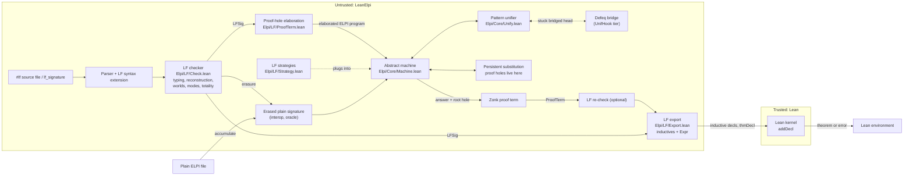
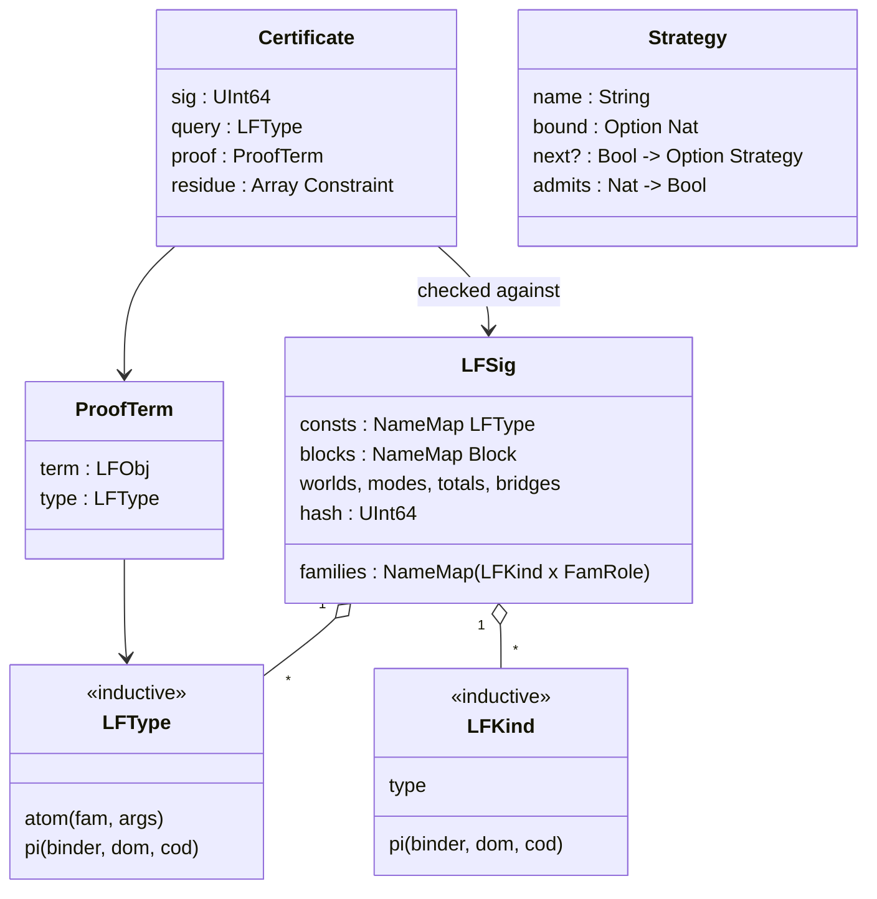
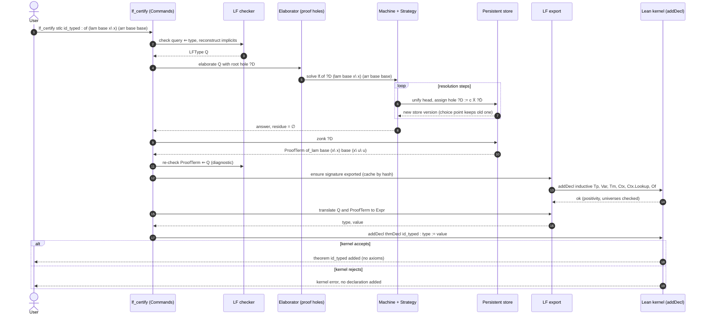
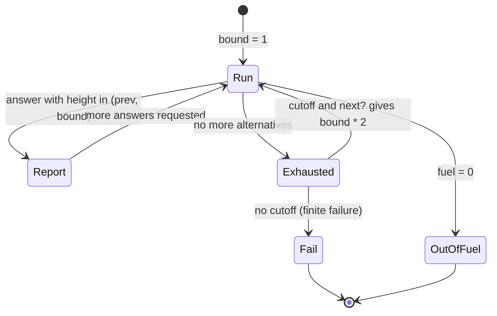

## Context

For motivation, see `proposal.md` (Why); the requirements are in `specs/elpi-lf/spec.md`. This document explains **how** an LF layer fits onto the engine built in M1 to M3, and why each choice was made.

The LF layer builds on these parts and changes none of them.

- **Simply typed core.** The ELPI core stays simply typed ([[decisions#Plain types with reflected Lean terms]]). Terms use de Bruijn levels, unification variables carry their scope level, and the [[components#Unifier]] implements higher-order pattern unification. Problems outside the [[glossary#Pattern fragment]] become a [[glossary#Delayed goal]].
- **Persistent substitution.** The substitution is a persistent map ([[decisions#Persistent store]], [[components#Persistent substitution]]). A choice point is a pointer to an old version, so anything stored in it is undone by backtracking at no cost.
- **Explicit machine.** The machine is an explicit goal stack, choice-point stack and cut barriers, with [[glossary#Fuel]] ([[decisions#Explicit abstract machine]], [[components#Abstract machine]]). Search is fixed depth-first for ELPI, with a pluggable strategy reserved for LF.
- **Unification hooks.** M2 adds the tier of [[glossary#Unification hook]]s to the solver API ([[decisions#Tiered solver API]], [[components#Solver registry]]).
- **Lean access.** M3 adds Expr reflection, commands, and MetaM access to `addDecl` ([[components#Expr reflection]], [[components#Commands]]).

The governing decision is [[decisions#LF as the dependent extension]]: LF (λΠ) is an *object theory* and Lean is the *metatheory*, in the style of Twelf. The rest of this document follows from that.

## Goals / Non-Goals

**Goals:**

- One engine. An LF query is an ELPI query over an elaborated program, so the unifier, the store and the machine are reused unchanged.
- Decidable everything on the LF side: type checking, equality (syntactic on canonical forms) and unification of patterns.
- A proof term for every LF answer, with no extra backtracking machinery.
- A faithful, adequate export of LF signatures to Lean inductive families that a human can read and that the kernel can check quickly.
- Soundness that rests on the Lean kernel alone. The engine, the LF checker and the exporter may all have bugs; a bug can make a certificate fail, but it cannot produce a false theorem.
- Staged meta-theory, Twelf-style: mode checking, then worlds, coverage and termination.

**Non-Goals:**

- CIC, or any type theory with computation in types, as the object theory ([[alternatives#Dependent types via CIC]]).
- Proving the exporter's adequacy *inside* Lean. That would require formalizing LF in Lean; adequacy is argued on paper and tested.
- Exporting the whole of LF. The exportable fragment is second-order: constructor arguments may be functions over syntax sorts, and hypotheses must be atomic. Signatures outside it still run and are still LF-checked, but they cannot be certified.
- Changing the answers or answer order of plain ELPI programs, or allowing strategies for them.
- Linear or concurrent LF (LLF, CLF), and Beluga-style contextual types.

## Background

### LF and judgments-as-types

LF ([HHP93]) is a dependent type theory with three levels: kinds (`type`, `Πx:A.K`), type families (`a M1…Mn`, `Πx:A.B`) and objects (`c`, `x`, `λx.M`, `M N`). It has *no* computation beyond β and η, and *no* inductive types, so definitional equality is βη-conversion and canonical forms are βη-normal, η-long terms. An object-language *judgment* is a type family, and a *derivation* of the judgment is an object of that type. This is the **judgments-as-types** principle.

- The simply typed λ-calculus typing judgment `Γ ⊢ e : τ` becomes `of : tm -> tp -> type`.
- The typing rule for λ becomes a constant whose type is the rule. Its premise is *hypothetical and parametric*: `pi x:tm\ of x T1 -> of (E x) T2`.
- LF's own context holds the object-language context, so weakening, exchange and substitution come for free.

Object-language binders are represented with [[glossary#HOAS]]: `lam : tp -> (tm -> tm) -> tm` uses LF's function space for the binder of `lam`. This works because LF's function space is *weak*: an LF function `tm -> tm` cannot inspect its argument. The canonical inhabitants of `tm -> tm` are therefore exactly the terms with one free variable, with no exotic terms.

### Adequacy

An encoding is **adequate** ([HHP93], [HL07]) when there is a compositional bijection between the object-language entities and the canonical LF objects of the corresponding type:

- *Syntax.* Terms `e` with free variables in `{x1…xn}` correspond one to one with canonical `M` where `x1:tm,…,xn:tm ⊢ M ⇐ tm`, and the bijection commutes with substitution.
- *Judgments.* Derivations of `Γ ⊢ e : τ` correspond one to one with canonical `D` where `⌜Γ⌝ ⊢ D ⇐ of ⌜e⌝ ⌜τ⌝`.

Adequacy is what lets an LF derivation stand for an object-language proof. The same notion, applied to our LF-to-Lean export, is in [Adequacy of the export](#adequacy-of-the-export).

### Twelf

Twelf ([PS99]) runs LF as a higher-order logic program. A type's target family is the predicate, constants are clauses, and search is depth-first with proof terms reconstructed as LF objects. On top of this Twelf checks *modes*, *worlds* (the shapes of contexts), *coverage* and *termination*. A relation that is total in this sense is a meta-theorem `∀ inputs. ∃ outputs. R`. We copy this design. Unlike Twelf, we then hand the evidence to a second, independent checker: the Lean kernel.

### λProlog and LF

λProlog's hereditary Harrop formulas are essentially LF with the dependencies erased. LF can be compiled to λProlog by adding the proof term as an explicit argument and erasing types ([Pfe91], [SBN10]). This is exactly how we reuse the ELPI engine: an LF signature is *elaborated* into an ELPI program whose answers carry the proof terms.

## Surface syntax

The LF syntax sits *inside* ELPI's lexical conventions, because it shares the ELPI lexer and parser.

| Construct | LeanElpi LF | Twelf | Why we differ |
|---|---|---|---|
| declaration | `c : A.` | `c : A.` | same |
| kind of types | `type` | `type` | same |
| Π (dependent) | `pi x:A\ B` | `{x:A} B` | `{…}` means spilling in ELPI |
| arrow | `A -> B` | `A -> B` | same |
| reverse arrow | `B <- A` | `B <- A` | same, left-associative |
| object λ | `x\ M` | `[x] M` | `x\` is ELPI's binder |
| implicit Π | free `Uppercase` vars | same | same |
| constant names | `of_lam` | `of/lam` | keep to ELPI identifier characters |
| directives | `#mode`, `#block`, `#worlds`, `#total`, `#strategy`, `#bridge` | `%mode`, … | `%` starts a comment in ELPI |
| opt-in | `#lf` header | (whole tool) | per-file opt-in |

Writing Π as `pi x:A\ B` is meant to look like ELPI's universal goal `pi x\ G`. Under judgments-as-types they are the same thing: a Π-typed premise *is* a universal goal. The `#` prefix for directives was chosen to match the `#lf` header and because `%` cannot be used. LF `#mode` is distinct from ELPI's `mode (p i o)`: the latter changes *runtime* behaviour (an input is matched, not unified), while `#mode` is a *static* groundness check.

Implicit arguments are ordered by their first occurrence. In `of_lam : of (lam T1 E) (arr T1 T2) <- …` the implicits are `T1, E, T2`, so the full type is `pi T1:tp\ pi E:tm -> tm\ pi T2:tp\ (pi x:tm\ of x T1 -> of (E x) T2) -> of (lam T1 E) (arr T1 T2)`. Reconstruction ([Pfe91]) infers the domains by unification and rejects ambiguous cases.

Worlds are written `#block b_of (T:tp) : x:tm, u:of x T.` and `#worlds (b_of) (of _ _).`. If a judgment family has no `#worlds`, its world is *inferred* from the hypothetical premises of its clauses. `of_lam` yields exactly `b_of`.

## Architecture of the extension

There are four new components, all in `Elpi/LF/`:

- [[components#LF checker]]
- [[components#LF proof terms]]
- [[components#LF export]]
- [[components#LF strategies]]

They sit around the unchanged core. Everything on the left of the trust boundary is untrusted.



The LF checker and the elaborator run once, at load time. The machine is reused unchanged except for one seam: an LF goal frame consults the current `Strategy` before it expands. The exporter runs in MetaM. It caches the generated inductives per signature in an environment extension, keyed by a hash of the signature, so a signature is exported once and every certificate reuses it.

### Data model

LF objects reuse the core term representation, the erased simply typed λ-terms with de Bruijn levels and hash-consing. Only types, kinds and signatures are new.

```lean
namespace Elpi.LF

/-- LF objects are core terms in canonical (β-normal, η-long) form.
    Constants are signature constants; bound variables are de Bruijn levels. -/
abbrev LFObj := Elpi.Term

/-- Type families: `a M₁ … Mₙ` and `Πx:A. B` (B's bound variable is the next level). -/
inductive LFType where
  | atom (fam : Name) (args : Array LFObj)
  | pi   (binder : Name) (dom : LFType) (cod : LFType)
  deriving Inhabited, BEq, Hashable

/-- Kinds: `type` and `Πx:A. K`. -/
inductive LFKind where
  | type
  | pi (binder : Name) (dom : LFType) (cod : LFKind)
  deriving Inhabited, BEq, Hashable

/-- How a family is exported (inferred, overridable). -/
inductive FamRole where
  | syntax      -- objects occur as indices of other families → Lean `Type`
  | judgment    -- constants are rules → Lean `Prop`

/-- A world block: `#block b (params) : x₁:A₁, …, xₖ:Aₖ.` -/
structure Block where
  name    : Name
  params  : Array (Name × LFType)
  entries : Array (Name × LFType)

structure ModeDecl where
  fam   : Name
  modes : Array (Bool × Name)        -- true = input (+)

structure TotalDecl where
  fam     : Name
  order   : Array Nat                -- argument positions, lexicographic
  worlds  : Array Name               -- blocks

structure Bridge where
  lfName  : Name
  leanFn  : Name                     -- e.g. `Nat.add`, or a type such as `Nat`
  toLean  : LFObj → Option Lean.Expr
  ofLean  : Lean.Expr → Option LFObj

structure LFSig where
  families : Lean.NameMap (LFKind × FamRole)
  consts   : Lean.NameMap LFType     -- fully explicit (implicits reconstructed)
  implicit : Lean.NameMap Nat        -- number of leading implicit Π's
  order    : Array Name              -- declaration order (export dependency order)
  blocks   : Lean.NameMap Block
  worlds   : Lean.NameMap (Array Name)
  modes    : Lean.NameMap ModeDecl
  totals   : Array TotalDecl
  bridges  : Lean.NameMap Bridge
  hash     : UInt64

/-- A derivation is an LF object of a judgment type; kept separate for clarity. -/
structure ProofTerm where
  term : LFObj                       -- closed after zonking
  type : LFType                      -- the instantiated query

structure Certificate where
  sig     : UInt64                   -- LFSig.hash it was produced against
  query   : LFType
  proof   : ProofTerm
  residue : Array Elpi.Constraint    -- must be empty to certify

end Elpi.LF
```



## Typing rules for LF

The checker uses the *canonical* presentation of LF ([HP05], [WCPW02]). Objects are kept in β-normal, η-long form, substitution is *hereditary* (it re-normalizes as it goes), and equality is syntactic α-equality. This is what makes type checking a simple, decidable, bidirectional algorithm with no conversion search. The syntax:

```
Kinds        K ::= type | Πx:A. K
Families     A ::= P | Πx:A. B             P ::= a M₁ … Mₙ        (atomic)
Canonical    M ::= R | λx. M
Atomic       R ::= x | c | R M
Contexts     Γ ::= · | Γ, x:A
Signatures   Σ ::= · | Σ, a:K | Σ, c:A
```

Judgments: `Γ ⊢ K kind`, `Γ ⊢ A ⇐ type`, `Γ ⊢ P ⇒ K`, `Γ ⊢ M ⇐ A` (checking), and `Γ ⊢ R ⇒ A` (synthesis). All are implicitly relative to Σ.

```
                         Γ ⊢ A ⇐ type    Γ, x:A ⊢ K kind
 ─────────────── (K-type) ────────────────────────────── (K-Π)
  Γ ⊢ type kind            Γ ⊢ Πx:A. K kind

  a:K ∈ Σ               Γ ⊢ P ⇒ Πx:A. K    Γ ⊢ M ⇐ A
 ───────── (F-const)   ─────────────────────────────── (F-app)
 Γ ⊢ a ⇒ K              Γ ⊢ P M ⇒ [M/x]ᴬ K

  Γ ⊢ P ⇒ type          Γ ⊢ A ⇐ type    Γ, x:A ⊢ B ⇐ type
 ─────────────── (F-at) ───────────────────────────────── (F-Π)
  Γ ⊢ P ⇐ type           Γ ⊢ Πx:A. B ⇐ type

  x:A ∈ Γ               c:A ∈ Σ
 ───────── (O-var)     ───────── (O-const)
 Γ ⊢ x ⇒ A             Γ ⊢ c ⇒ A

  Γ ⊢ R ⇒ Πx:A. B    Γ ⊢ M ⇐ A
 ────────────────────────────── (O-app)
  Γ ⊢ R M ⇒ [M/x]ᴬ B

  Γ ⊢ R ⇒ P′    P′ ≡α P              Γ, x:A ⊢ M ⇐ B
 ──────────────────────── (O-at)    ───────────────────── (O-λ)
  Γ ⊢ R ⇐ P                          Γ ⊢ λx. M ⇐ Πx:A. B

 Signatures:   ⊢ Σ sig    ⊢_Σ K kind              ⊢ Σ sig    ⊢_Σ A ⇐ type
              ─────────────────────── (a ∉ Σ)    ──────────────────────── (c ∉ Σ)
                 ⊢ Σ, a:K sig                       ⊢ Σ, c:A sig
```

Some notes on the rules:

- **No conversion rule.** O-at compares atomic types *syntactically*. Because every object is canonical and hereditary substitution `[M/x]ᴬ` preserves canonicity, α-equivalence is the only equality needed. This is the formal content of "LF has no computation in types". It is why [[constraints#Pattern unification is decidable]] suffices: we never have to unify modulo a reduction relation.
- **Hereditary substitution.** `[M/x]ᴬ N` is defined by structural recursion on the type `A` (more precisely on its erasure). When it substitutes `λy.M′` for the head `x` of `x N₁ … Nₖ`, it continues by substituting `N₁` into `M′` at a smaller type, so it always terminates.
- **η-long form.** O-at only applies at atomic type. A variable of function type must therefore appear η-expanded, as in `x\ E x`. The parser η-expands user input using declared types, which is also what the exporter needs.
- **Reconstruction.** Before checking, each declaration's free uppercase variables become fresh unification variables of unknown type. The checker runs in "inference mode", where the O-at comparison *unifies* instead of comparing. The variables are then abstracted as leading implicit Π's in order of first occurrence. A leftover unconstrained domain is an ambiguity error that names the variable.
- **Errors** carry the declaration name, the source span of the sub-object at fault, and the expected and found types, for example `tm` expected and `tp` found.

The rules are implemented as a pure function in `Elpi/LF/Check.lean`. The same checker re-checks recorded proof terms before export as an extra safety layer. That re-check helps diagnostics only and plays no part in soundness.

## Unification

### Why the pattern fragment suffices

LF *search* produces unification problems between LF objects. The first question is whether dependent types make unification harder than in simply typed λProlog. For LF the answer is no, for two reasons.

1. **No computation in types.** Equality is βη, and β-reduction is performed by hereditary substitution as part of instantiating a variable. Unification is therefore *higher-order unification modulo βη*, the same problem as in λProlog. It is undecidable in general, but decidable with most general unifiers in Miller's pattern fragment ([Mil91]): every unification variable is applied to distinct bound variables. Compare [[constraints#CIC unification is undecidable]]: there, equality includes δ-, ι- and ζ-reduction and unification is hopeless, which is the main reason CIC was rejected.
2. **Types are carried by explicit arguments.** Dependent HOU in general must unify types along with terms ([Ell89]). In our setting the implicit arguments of every constant *stay explicit* in the elaborated, erased terms, for instance `of_lam T1 E T2 D`. Every type index therefore occurs as an ordinary argument somewhere in the term being unified. When two well-typed LF objects of the same type are unified in erased form, every index is unified too. By the standard subject-reduction argument for LF logic programming ([Pfe91]), the resulting substitution is well-typed. We do not have to *trust* this argument: a violation would surface as a rejected certificate, since the kernel re-checks the result.

The [[components#Unifier]] from M1 is therefore reused unchanged. LF adds two things around it:

- **Type-directed η.** Objects are η-long by construction. When a unification variable `E : tm -> tm` is assigned through a pattern problem `E x = app x x`, the solution `x\ app x x` is already canonical. Constants of function type supplied by users are η-expanded at parse time.
- **Delays.** A non-pattern problem, such as `G (app c c) = c`, becomes a [[glossary#Delayed goal]] exactly as in plain ELPI. If it is still delayed when search ends, the answer is reported with its residual constraints and the `Certificate.residue` field is non-empty. `lf_certify` refuses such a certificate. An LF proof term with unsolved constraints is only a *schema*.

### Dependent pattern unification in practice

Pattern unification of LF objects can still meet a dependency. A unification variable `D : of X T` has a type that mentions another unification variable `X`. We keep the invariant that every unification variable created by elaboration is *typed by the goal it stands for*. When `D` is assigned `c M̄ D̄`, unifying the clause head with the goal has already unified `X` with the corresponding index. No separate type-unification pass is needed. That is the operational reading of reason 2 above.

## Proof-term recording

### Proof holes

Every LF goal frame in the machine carries a **proof hole**: a unification variable in the persistent substitution whose expected type is the goal. The answer's proof term is the zonked value of the root hole. Recording is just unification:

| Machine step on goal `G` with hole `?D` | Effect on the derivation |
|---|---|
| resolve with constant `c : Πx̄:Ā. B₁ → … → Bₖ → H` | `?D := c X̄ ?Dₖ … ?D₁` with fresh `X̄` for implicits, and `?Dᵢ` the holes of the new subgoals `Bᵢ` |
| universal goal `pi x:A\ G′` | introduce eigenvariable `x`; `?D := x\ ?D′`, where `?D′` lives one scope level deeper |
| hypothetical goal `A -> G′` | introduce a fresh hypothesis variable `u`, assume clause `u : A`; `?D := u\ ?D′` |
| resolve with assumption `u : Πȳ. B₁ → … → H` | `?D := u Ȳ ?Dₖ … ?D₁` |
| defeq bridge closes a unification problem | no derivation node; the equation is justified in the certificate by kernel defeq |

The hole discipline is implemented by **elaboration at load time**, not by new machine instructions. Each LF clause compiles to an ELPI clause of an internal predicate that takes the proof as an extra first argument. For the running example:

```
% LF:   of_lam : of (lam T1 E) (arr T1 T2) <- (pi x:tm\ of x T1 -> of (E x) T2).
lf.of (of_lam T1 E T2 D) (lam T1 E) (arr T1 T2) :-
  pi x\ pi u\ lf.of u x T1 => lf.of (D x u) (E x) T2.

% LF:   of_app : of (app E1 E2) T2 <- of E1 (arr T1 T2) <- of E2 T1.
%       i.e. pi E1 E2 T2 T1\ of E2 T1 -> of E1 (arr T1 T2) -> of (app E1 E2) T2
lf.of (of_app E1 E2 T2 T1 D2 D1) (app E1 E2) T2 :-
  lf.of D1 E1 (arr T1 T2),        % premises in textual (Twelf) order
  lf.of D2 E2 T1.
```

The query `of (lam base x\ x) T` becomes `lf.of D (lam base x\ x) T`. It answers `T = arr base base` and `D = of_lam base (x\ x) base (x\ u\ u)`. Inside the hypothetical premise, the goal `lf.of (D x u) x base` is solved by the assumed clause `lf.of u x base`. That gives `D x u = u` and hence `D = x\ u\ u`, a pattern problem since `x` and `u` are distinct eigenvariables.

How this relates to the machine:

- **Backtracking.** Holes are ordinary unification variables in the persistent store. A choice point captures the store version, so every partial derivation built on an abandoned branch disappears when the machine backtracks. No undo log is needed ([[decisions#Persistent store]]).
- **Hypotheses.** `pi` and `=>` are the core [[glossary#Eigenvariable]] and implication machinery. Under elaboration, Π-hypotheses and →-hypotheses become LF λs automatically, because the hole for the body is applied to the eigenvariables (`D x u`).
- **Invariant (partial derivations are well-typed).** At every machine state, the root hole, instantiated by the current substitution, is a well-typed LF object of the query type whose unfilled holes are typed by their pending goals. Each row of the table preserves this invariant. This is what the optional LF re-check verifies on the final term.
- **Cost.** Plain programs pay nothing. LF queries pay one extra argument per goal, and the proof term shares structure through hash-consed terms.
- **Strategy independence.** Proofs are built by unification, so every strategy records them identically.

### Erasure and interoperation

The plain view of an LF signature is its **erasure**:

```
|a M₁ … Mₙ|  = a                      (syntax family)
|Πx:A. B|    = |A| -> |B|
family a : Πx̄:Ā. type   ↦  kind a type.                          (syntax)
                         ↦  type a |A₁| -> … -> |Aₙ| -> prop.      (judgment)
constant c : A (syntax)   ↦  type c |A|.
clause   c : H <- B₁ <- … ↦  H :- B₁, …   with pi x:A\ ↦ pi x\  and  B -> G ↦ B => G
```

A plain file that accumulates an LF signature sees the erased declarations. Each judgment family is exposed through a wrapper `of M A :- lf.of _ M A.`, which delegates to the elaborated predicate and discards the proof. Answers and their order are identical to the LF query, because the wrapper adds no choice points. `lean-elpi --lf-erase` writes the erased program without proof arguments as a valid ELPI 1.18 file. That is the hook for differential testing against the [[glossary#Oracle]].

## Export to Lean

### The negative-occurrence problem

The obvious translation of `lam : tp -> (tm -> tm) -> tm` is

```lean
inductive Tm where
  | lam : Tp → (Tm → Tm) → Tm      -- rejected
  | app : Tm → Tm → Tm
```

The Lean kernel rejects it: `Tm` occurs to the left of an arrow in a constructor argument. The positivity check is not a technicality. Without it one can write `inductive Bad | mk : (Bad → False) → Bad` and derive `False`. Even if positivity were waived, Lean's function space is *strong*: a Lean function `Tm → Tm` can pattern-match on its argument, which would admit **exotic terms** that are not λ-terms ([DFH95]), and adequacy fails. LF's weak function space is exactly what Lean lacks.

The same problem hits judgments. The naive `Of.lam : (∀ x, Of x T1 → Of (E x) T2) → Of (lam T1 E) (arr T1 T2)` has `Of` negatively inside its premise. The export must turn binders into *first-order data*.

### Options considered

| Encoding | Positivity | Adequate by construction? | Kernel-check cost | Translation from HOAS | Notes |
|---|---|---|---|---|---|
| raw de Bruijn `Tm : Type`, `var : Nat → Tm` | ok | **no**: dangling indices need a side predicate | low | easy | breaks the syntax bijection |
| **well-scoped de Bruijn** `Tm : Nat → Type`, `var : Var n → Tm n` | ok | **yes**: `Tm n` = terms with `n` free vars | low, structural | easy: level → index | chosen |
| sort-indexed scopes `Tm : List Srt → Type` | ok | yes | low | easy | generalization of the row above to several bindable sorts |
| PHOAS `Tm (V : Type)`, `lam : Tp → (V → Tm V) → Tm V` ([Chl08]) | ok (`V` is a parameter) | only with parametricity, which Lean cannot state internally | medium | trivial for syntax | judgments over `∀ V, Tm V` are awkward; no inversion on binders |
| locally nameless (+ cofinite quantification) ([Cha12]) | ok | needs an `lc` predicate | medium | moderate | atoms and freshness add overhead to every certificate |
| weak HOAS with an abstract variable type ([DFH95]) | ok | no: exotic terms via the variable type | low | easy | adequacy needs extra axioms |
| deep embedding of LF in Lean (`LFObj`, `HasType Σ Γ M A`) | ok | yes, relative to a formal LF | high | trivial | theorems are about a generic `HasType`, not a readable `Of`; unusable downstream |

### Choice: well-scoped de Bruijn with explicit contexts

The recommended encoding is **well-scoped de Bruijn, indexed by scope**, with **contexts as data** for hypothetical judgments ([AR99], [BP99]).

1. **Syntax families with binders** get an index for the scope. With one bindable sort the scope is `Nat`, so `Tm : Nat → Type`, with a generated variable type `Var : Nat → Type` (`zero : Var (succ n)`, `succ : Var n → Var (succ n)`). With several bindable sorts, as in System F where `tp` variables are bound too, the scope is a list of sorts and variables are typed: `Var : List Srt → Srt → Type`. Syntax families without binders, such as `tp` in `stlc`, get no index.
2. **A function-typed argument** `A₁ -> … -> Aₖ -> B` of a constructor becomes a `B` over the scope extended by `A₁ … Aₖ`. So `lam : tp -> (tm -> tm) -> tm` becomes `Tm.lam : Tp → Tm (succ n) → Tm n`.
3. **Judgment families** become inductive `Prop`s indexed by a **context** `Γ : Ctx n`. `Ctx` is generated from the family's world. Each block `#block b (params) : x̄:Ā, ū:B̄` becomes one constructor of `Ctx`, taking the block parameters and extending the scope by the block's syntax variables. With a single block, the constructor is named `snoc`. Each assumption `u : B` in a block becomes one **lookup constructor** of the judgment, such as `hyp`, whose premise is a generated membership relation. A hypothetical premise `pi x:tm\ of x T1 -> of (E x) T2` becomes a premise over the extended context, `Of (Ctx.snoc Γ T1) E T2`.
4. **Applications of a bound function variable** in constructor types fall into two cases. If the arguments are exactly the most recently bound variables, in order (the pattern case, `E x`), the application translates to `E` itself at the extended scope. Any other instance, such as `E V` in a β rule `step (app (lam T E) V) (E V)`, uses generated, *structurally recursive* `Tm.ren`, `Tm.subst` and `Tm.inst`: `Step (Tm.app (Tm.lam T E) V) (Tm.inst E V)`.
5. **Kernel friendliness.** Generated code uses only fresh inductives and `Nat.succ`. It uses no `Fin`, no numerals with `OfNat`, no typeclass instances and no well-founded recursion. The kernel then checks certificates by pure structural conversion. Contexts are looked up through an inductive *relation* (`Ctx.Lookup`), not a function, so checking a variable never requires reduction.

The `stlc` export, as `lf_export stlc` prints it:

```lean
namespace Stlc
inductive Tp : Type where
  | arr  : Tp → Tp → Tp
  | base : Tp

inductive Var : Nat → Type where
  | zero {n} : Var (Nat.succ n)
  | succ {n} : Var n → Var (Nat.succ n)

inductive Tm : Nat → Type where
  | var {n} : Var n → Tm n
  | lam {n} : Tp → Tm (Nat.succ n) → Tm n
  | app {n} : Tm n → Tm n → Tm n

-- world of `of`: one block  b_of (T:tp) : x:tm, u:of x T
inductive Ctx : Nat → Type where
  | nil  : Ctx Nat.zero
  | snoc {n} : Ctx n → Tp → Ctx (Nat.succ n)

inductive Ctx.Lookup : {n : Nat} → Ctx n → Var n → Tp → Prop where
  | here  {n} {Γ : Ctx n} {T}       : Ctx.Lookup (Ctx.snoc Γ T) Var.zero T
  | there {n} {Γ : Ctx n} {S T} {i} : Ctx.Lookup Γ i T → Ctx.Lookup (Ctx.snoc Γ S) (Var.succ i) T

inductive Of : {n : Nat} → Ctx n → Tm n → Tp → Prop where
  | hyp    {n} {Γ : Ctx n} {i : Var n} {T} : Ctx.Lookup Γ i T → Of Γ (Tm.var i) T
  | of_lam {n} {Γ : Ctx n} {T1 : Tp} {E : Tm (Nat.succ n)} {T2 : Tp} :
      Of (Ctx.snoc Γ T1) E T2 → Of Γ (Tm.lam T1 E) (Tp.arr T1 T2)
  | of_app {n} {Γ : Ctx n} {E1 E2 : Tm n} {T2 T1 : Tp} :
      Of Γ E2 T1 → Of Γ E1 (Tp.arr T1 T2) → Of Γ (Tm.app E1 E2) T2
end Stlc
```

Constructor arguments follow the LF type: first the scope and context, then the LF implicits in first-occurrence order, then the premises in Π order. That is why `of_app` takes `D2` before `D1`.

### Translating objects and derivations

The translation `⌜·⌝` runs on *closed, zonked, η-long* proof terms. It tracks the current scope depth `n` and context `Γ`. Core terms use de Bruijn levels, so a variable at level `k` under depth `n` has index `n − 1 − k`, which becomes `Var.succ^(n−1−k) Var.zero`.

```
⌜x_k⌝ₙ                    = Tm.var (succ^(n−1−k) zero)
⌜c M₁ … Mₘ⌝ₙ              = C ⌜M₁⌝ₙ … ⌜Mₘ⌝ₙ                       (syntax constant)
⌜x\ M⌝ₙ  at type tm → tm  = ⌜M⌝ₙ₊₁                                 (binder argument)
⌜c X̄ D̄⌝_Γ                 = @J.c n Γ ⌜X̄⌝ ⌜D̄⌝_Γ                     (rule constant)
⌜x\ u\ D⌝_Γ at Πx:tm. B→C = ⌜D⌝_(Ctx.snoc Γ ⌜T⌝)                   (hypothetical premise)
⌜u_j⌝_Γ                   = @J.hyp … (Lookup.there^(…) Lookup.here)  (assumption use)
```

Applied to `of_lam base (x\ x) base (x\ u\ u)` at the empty context, this gives the certificate below. Every argument is explicit, because implicitness is an elaborator notion and we bypass the elaborator.

```lean
@Stlc.Of.of_lam 0 Stlc.Ctx.nil Stlc.Tp.base (@Stlc.Tm.var 1 Stlc.Var.zero) Stlc.Tp.base
  (@Stlc.Of.hyp 1 (Stlc.Ctx.snoc Stlc.Ctx.nil Stlc.Tp.base) Stlc.Var.zero Stlc.Tp.base
    (@Stlc.Ctx.Lookup.here 0 Stlc.Ctx.nil Stlc.Tp.base))
  : Stlc.Of Stlc.Ctx.nil (Stlc.Tm.lam Stlc.Tp.base (Stlc.Tm.var Stlc.Var.zero))
           (Stlc.Tp.arr Stlc.Tp.base Stlc.Tp.base)
```

### Adequacy of the export

Fix a signature Σ in the exportable fragment, a judgment family `j` with world `W`, and the generated Lean declarations. The statement we argue on paper, and test, is:

> **Theorem (Export adequacy).**
> 1. *Syntax.* For every syntax family `a` and scope `Ψ = x₁:a₁, …, xₙ:aₙ` over bindable sorts, `⌜·⌝_Ψ` is a bijection between canonical `M` with `Ψ ⊢_Σ M ⇐ a N̄` and Lean values of `A ⌜Ψ⌝ ⌜N̄⌝`. It is compositional: `⌜[M/x]N⌝ = Tm.inst ⌜N⌝ ⌜M⌝`, and weakening corresponds to `Tm.ren`.
> 2. *Soundness for judgments.* If `Γ ⊢_Σ D ⇐ j M̄` with `Γ` an instance of `W`, then `⌜D⌝_Γ : J ⌜Γ⌝ ⌜M̄⌝` type-checks in Lean.
> 3. *Completeness for judgments.* If `J ⌜Γ⌝ ⌜M̄⌝` is inhabited in Lean, then `j M̄` is inhabited in LF under `Γ`. Lean proofs are proof-irrelevant, so this is inhabitation, not a bijection.

Certificates rely only on part 2, and part 2 is *checked* on every instance by the kernel. Parts 1 and 3 are what make a certified Lean statement *mean* the LF statement. They matter to users and to the totality theorems, and they are covered by round-trip tests (LF → Lean → LF on generated canonical objects) and by printing the generated inductives for inspection.

### Universes and roles

Syntax families go to `Type` and judgment families to `Prop`. The role is inferred: a family is *syntax* if its objects occur as indices of another family, and *judgment* otherwise. It can be overridden with `#export of : Type`. That override is useful when a meta-theorem must eliminate derivations into data, which `Prop`'s elimination restriction forbids. Families indexed by derivations, such as Twelf-style meta-relations like `preserve : of E T -> step E E' -> of E' T -> type`, are legal Lean (`Prop`-valued indices). There is no universe polymorphism. Bridged types must live in `Type`.

## Certificate checking

`lf_certify sig name : Q` works through five steps.

1. **Search.** It runs the elaborated query under the file's strategy. It requires an answer with an empty `residue`.
2. **Zonk and re-check.** It zonks the root hole into a `ProofTerm`, η-expands it, and re-checks it with the LF checker. The re-check is on by default and can be disabled for testing; it exists only for diagnostics.
3. **Ensure export.** It looks up the signature hash in the export cache. If the signature has not been exported, it adds the generated inductives first, each through `addDecl`, so the kernel's positivity and universe checks apply.
4. **Build the Exprs.** It builds `type := ⌜Q⌝` and `value := ⌜D⌝`. It runs `Meta.check value` and `Meta.isDefEq (← inferType value) type` to get readable elaborator-level errors early.
5. **Submit.** It calls `addDecl (.thmDecl { name, levelParams := [], type, value })`. The **kernel** type-checks `value` against `type` here. If it rejects, the error is reported and nothing is added. The command refuses to run when kernel checking is disabled (`debug.skipKernelTC`).

**Trust boundary** ([[constraints#Kernel is the trust anchor]]):

- *Untrusted:* the parser, the LF checker, the elaborator, the machine, the strategies, the bridge, the exporter, the Expr builder and `Meta.check`.
- *Trusted:* the Lean kernel, including its built-in `Nat` literal arithmetic.

A certificate uses no axioms. `propext`, `Quot.sound`, `Classical.choice`, `sorryAx` and `Lean.ofReduceBool` never appear, which `#print axioms` confirms. The only gap between "the kernel accepted" and "the LF judgment holds" is adequacy, discussed above. An adequacy bug in the exporter can make a theorem *say something other than intended*, but the theorem is still a true statement about the printed inductive.

The flow is also recorded as [[uml#LF certification sequence]]:



## Strategies

Plain ELPI programs keep fixed depth-first search. Their meaning, including cut and side effects, is defined by that order, and the 1.18 oracle compares answers in that order. LF files contain no cut and no side-effecting builtins; the bridge is pure. Their answer *set* is therefore independent of the search order, and only completeness and efficiency change. Hence the strategy is pluggable for LF goals only ([[decisions#Explicit abstract machine]]).

```lean
namespace Elpi.LF

/-- A search strategy for LF goals. Plain goals never consult it. -/
structure Strategy where
  name   : String
  /-- Maximum derivation depth expanded in this run (`none` = unbounded). -/
  bound  : Option Nat
  /-- Called when a run is exhausted; `cutoff` says whether the bound pruned
      anything. Returns the strategy for the next run, or `none` to stop. -/
  next?  : (cutoff : Bool) → Option Strategy
  /-- Report an answer whose proof height is `h` only if `admits h`
      (used by iterative deepening to avoid duplicates). -/
  admits : (h : Nat) → Bool

def dfs : Strategy :=
  { name := "dfs", bound := none, next? := fun _ => none, admits := fun _ => true }

def bounded (b : Nat) : Strategy :=
  { name := s!"bounded {b}", bound := some b, next? := fun _ => none, admits := fun _ => true }

/-- Iterative deepening: bounds 1, 2, 4, …; window (prev, bound]. -/
partial def iddfs (prev := 0) (b := 1) : Strategy :=
  { name := "iddfs", bound := some b
    next? := fun cutoff => if cutoff then some (iddfs b (2 * b)) else none
    admits := fun h => prev < h && h ≤ b }

end Elpi.LF
```

The machine side is one integer per goal frame, the derivation depth `d`, plus one flag per run. When the machine is about to expand an LF goal with `d > bound`, it skips all the goal's alternatives and sets `cutoff := true`. The driver restarts from the initial store when `next?` returns a strategy. A restart is cheap: the persistent store makes the initial state just a value. [[glossary#Fuel]] is shared across runs.

Iterative deepening is complete for proofs of finite height. In the spec's `p_loop` example, depth-first search loops in `p_loop` until fuel runs out. `iddfs` finds `p_a`, of height 1, in the first run and never reports it again, because later windows exclude height 1. A run that finishes with `cutoff = false` proves that the search space is exhausted, so finite failure is reported only then.



## Mode, coverage and termination (staged)

These checks are later milestones inside this change, delivered in this order. They are *diagnostics*. They are never part of the trust base.

1. **Mode checking (`#mode of +E -T`).** This is an abstract interpretation over the two values *ground* and *unknown* ([RP96]). Each clause is read with the head's inputs ground, then its premises left to right. A premise requires its inputs ground and makes its outputs ground. At the end, the head's outputs must be ground. Under `pi x:A\` the eigenvariable is ground. An assumed hypothesis must have ground inputs when it is introduced, so that later uses stay well-moded. A variable that occurs in a pattern position of a ground term, such as `E` in `lam T E`, counts as ground. Errors name the clause, the premise, the argument and the variable.
2. **Worlds (`#block`, `#worlds`).** This check confirms that every hypothetical premise of a family extends the context only with instances of its declared blocks. Regularity is what makes coverage sound, and it also yields the `Ctx` type used by the export.
3. **Termination (`#total` order).** Termination uses a subterm order on the designated input arguments, lexicographic for tuples. Higher-order subterms count: `E x ≺ lam T E` ([RP96]). Every recursive premise must decrease.
4. **Coverage.** Input coverage checks that the clause heads cover all canonical forms of the input types, *including variables from the world*, by splitting ([SP03]). Output coverage checks that outputs are not constrained by premises in ways that could fail. A failure prints the missing case, such as `plus z M P`.
5. **Meta-theorem.** When all four checks pass, the checker reports that `R` is total: `∀ inputs. ∃ outputs. R inputs outputs`, quantified over contexts of the world. For the common case of structural recursion on one argument with a one-level coverage split, the exporter *builds the proof* as an Expr:

   ```lean
   theorem Arith.plus_total : ∀ (N M : Arith.Nat), ∃ P, Arith.Plus N M P :=
     fun N => Arith.Nat.rec (motive := fun N => ∀ M, ∃ P, Arith.Plus N M P)
       (fun M => ⟨M, Arith.Plus.plus_z⟩)
       (fun N ih M => (ih M).elim fun P d => ⟨Arith.Nat.s P, Arith.Plus.plus_s d⟩)
       N
   ```

   The kernel checks this proof like any certificate. When no proof can be built (lexicographic orders, mutual families, non-empty worlds in v1), only the *statement* is emitted, as `def Arith.plus_total_stmt : Prop := ∀ …`. **`sorry` and axioms are never emitted.**

## Defeq bridge

The bridge lets an LF clause use Lean computation without putting computation into LF's type theory. That was the role of the rejected [[alternatives#Defeq suspension as the dependent mechanism]], which survives here only as an option.

- **Declaring a bridge.** `#bridge nat = Nat.` maps an LF syntax type to a Lean type. Objects of the LF type are marshalled through `ToElpi` and `FromElpi` from M3. `#bridge add : nat -> nat -> nat = Nat.add.` declares `add` as a **defined head**.
- **Unifier behaviour.** The unifier treats an application of a defined head as *stuck*, not rigid. A rigid-rigid clash with another constant therefore consults the [[glossary#Unification hook]] instead of failing, as the M2 hook contract requires: hooks are consulted only when unification is stuck, and a hook never overrides a syntactic success.
- **What the hook does.** If all arguments are ground, the hook builds the Lean application, `Nat.add 2 3`, and normalizes it in MetaM with `whnf` followed by literal folding. It then marshals the result back (`5`) and continues unifying. If some arguments are not ground, the problem is delayed and retried when they are bound.
- **Export.** A bridged constant translates to the Lean function itself. The proof term `refl (add 2 3)` becomes `@Br.Same.refl (Nat.add 2 3)`, checked against `Br.Same (Nat.add 2 3) 5`. The kernel must establish `Nat.add 2 3 ≡ 5` by definitional unfolding, which is fast through its built-in `Nat` literal arithmetic.
- **Soundness.** The bridge only influences *which* unifier the search finds. If the hook computed wrongly, the kernel's defeq check fails and the certificate is rejected. Uncertified answers from a buggy bridge can be wrong, which is why only certified answers count as proven.
- **Where it runs.** Bridged computation needs a Lean environment. In the pure runtime library, without MetaM, a file with `#bridge` loads but reports a clear error the first time a bridged head is evaluated.

## Decisions

Each decision records an existing tg.md Decision or proposes a new one for `tg.md/decisions.md`.

1. **LF (λΠ) as the object theory, Lean as the metatheory, on the same engine with per-file opt-in.** This records [[decisions#LF as the dependent extension]].
   - Motivated by [[constraints#Pattern unification is decidable]] and [[constraints#CIC unification is undecidable]].
   - *Rejected:* [[alternatives#Dependent types via CIC]] (undecidable unification; it would duplicate Lean's elaborator).
   - *Rejected:* [[alternatives#Static Lean-typed signatures only]] (no dependent search, and no proof terms of the search itself).
   - *Rejected:* [[alternatives#Defeq suspension as the dependent mechanism]] (unbounded, opaque suspension; kept only as the bridge).
   - *Rejected:* a separate LF engine, such as a Twelf port (two engines to maintain, no interoperation).
   - *Rejected:* a global LF switch (it would change plain programs).
2. **LF surface syntax inside ELPI lexing.** Π is `pi x:A\ B`, both arrows are accepted, declarations are `c : A.`, and directives start with `#`. This is a *proposed* new Decision, "LF surface syntax".
   - *Rejected:* Twelf's `{x:A}B`, which clashes with spilling.
   - *Rejected:* `%` pragmas, which clash with comments.
   - *Rejected:* ELPI's `type c A.` form, which cannot name Π-bound variables.
3. **Proof terms by proof holes, elaborated as an extra argument.** This builds on [[decisions#Persistent store]] and [[decisions#Explicit abstract machine]]. It is a *proposed* Decision, "Proof holes by elaboration".
   - *Rejected:* an in-machine trace log replayed after success (extra state that must be trailed, and coupled to the strategy).
   - *Rejected:* re-running the search with recording only after success (doubles the cost and is nondeterministic under strategies).
4. **Export as well-scoped de Bruijn syntax with contexts as data.** This is a *proposed* Decision, "Well-scoped export with explicit contexts".
   - *Rejected:* PHOAS (adequacy needs parametricity; judgments are awkward).
   - *Rejected:* locally nameless (freshness overhead in every certificate).
   - *Rejected:* raw de Bruijn (not adequate without side conditions).
   - *Rejected:* a deep embedding of LF (unreadable statements).
   - *Rejected:* Lean-function premises (violate positivity).
5. **The kernel is the only trust anchor; certificates are `thmDecl`s added with `addDecl`.** This records [[constraints#Kernel is the trust anchor]].
   - *Rejected:* trusting the LF checker or `Meta.check` (not a trust anchor).
   - *Rejected:* `native_decide` or `ofReduceBool` (they enlarge the trust base).
6. **Pluggable strategy for LF goals only.** This records [[decisions#Explicit abstract machine]].
   - *Rejected:* strategies for all programs (they break cut semantics and oracle answer order).
   - *Rejected:* breadth-first search (memory grows without bound; iterative deepening gives the same completeness).
7. **Meta-theory staged, and theorems only with kernel proofs.** This is a *proposed* Decision, "No unproved totality theorems".
   - *Rejected:* emitting statements with `sorry` (silently pollutes the environment).
   - *Rejected:* trusting Twelf-style checks as axioms.
8. **Defeq bridge through the unification-hook tier.** This records [[decisions#Tiered solver API]].
   - *Rejected:* bridging through Lean builtin predicates only (the computed value would not appear inside indices and could not be re-checked by defeq).
9. **Interoperation by type erasure.** This keeps [[decisions#Plain types with reflected Lean terms]] intact: the plain world sees simple types.
   - *Rejected:* exposing dependent types to plain programs, which would require a dependent core type checker.

## Risks / Trade-offs

- **[Proof-term size]** Fully explicit terms repeat type indices, which grow quadratically for deep derivations. → Hash-consed terms on the ELPI side and shared `Expr` DAGs on the Lean side. Above a size threshold, large sub-derivations are split into auxiliary lemmas. Recording can be switched off for queries that are not certified.
- **[Performance]** The extra proof argument and η-long objects cost time on every LF step. → Plain programs pay nothing. Benchmark LF queries against the erased program. Recording overhead should stay within a small constant factor.
- **[Kernel checking time and recursion depth]** Deep derivations are deep `Expr`s. → Lemma splitting, as above. Translated terms are structural, with no reduction except for bridged heads.
- **[Adequacy bugs in the exporter]** A theorem could state something other than intended. → Print the generated inductives (`lf_export` shows them). Run round-trip tests, LF → Lean → LF, on generated canonical objects. Keep golden tests of exported signatures. Document the adequacy statement in `tg.md/papers/certified-lf.md`.
- **[Lean positivity checker and inductive limits]** Some exportable-looking signatures may still hit kernel limits, such as mutual indexed families with nested occurrences. → Restrict the export fragment, reject with a clear error before calling `addDecl`, and test mutual families explicitly.
- **[Universe and elimination issues]** `Prop` judgments cannot be eliminated into `Type`. → Offer the per-family `#export … : Type` override. Totality proofs target `Prop` goals (`∃`), so the restriction does not block them.
- **[Dependent unification gaps]** If some untyped unification produced a well-formed-looking but ill-typed proof term, it would be caught. → The LF re-check and the kernel both reject it. Such a case is a completeness bug, not a soundness bug.
- **[Strategy duplicates and fairness]** Iterative deepening revisits nodes, costing up to about twice the work of depth-first search with doubling. → It is used only when chosen. The height window prevents duplicate answers.
- **[Bridge trust confusion]** Users may trust uncertified bridged answers. → Documentation and output mark uncertified answers. `lf_certify` is the only command that yields theorems.
- **[Scope creep toward Beluga or CLF]** → These are listed as non-goals. Contextual types and linearity are out of scope.

## Migration Plan

This change is purely additive. Files without `#lf` are untouched, and no existing requirement changes. Rollout follows the task groups: syntax and checker first, then recording, export and certificates, then strategies, mode, totality and bridge. Each group ships with its tests. Rollback means removing the `Elpi/LF/` modules and the four commands. Nothing else depends on them.

## Open Questions

These can be answered later without changing the specs, the approach or the task breakdown.

- The exact size threshold for splitting large derivations into auxiliary lemmas, to be tuned by benchmarks.
- Whether to offer PHOAS as an *additional* export backend for users who prefer it. It would not change the default.
- How exported names map to Lean names beyond the default capitalization (`of` → `Of`): for example, an `#export_name` directive.
- Whether the export cache should persist across `.olean` files, through an environment extension with import-time merging, or be rebuilt per file.
- Whether `#block` parameters may depend on earlier parameters, as in Twelf's `some {T:tp} {D:wf T}`, in the first version of world checking.

## References

- [HHP93] R. Harper, F. Honsell, G. Plotkin. *A Framework for Defining Logics.* Journal of the ACM 40(1), 1993.
- [PS99] F. Pfenning, C. Schürmann. *System Description: Twelf — A Meta-Logical Framework for Deductive Systems.* CADE-16, 1999.
- [Mil91] D. Miller. *A Logic Programming Language with Lambda-Abstraction, Function Variables, and Simple Unification.* Journal of Logic and Computation 1(4), 1991.
- [DGSCT15] C. Dunchev, F. Guidi, C. Sacerdoti Coen, E. Tassi. *ELPI: Fast, Embeddable, λProlog Interpreter.* LPAR-20, 2015.
- [Tas18] E. Tassi. *Elpi: an Extension Language for Coq (Metaprogramming Coq in the Elpi λProlog Dialect).* CoqPL 2018.
- [Chl08] A. Chlipala. *Parametric Higher-Order Abstract Syntax for Mechanized Semantics.* ICFP 2008.
- [PD10] B. Pientka, J. Dunfield. *Beluga: A Framework for Programming and Reasoning with Deductive Systems (System Description).* IJCAR 2010.
- [Pfe91] F. Pfenning. *Logic Programming in the LF Logical Framework.* In G. Huet, G. Plotkin (eds.), Logical Frameworks, Cambridge University Press, 1991.
- [Ell89] C. Elliott. *Higher-Order Unification with Dependent Function Types.* RTA 1989.
- [HP05] R. Harper, F. Pfenning. *On Equivalence and Canonical Forms in the LF Type Theory.* ACM TOCL 6(1), 2005.
- [WCPW02] K. Watkins, I. Cervesato, F. Pfenning, D. Walker. *A Concurrent Logical Framework I: Judgments and Properties.* Tech. report CMU-CS-02-101, 2002 (hereditary substitution).
- [HL07] R. Harper, D. Licata. *Mechanizing Metatheory in a Logical Framework.* Journal of Functional Programming 17(4–5), 2007.
- [RP96] E. Rohwedder, F. Pfenning. *Mode and Termination Checking for Higher-Order Logic Programs.* ESOP 1996.
- [SP03] C. Schürmann, F. Pfenning. *A Coverage Checking Algorithm for LF.* TPHOLs 2003.
- [SBN10] Z. Snow, D. Baelde, G. Nadathur. *A Meta-Programming Approach to Realizing Dependently Typed Logic Programming.* PPDP 2010.
- [AR99] T. Altenkirch, B. Reus. *Monadic Presentation of Lambda Terms Using Generalized Inductive Types.* CSL 1999.
- [BP99] R. Bird, R. Paterson. *De Bruijn Notation as a Nested Datatype.* Journal of Functional Programming 9(1), 1999.
- [Cha12] A. Charguéraud. *The Locally Nameless Representation.* Journal of Automated Reasoning 49(3), 2012.
- [DFH95] J. Despeyroux, A. Felty, A. Hirschowitz. *Higher-Order Abstract Syntax in Coq.* TLCA 1995.
