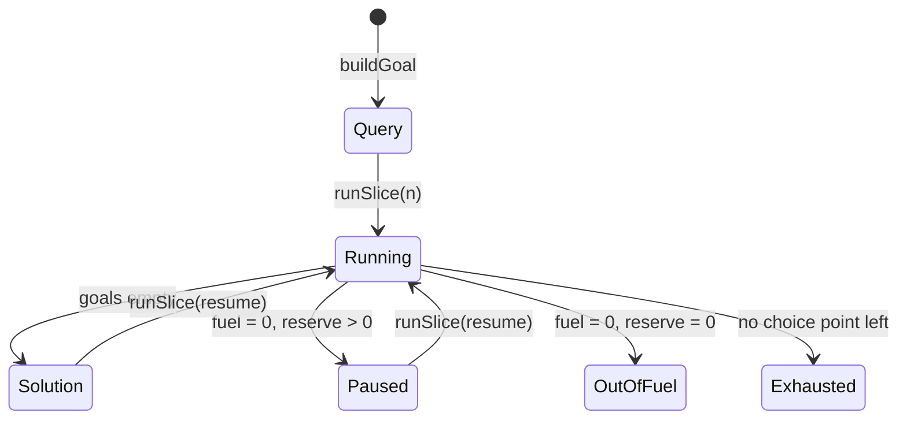

## Context

A host embeds LeanElpi statically and calls Lean directly, so the contract is a Lean API, not new C functions. The machine already keeps its store beside it while it runs (`runLoopS`) so that the store is uniquely owned and updated in place; any pause has to keep that property.

## Goals / Non-Goals

**Goals:** one small module a host imports instead of `Elpi.Core.*`; resumable fuel without a per-step cost; facts loaded as terms in linear time; errors a host can report structurally.

**Non-Goals:** reclaiming variables in long runs; new language features; changes to answer order; a C interface for these functions (the JSON form of `ResultTerm` is ready for one).

## Decisions

- **Pause through a fuel reserve.** `Machine` gains `reserve : Nat`. A slice of `n` steps runs with `fuel := min n total` and `reserve := total - fuel`; when `fuel` reaches zero with a reserve left, `stepM` returns `paused` with the machine, before consuming the goal, instead of `outOfFuel`. Nested runs (`findall`, CHR guards) get the whole remaining budget (`totalFuel`), and their leftover is handed back with `refuel`, which keeps the slice boundary. So the step at which the whole budget runs out, and therefore every answer, is the same however the run is sliced. The check costs nothing per step: it happens only when `fuel` is already zero. Rejected: a separate per-step slice counter (one more decrement and allocation per step) and hosts driving `stepM` themselves (the store's only owner would be outside the engine).
- **Goals from terms through the checker.** `buildGoal` turns each argument into surface syntax (`STm`) directly, never text, and runs the ordinary goal checker. Each argument's subterms carry the argument's position as their column, so a type error names the argument without a second checker.
- **Facts through a small ground checker.** `addFacts` checks ground values against the predicate's type with a few-line unifier over `Ty` (literals, constants, applications, lists, polymorphic constructors), which is linear in the batch, then rebuilds the predicate's index once with `PredDB.ofArray`. The checks and the construction of facts are separate functions, which makes the atomicity proof short.
- **Positions of units are their file names.** Each unit is parsed with its name as the file, so `Pos` already names the unit; `addDeclsAt` keeps type errors as `TypeError` values instead of joining them into a string.
- **The AST is a view of the parsed units.** `ast` compiles the units (so the view is of a well-typed program), then classifies the parsed clauses of the units themselves; accumulated library clauses are left out. Builtins are the core builtins not redefined by clauses.

## Proofs and tests

| Property | How |
|---|---|
| `fromJson? (toJson t) = some t` | proved, `ResultTerm.json_roundtrip`, by mutual structural induction |
| `==` on `TyTerm` agrees with equality | proved, `TyTerm.beq_iff_eq` |
| A fact batch is all or nothing, one clause per row | proved, `addFacts_atomic` |
| Slices of any size equal one run, including where the budget runs out | tested, `tests/Host/Slices.lean` (slice sizes 1 to 99991, with a `findall` across slices) |
| Pausing does not copy the store | tested, `tests/Core/Scaling.lean` (slices of 1000 within 10% of one run) |
| Fact loading is linear | tested, `tests/Host/Facts.lean` (10⁶ facts at most 15 times 10⁵) |

## Risks / Trade-offs

- **API freeze cost:** the AST and `ResultTerm` constrain later refactors. They are views built from the internal forms and versioned with the minor version.
- **A long `findall` makes one slice long:** a host that uses slices to poll for interruption polls less often during it.
