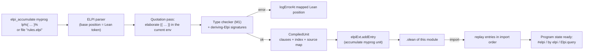
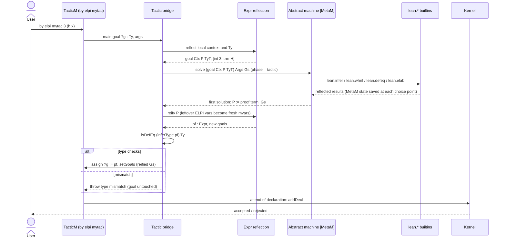
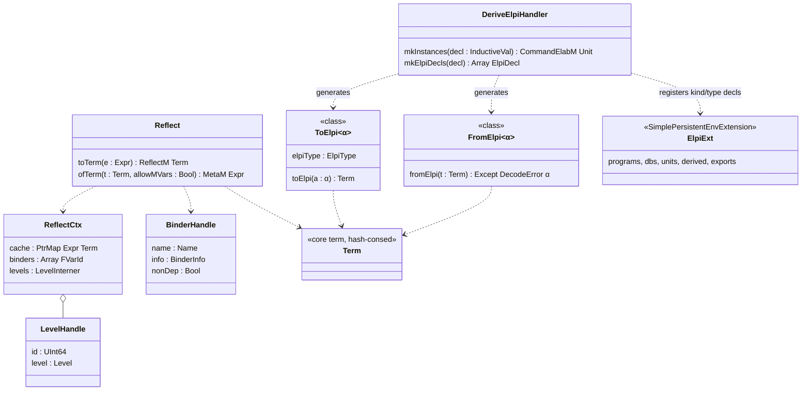

## Context

After M1 and M2 the engine is MetaM-free and generic over `Backtrackable m` ([[decisions#Monad-generic core and packaging]]). It has a persistent store ([[decisions#Persistent store]]), delayed goals and CHR ([[components#Constraint store]], [[components#CHR engine]]), and a [[components#Solver registry]] fed by attributes. M3 instantiates the core at `MetaM` and builds the Lean-facing surface on top of it. The motivation is in proposal.md (Why). The fixed points are:

- [[decisions#Plain types with reflected Lean terms]]: ELPI stays simply typed. `Expr` is data, and anything dependent is answered by Lean through builtins.
- [[decisions#Lossless reflection with opaque levels]]: every `Expr` form, with an exact round trip and levels as handles.
- [[decisions#Coq-Elpi style integration surface]]: programs, databases, accumulate, `#elpi`, tactics, commands, export, and the `solve` convention.
- [[constraints#Kernel is the trust anchor]]: nothing ELPI produces is trusted without a Lean check.
- [[constraints#MetaM is not callable from C]]: the bridge is native Lean ([[decisions#Native Lean engine]]).
- [[constraints#CIC unification is undecidable]]: ELPI unification on `term` stays syntactic and higher-order-pattern based, and definitional equality is a builtin call.
- [[constraints#Lean toolchain 4.35]]: we target the `Expr`, `EnvExtension` and `Syntax` APIs of v4.35.0.

## Goals / Non-Goals

**Goals:**
- Exact two-way reflection of `Expr`, cheap enough to run on every tactic call (hash-consed and cached).
- Programs and databases precompiled once, when their module is compiled, and loaded from `.olean` on import.
- ELPI errors and quotation errors underlined at the right place in the Lean file.
- Tactics whose proofs Lean always re-checks, both with `isDefEq` and in the kernel.
- Effects scoped by phase: environment changes only from commands.

**Non-Goals:**
- Dependent typing of ELPI programs. That belongs to the LF extension ([[decisions#LF as the dependent extension]]), not to the reflection layer.
- Reflecting the whole environment eagerly. `lean.env.find` reflects declarations on demand.
- Macros, deep indexing and a tracing protocol, all deferred by [[decisions#Staged language surface]].
- Infoview widgets beyond plain info and error messages.

## Decisions

### D1. HOAS `term` with spine applications and λ-bound variables
Reflection maps `Expr.lam`, `forallE` and `letE` to `fun`, `forall` and `let`, each with an ELPI abstraction `(x\ B)`. A loose `bvar i` becomes the ELPI bound variable of the i-th enclosing binder, so `bvar` never appears in a `term`. `Expr.app` chains collapse into `app Head Args`, which makes heads directly matchable (`app (const "Nat.add" _) [A, B]`) and keeps first-argument indexing useful. Records [[decisions#Plain types with reflected Lean terms]] and [[glossary#HOAS]].
*Rejected:*
- A first-order de Bruijn encoding: users would shift indices by hand, and `pi`/`=>` reasoning under binders would be lost.
- [[alternatives#Static Lean-typed signatures only]]: it gives up ELPI's unification on syntax, which is what makes it good at meta-programming.
- [[alternatives#Dependent types via CIC]]: undecidable, and a different project.

### D2. Opaque handles for everything ELPI should not inspect structurally
`level`, `binder` (user name, `BinderInfo`, `let` non-dependency flag), `mdata` payloads, `MVarId` and `FVarId` are ELPI ctypes, that is, host values with identity equality. Levels are interned, so structurally equal levels share a handle and the round trip is exact. Unifying two handles compares their identities and never runs level normalisation. That is sound, because it never equates levels Lean considers different, and complete enough, because `lean.defeq` answers the remaining cases. Records [[decisions#Lossless reflection with opaque levels]].
*Rejected:* reflecting levels as ELPI data (`max`, `succ`, `param`). ELPI unification would then decide level equality syntactically, which is incomplete with respect to Lean's normalisation and invites silent mismatches. Dropping levels breaks the round trip.

### D3. Hash-consed, cached reflection
`Reflect.toTerm` memoises on the `Expr` pointer with a `PtrMap` that lives for one execution, so a shared subterm is reflected once and becomes one hash-consed core term (following the "hash-consed terms from Expr" clause of [[decisions#Explicit abstract machine]]). `Reflect.ofTerm` reifies bottom-up, keeping a binder stack of fresh `fvar`s for the abstractions it opens and abstracting them back with `mkLambdaFVars`/`mkForallFVars`, which avoids any index arithmetic. ELPI unification variables still present in the term become `mkFreshExprMVar` when the caller allows that (the tactic bridge does). Otherwise they are an error.

### D4. One environment extension holds programs, databases and their compiled clauses
`elpiExt : SimplePersistentEnvExtension Entry State` has these entries:
- `declProgram p`
- `declDb d`
- `accumulate target (compiled : CompiledUnit)`
- `deriveDecls (kinds/types)`
- `export cmd`

A `CompiledUnit` is the output of parsing and type checking: the indexed clause set, signatures and the source map, all serialisable. Each `elpi_accumulate` therefore does its work when the module is compiled, and importing a module only replays entries, in import order, into the in-memory `State`. A database extended in module `B` gets its `accumulate` entry in `B`'s `.olean`, so only modules that import `B` see the extra clauses (scenario *Database extended downstream*). `lean.db.accumulate` (commands only) adds the same kind of entry with `modifyEnv`. Records [[decisions#Coq-Elpi style integration surface]].
*Rejected:*
- Storing only source text and re-parsing on import: slow and position-fragile.
- A global mutable `IO.Ref` registry: not import-scoped, and lost between `lake build` runs.

### D5. Position mapping for inline sources
`lp%{ … }%` is a Lean token whose raw string carries a `SourceInfo`. The ELPI parser takes a `base : String.Pos` and the module `FileMap`. Every ELPI token position is `base + offset`, computed in code points, so tabs and multi-byte characters stay exact. Diagnostics are turned into `Syntax` ranges and reported with `logErrorAt`. The `CompiledUnit` source map keeps these Lean positions, so runtime errors (for example a type error in a clause added later, or an exception from a builtin) also point into the Lean file. File sources keep `file:line:col` positions. A `{{ … }}` quotation found by the ELPI parser is handed to the Lean term parser with its mapped position, so Lean's own errors land correctly. Records [[decisions#Coq-Elpi style integration surface]].
*Rejected:* reporting ELPI-relative positions, which every user would have to add up by hand.

### D6. Quotations are elaborated when they are accumulated
`{{ t }}` is elaborated with `Term.elabTerm` in the environment and open namespaces of the accumulation point. Each antiquotation `lp:{{X}}` is first replaced by a synthetic hole, and `_` holes stay as natural holes. After elaboration, the remaining holes are abstracted into ELPI unification variables, and the hole for `X` is linked to the variable `X`. The reflected result is stored in the `CompiledUnit`, so running a query never elaborates anything. Code that needs elaboration at run time against the current local context calls `lean.elab`. Records [[decisions#Plain types with reflected Lean terms]].
*Rejected:* elaborating at every execution, which is slow and makes quotations depend on the caller's context.

### D7. Tactic bridge: reflect, solve in MetaM, reify, check, assign
The machine runs with `m := MetaM`. Its `Backtrackable` instance saves and restores `Meta.SavedState`, which includes the Core state, so metavariable assignments and environment changes made by builtins roll back with ELPI choice points ([[glossary#Host monad]]). After `solve` succeeds, the bridge reifies the proof variable, checks it with `isDefEq (← inferType pf) goalType`, assigns the goal and replaces the main goals with the reified output goals. The kernel re-checks everything when the declaration is added. Records [[decisions#Coq-Elpi style integration surface]], under [[constraints#Kernel is the trust anchor]].

*Rejected:*
- Trusting the ELPI proof and skipping `isDefEq`: the error would surface far from its cause, in the kernel.
- Assigning the goal metavariable from inside ELPI with a `lean.assign` builtin: the check would be spread over many builtin calls, and a proof would be half-assigned when ELPI backtracks.

### D8. Phase restriction is a capability flag on the execution context
`ExecCtx.phase : Phase` (`command | tactic | query | runtime`) is set by the entry point (`elpi_command`, `elpi_tactic`, `#elpi`/`Elpi.query`, runtime API) and cannot be changed from ELPI. Each registry entry declares `requires : Option Phase`. The machine checks it before calling a builtin and, if the phase is wrong, fails with the scenario's message. Records [[decisions#Coq-Elpi style integration surface]] and [[glossary#Phase restriction]].
*Rejected:*
- A separate builtin set per phase: signatures would be duplicated, and type errors would depend on where a program is used.
- Checking the phase inside each builtin: easy to forget.

### D9. Commands, export and the rule DSL reuse the same pipeline
- `elpi_command` runs `main Args` through `liftTermElabM`, with phase `command`.
- `elpi_export name` emits a `syntax` declaration and an `elab_rules` that build the `argument` list and dispatch to the stored command. Both go through `elabCommand`, so the export is ordinary syntax and appears in the `.olean`.
- `elpi_rules` maps each Lean type to its ELPI type through the signatures registered by `deriving Elpi` (D4 `deriveDecls`), runs the M1 type checker with Lean positions (D5), and stores a `CompiledProgram` constant, as in the M1 requirement on compiled program constants.

All three record [[decisions#Monad-generic core and packaging]].

### D10. The ELPI-side libraries are ordinary accumulated files
`lib/elpi/lean.elpi`, `lib/elpi/lean.ltac.elpi` and `lib/elpi/lean.derive.elpi` are found by the [[components#Library resolver]], which searches the `lib/elpi/` folder of every Lake package, and are embedded in the binary. The builtin signatures in `lean.elpi` are generated from the registry at build time, and a test checks that they match the registry, so the two cannot drift. Records [[decisions#Monad-generic core and packaging]].

### Reflection structure

`ToElpi Expr` and `FromElpi Expr` are defined through `Reflect`, so the typed and the reflective paths share one encoding. See also [[uml#Tactic sequence]] and [[uml#Query sequence]] in the knowledge graph.

## Risks / Trade-offs

- [`Expr`/`EnvExtension` API changes in later toolchains] → The toolchain is pinned ([[constraints#Lean toolchain 4.35]]). Reflection is a single module with a round-trip property test over a corpus of `Expr`s taken from core Lean declarations, which flags breakage on upgrade.
- [Saving `Meta.SavedState` at every choice point is expensive] → Save lazily: a choice point records a "host epoch". The state is snapshotted only if a builtin with host effects runs before the next backtrack, and pure ELPI search pays nothing.
- [Large reflected terms (unfolded definitions) blow up memory] → The pointer cache and hash-consing share subterms. `lean.env.find` returns a declaration's type and value as lazily reflected thunks.
- [Users expect `sort L1 = sort L2` to decide level equality] → The `lean-reflection` spec and the `lean.elpi` header comment say so explicitly. `lean.defeq` is the documented way.
- [Elaborating quotations at accumulation time fixes default instances (for example `Nat` for numerals)] → We accept this for speed and reproducibility, and `lean.elab` covers elaboration at run time.
- [Positions drift for inline sources with CRLF or tabs] → Positions are computed in code points from the Lean `FileMap`, and golden tests cover tabs, CRLF and non-ASCII identifiers.
- [`.olean` growth from compiled units] → Units store indexed clauses compactly, without source text. Source text is kept only for inline snippets, for error display.
- Trade-off: ELPI programs see `Expr` only syntactically and must call builtins for anything dependent. This is the cost of [[decisions#Plain types with reflected Lean terms]], and the price of keeping ELPI's decidable unification.

## Migration Plan

This change only adds behaviour. M1/M2 users of the CLI and the runtime library see no change. The new environment extension starts empty, and a module that never uses `elpi_*` commands writes no entries. To roll back, revert the change; the `.olean` files of downstream modules have to be rebuilt.

## Open Questions

- Should `#elpi` render reflected terms with `ppExpr` (Lean syntax) only, or also offer the raw `term` form behind a hover? Either way the specs are unchanged.
