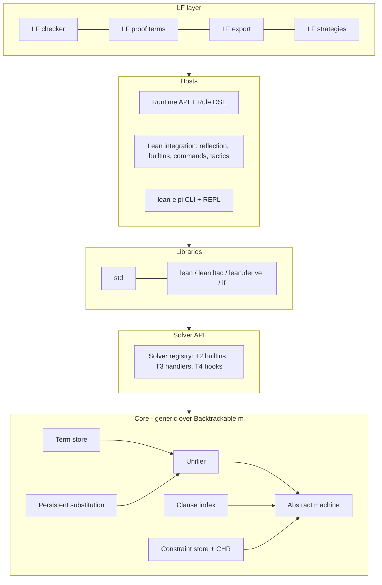

# Architecture

How LeanElpi is put together: the layers, the module map and the flow of a query. Start here, then read [[components]] for each module and [[uml]] for the diagrams.

- [[components]] — one typed node per module or tool, with dependency, motivation and change edges
- [[uml]] — component, class, state, sequence and deployment diagrams

## Layers

Five layers, each depending only on the ones below it. The core has no `MetaM` dependency, which lets one engine serve the CLI, ordinary programs and Lean metaprograms.

1. **Core** (`Elpi/Core`): terms, parser, type checker, unifier, persistent store, clause index, abstract machine, constraint store, CHR and core builtins. It is generic over a `Backtrackable` host monad: [[decisions#Monad-generic core and packaging]].
2. **Solver API** (`Elpi/Solver`): the registry for builtins, constraint handlers and unification hooks: [[decisions#Tiered solver API]].
3. **Libraries** (`Elpi/Std`, `lib/elpi/`): the clean-room `std` and the Lean-facing ELPI libraries.
4. **Hosts**: the runtime library (`Elpi/Runtime`) for ordinary programs; the Lean integration (`Elpi/Lean`) running the core at `MetaM`; the CLI (`Elpi/Cli`).
5. **LF** (`Elpi/LF`): the opt-in dependent layer that reuses the core and the Lean integration: [[decisions#LF as the dependent extension]].

## Module map

Each component maps to one Lean module (one file), so a requirement's `implements` edge lands in a predictable place.

| Layer | Module | Component | Milestone |
|---|---|---|---|
| Core | `Elpi.Core.Term` | [[components#Term store]] | M1 |
| Core | `Elpi.Core.Parser` | [[components#Parser]] | M1 |
| Core | `Elpi.Core.Typecheck` | [[components#Type checker]] | M1 |
| Core | `Elpi.Core.Unify` | [[components#Unifier]] | M1 |
| Core | `Elpi.Core.Store` | [[components#Persistent substitution]] | M1 |
| Core | `Elpi.Core.Index` | [[components#Clause index]] | M1 |
| Core | `Elpi.Core.Machine` | [[components#Abstract machine]] | M1 |
| Core | `Elpi.Core.Builtins` | [[components#Core builtins]] | M1 |
| Core | `Elpi.Core.Constraints` | [[components#Constraint store]] | M2 |
| Core | `Elpi.Core.CHR` | [[components#CHR engine]] | M2 |
| Solver API | `Elpi.Solver.Registry` | [[components#Solver registry]] | M1 |
| Libraries | `Elpi.Std.Std` | [[components#Standard library]] | M1 |
| Hosts | `Elpi.Runtime.Api` | [[components#Runtime API]] | M1 |
| Hosts | `Elpi.Runtime.Dsl` | [[components#Rule DSL]] | M3 |
| Hosts | `Elpi.Lean.Reflect` | [[components#Expr reflection]] | M3 |
| Hosts | `Elpi.Lean.Marshal` | [[components#Marshalling]] | M3 |
| Hosts | `Elpi.Lean.Builtins` | [[components#Lean builtins]] | M3 |
| Hosts | `Elpi.Lean.Commands` | [[components#Commands]] | M3 |
| Hosts | `Elpi.Lean.Tactic` | [[components#Tactic bridge]] | M3 |
| Hosts | `Elpi.Lean.Libraries` | [[components#Library resolver]] | M1 |
| Hosts | `Elpi.Cli.Main` | [[components#CLI]] | M1 |
| LF | `Elpi.LF.Check` | [[components#LF checker]] | LF |
| LF | `Elpi.LF.ProofTerm` | [[components#LF proof terms]] | LF |
| LF | `Elpi.LF.Export` | [[components#LF export]] | LF |
| LF | `Elpi.LF.Strategy` | [[components#LF strategies]] | LF |
| Tests | `tests/conformance` | [[components#Conformance harness]] | M1 |

## Data flow

A program goes from source text to clauses once; each query then runs on the machine and yields a lazy stream of solutions.

1. **Load.** The [[components#Parser]] reads `.elpi` text (a file, an inline Lean block or an `elpi_rules` block). The [[components#Library resolver]] follows `accumulate`. The [[components#Type checker]] checks the result against declarations.
2. **Compile.** Clauses enter the [[components#Clause index]]. Inside Lean the compiled program is stored in an environment extension and serialized into the `.olean`, so executables start without parsing.
3. **Query.** The [[components#Abstract machine]] pops goals, selects clauses through the index, unifies with the [[components#Unifier]] over the [[components#Persistent substitution]], pushes choice points and delays stuck goals in the [[components#Constraint store]].
4. **Host calls.** Builtins and handlers from the [[components#Solver registry]] run in the host monad; under `MetaM` they reach Lean through [[components#Lean builtins]] and [[components#Expr reflection]].
5. **Answer.** Each solution is the substitution restricted to the query's variables plus residual constraints. Callers take as many as they need: [[components#Runtime API]], `#elpi`, the [[components#Tactic bridge]] or the [[components#CLI]].

The step-by-step version of this flow is drawn in [[uml#Query sequence]].
