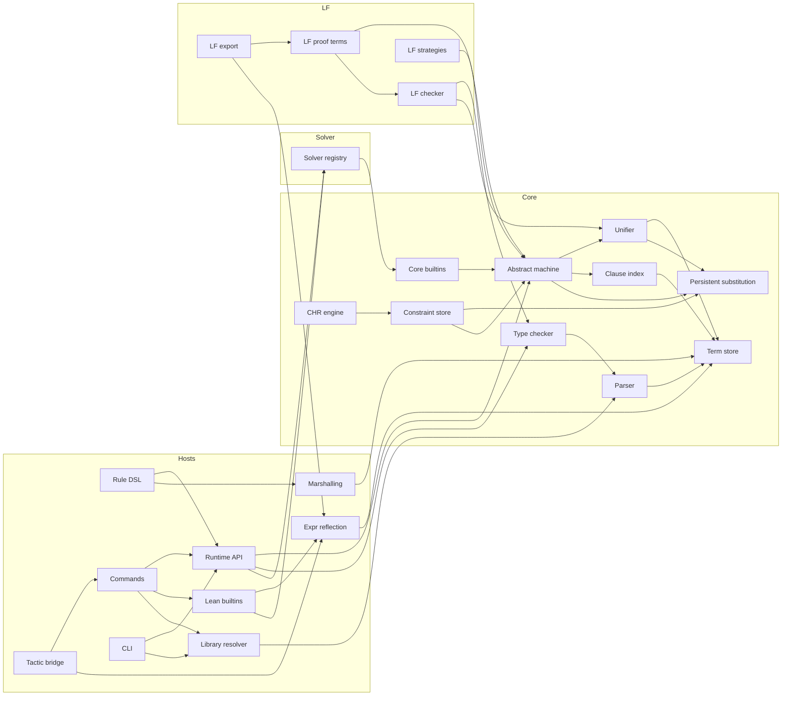
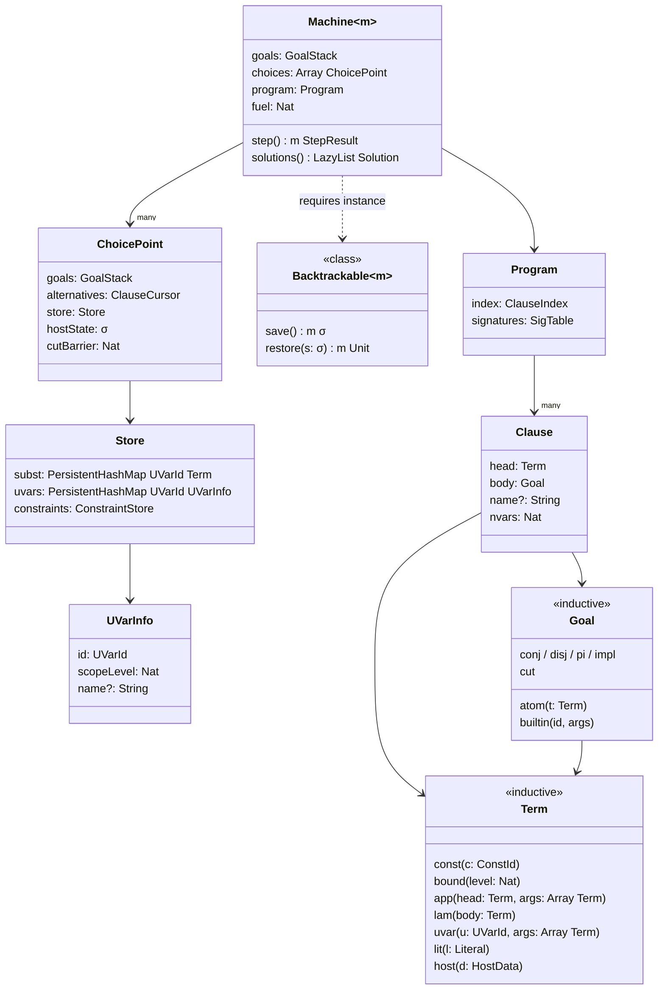
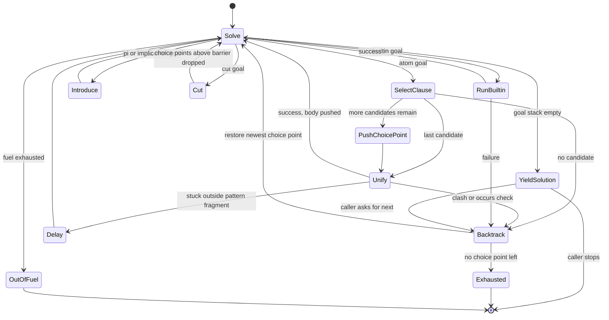
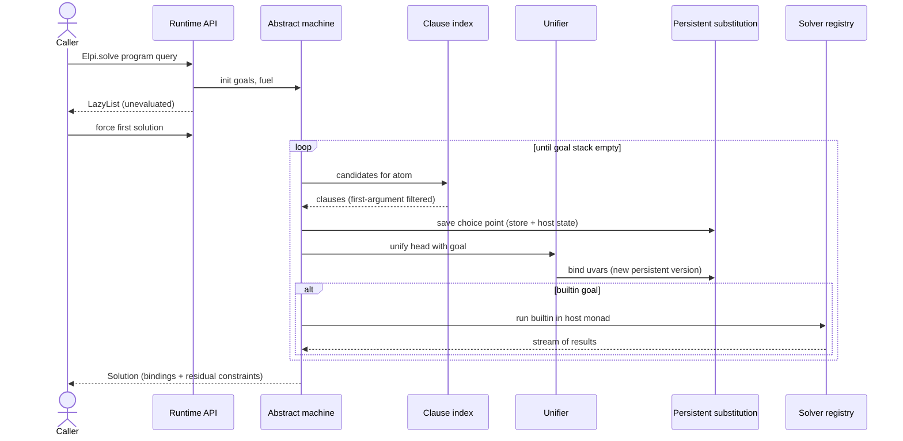
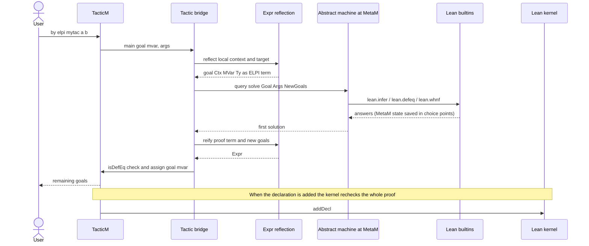
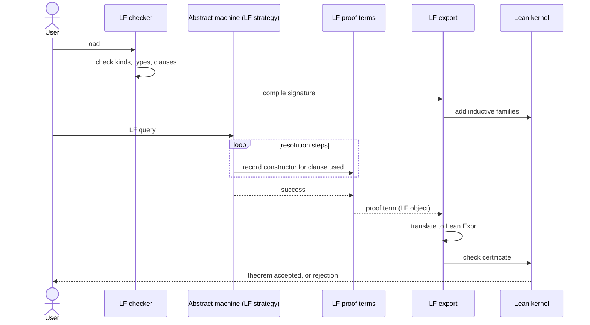
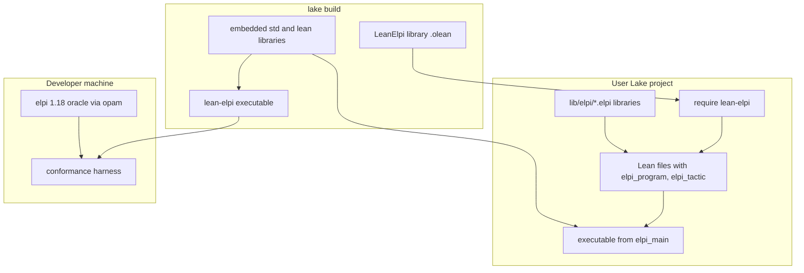

# UML

The planned UML views of LeanElpi as Mermaid diagrams. They describe the intended design; the code skeleton follows the same module boundaries.

Each diagram names the [[components]] it involves, so a reader can jump from a box to its section and from there to the decisions behind it.

## Component diagram

The modules and their main dependencies, grouped by layer. It matches the `depends_on::` edges in [[components]].

## Core class diagram

The main types of the core and how they relate. Names are the planned Lean names; fields are abbreviated.

## Machine state diagram

The states of the [[components#Abstract machine]] for one query. Backtracking always returns to the most recent choice point and restores its store and host snapshot.

## Query sequence

How a query flows from a caller through the core and back as a lazy stream. Under `MetaM` the builtin step reaches Lean.

## Tactic sequence

What happens for `by elpi mytac args`: the goal is reflected into ELPI, `solve` runs under `MetaM`, and the proof term comes back to Lean. See [[components#Tactic bridge]].

## LF certification sequence

How an LF query becomes a kernel-checked Lean theorem. ELPI is untrusted; only the kernel decides: [[constraints#Kernel is the trust anchor]].

## Deployment diagram

The artifacts LeanElpi produces and where each runs. The library and `.olean`s are shared by the CLI, Lean projects and user executables.

