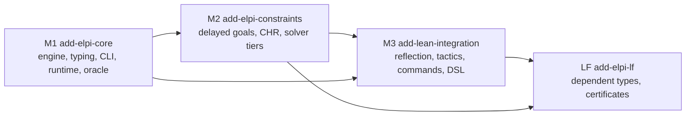

# Overview

LeanElpi is a clean-room Lean 4 implementation of the ELPI dialect of λProlog, built to embed in Lean as a metaprogramming tool, a runtime library and a standalone binary.

The project is in the specification phase: the design is fixed in [[decisions]], requirements are written as OpenSpec changes ([[changes]]), and a Lake skeleton mirrors the planned [[components]].

## Goals

Five goals in priority order. Each maps to capabilities in OpenSpec and to papers in [[papers]].

1. **Faithful ELPI.** Run ELPI 1.18 programs natively with the same answers in the same order as the upstream binary, the [[glossary#Oracle]]: [[decisions#ELPI 1.18 dialect]].
2. **Lean and ELPI together.** ELPI programs read and build Lean terms, run as commands and tactics, and call `MetaM` through builtins: [[decisions#Coq-Elpi style integration surface]].
3. **Your own solvers.** CHR, Lean builtins, native constraint handlers and unification hooks: [[decisions#Tiered solver API]].
4. **LP everywhere.** A pure library for ordinary Lean programs, the `lean-elpi` CLI and precompiled executables: [[decisions#Monad-generic core and packaging]].
5. **Certified proof search.** An opt-in LF layer whose proof terms Lean's kernel checks: [[decisions#LF as the dependent extension]].

## Non-goals

What LeanElpi deliberately does not do, each backed by a rejected alternative.

- CIC as ELPI's object theory: [[alternatives#Dependent types via CIC]].
- ELPI 2.x syntax for now: [[alternatives#ELPI 2.x dialect]].
- Porting or vendoring LGPL upstream code: [[alternatives#Porting upstream under LGPL]].
- A Mathlib dependency, or performance tuning of a mutable heap before correctness: [[alternatives#Mutable heap with trail]].

## Milestones

Four milestones, each one OpenSpec change. Later milestones build on earlier ones; LF needs all three.



Details: [[changes#add-elpi-core]], [[changes#add-elpi-constraints]], [[changes#add-lean-integration]], [[changes#add-elpi-lf]].

## How to read this graph

The knowledge graph has two layers: intent written by people in `tg.md/` and OpenSpec, and code linked to it by `@tg:` comments. These commands walk it.

Node types follow [[code-ontology]]: `Decision`, `Constraint`, `Concept`, `Component` and `Change` live in `tg.md/`; `Requirement` and `Scenario` live in `openspec/`. Useful starting points:

```bash
tg search "pattern unification"                 # find sections by topic
tg section "decisions#Persistent store"          # read one node with its links in and out
tg refs "constraints#Kernel is the trust anchor" # what a constraint touches
tg trace --gaps                                  # requirements not yet implemented or verified
tg validate                                      # check typed edges against Types/code-types.md
```

Graph queries with `tg cypher`:

```cypher
// Every component with the decisions it links to
MATCH (c:Component)-[:references]->(d:Decision) RETURN c.title, collect(d.title)

// Rejected alternatives and the decision each one lost to
MATCH (a:Decision)-[:references]->(d:Decision) WHERE a.file ENDS WITH 'alternatives.md' RETURN a.title, d.title

// Concepts nothing links to (glossary terms the docs never use)
MATCH (c:Concept) OPTIONAL MATCH (x)-[r:references]->(c) WITH c, count(r) AS n WHERE n = 0 RETURN c.title
```

Once code exists, `tg cypher --code annotated` adds the `implements` and `verifies` edges from Lean declarations to requirements.
