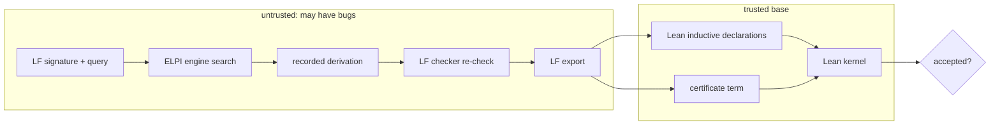
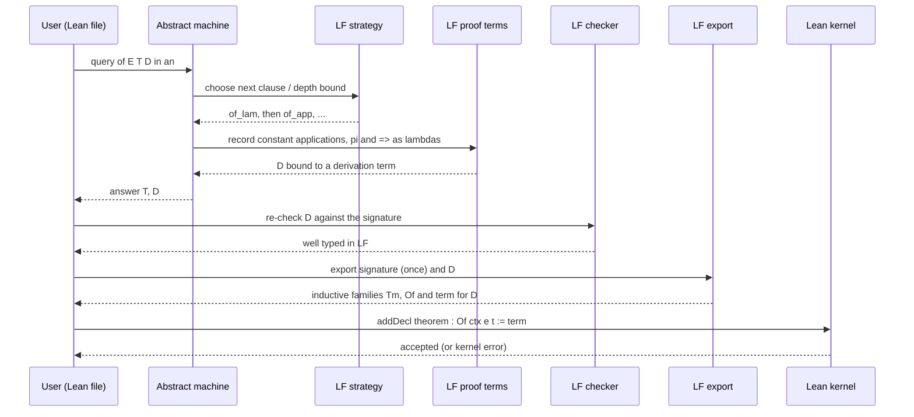

# Certified Proof Search with LF

How LeanElpi does dependently typed proof search in LF and hands every derivation it finds to the Lean kernel as a checked certificate, so the search engine never has to be trusted.

This paper is for readers who know some Prolog or Lean but have not met logical frameworks. It explains why we chose LF as the dependent extension ([[decisions#LF as the dependent extension]]), what the extension adds to the engine, how a derivation becomes a Lean proof, and where the trust boundary lies. The work is the `add-elpi-lf` milestone ([[changes#add-elpi-lf]]), currently proposed; everything here describes the agreed design, specified in the `elpi-lf` capability.

## Judgments as types

In a logical framework, a judgment such as "term e has type t" is itself a type, and a derivation of the judgment is a term of that type.

Ordinary λProlog already treats clauses as inference rules: `of (app E1 E2) T2 :- of E1 (arr T1 T2), of E2 T1.` reads as "from these premises, conclude that". What λProlog does not do is keep the derivation. The search succeeds or fails, and the tree of rule applications that justified success disappears.

LF (the Edinburgh Logical Framework, [[glossary#LF]]) makes the derivation a first-class object. The judgment `of E T` is a *type* indexed by the objects `E` and `T`, each inference rule is a *constant* whose type says what it concludes from what, and a derivation is a well-typed term built from those constants: a [[glossary#Proof term]]. Checking a proof becomes type checking, and finding a proof becomes finding an inhabitant of a type. This is the "judgments as types" principle, and it is exactly what lets us hand a found derivation to another system for checking.

## LF in one page

LF is the dependently typed λ-calculus λΠ: dependent function types over objects, and nothing else, with no computation inside types.

LF has three levels. *Objects* are λ-terms such as `lam base (x\ x)`. *Types* are either base types like `tm` or families applied to objects like `of E T`, and dependent products `Πx:A. B` where `B` may mention `x`. *Kinds* classify families: `tm : type` and `of : tm -> tp -> type`, where the kind of `of` says it is indexed by a `tm` and a `tp`.

What LF deliberately lacks is as important as what it has. There are no inductive types with recursors, no pattern matching, no type-level functions, no universes and no `match` that could make one type reduce to another. Two LF types are equal only if they are equal up to β and η on objects. That restriction is what makes LF a good *object language* for search, and it is why LeanElpi keeps Lean, with its full Calculus of Inductive Constructions (CIC), as the *metatheory* rather than trying to search in CIC directly.

### Why no computation keeps unification decidable

Without computation in types, LF unification reduces to higher-order pattern unification, which is decidable with most general unifiers; CIC unification is not.

Proof search is driven by unification: to use a rule, the engine unifies the rule's conclusion with the goal. In LF the only equality to respect is βη on objects, and when unification variables are applied only to distinct bound variables (the [[glossary#Pattern fragment]]) the problem is decidable and has a most general unifier ([[constraints#Pattern unification is decidable]]). This is the same algorithm the plain ELPI engine already implements in the [[components#Unifier]], so LF needs no new unifier (`elpi-lf › Pattern unification for LF`, scenario "LF unification stays in the pattern fragment").

In CIC, two types can be equal because one *computes* to the other: `Vec α (n + 0)` and `Vec α n` are definitionally equal only after unfolding `+`. Unification modulo such computation is undecidable in general and has no most general unifiers, which is why Lean's elaborator relies on heuristics, postponement and user hints ([[constraints#CIC unification is undecidable]]). A proof search engine built on it would inherit incompleteness in its most basic step. That is the core reason [[alternatives#Dependent types via CIC]] was rejected, and also why [[alternatives#Defeq suspension as the dependent mechanism]], suspending every definitional-equality problem and asking Lean later, was kept only as an optional bridge.

## The extension: same engine, opt-in per file

An ELPI file becomes an LF signature by starting with an `#lf` header; it is then checked dependently, and its queries record proof terms, while plain files are untouched.

The `#lf` header switches the file's declarations from ELPI's simple types to LF kinds and dependent types (`elpi-lf › LF opt-in per file`, scenarios "lf header enables dependent checking" and "Plain file is unaffected"). Everything else stays the same engine: the same parser with a few extra forms, the same [[components#Abstract machine]], the same persistent store, the same unifier. Three components are added: the [[components#LF checker]] for dependent type checking, [[components#LF proof terms]] for recording derivations, [[components#LF export]] for producing Lean declarations, plus [[components#LF strategies]] for search orders other than depth-first.

LF predicates are callable from plain ELPI programs (`elpi-lf › Interoperation with plain programs`, scenario "LF predicate is callable from a plain program"): from the outside, `of E T D` looks like an ordinary predicate whose last argument is the derivation. This keeps the separation from [[decisions#Plain types with reflected Lean terms]]: plain ELPI remains simply typed, and dependency lives only where it was asked for.

## Running example: the simply typed λ-calculus

We encode types, terms with higher-order abstract syntax, and the typing judgment, then ask the engine to infer a type and produce its derivation.

### The signature

Types `tp` and terms `tm` are kinds of objects; `of` is a type family indexed by a term and a type; each typing rule is a constant.

```
#lf
tp   : type.
arr  : tp -> tp -> tp.
base : tp.
tm   : type.
lam  : tp -> (tm -> tm) -> tm.       % HOAS: the body is an LF function
app  : tm -> tm -> tm.
of   : tm -> tp -> type.             % a family indexed by objects
of_lam : of (lam T1 E) (arr T1 T2)
          <- (pi x:tm\ of x T1 -> of (E x) T2).
of_app : of (app E1 E2) T2
          <- of E1 (arr T1 T2)
          <- of E2 T1.
```

Three things in this signature are impossible in plain ELPI. The kind of `of` mentions objects, so `of` is a dependent family (`elpi-lf › Dependent signatures`, scenario "Type family is indexed by objects"). The rule constants have types that mention object variables `E1`, `T1` and so on; as in Twelf, capitalised free variables are implicitly Π-bound and elaborated to explicit `pi` binders, so `of_app` really has type `Πe1 e2 t2 t1. of e2 t1 → of e1 (arr t1 t2) → of (app e1 e2) t2` (`<-` is left-associative, so the last premise comes first). And the premise of `of_lam` is a *hypothetical* judgment: for a fresh variable `x` and an assumption that `x` has type `T1`, the body `E x` has type `T2`. The dependent product is written `pi x:tm\ B`; declarations are `c : A.` and directives start with `#`, because braces mean spilling and `%` starts a comment in ELPI.

`lam` uses [[glossary#HOAS]]: an object-language binder is represented by a meta-language function `tm -> tm`, so substitution is LF application and α-equivalence is free. The identity function on `base` is `lam base (x\ x)`. An ill-typed object such as `app base base` is rejected by the LF checker when it is declared or appears in a query (scenario "Ill-typed LF object is rejected").

### Searching for a derivation

A query asks for a type and a derivation; the engine finds both, recording the rule constants it applies as a proof term.

```
#lf_query stlc (of (lam base (x\ lam (arr base base) (f\ app f x))) T)

T = arr base (arr (arr base base) base)
D = of_lam (x\ hx\ of_lam (f\ hf\ of_app hx hf))
```

Reading the derivation: the outer `of_lam` introduces `x` with hypothesis `hx : of x base`; the inner one introduces `f` with `hf : of f (arr base base)`; and `of_app hx hf` derives `of (app f x) base` from the two hypotheses. The implicit arguments (`T1`, `E` and so on) are omitted in this display; they are reconstructed by unification and kept in the stored term.

### Recording proof terms

Each resolution step contributes the applied clause's constant, each `pi` contributes a λ over the fresh variable, and each `=>` contributes a λ over the hypothesis.

Recording is the job of [[components#LF proof terms]] (`elpi-lf › Proof term recording`, scenario "Successful query yields a derivation term"). In an LF file every clause is a named constant, so when the machine selects clause `of_app` for a goal, it allocates unification variables for the derivations of the two premises and binds the goal's derivation to `of_app D1 D2`. Solving a hypothetical goal `pi x\ of x T1 => G` introduces an [[glossary#Eigenvariable]] for `x` and a local clause named by a fresh hypothesis variable `hx`, then binds the derivation to `x\ hx\ DG`. Using that local clause later contributes `hx`. Because derivations are just terms in the [[components#Persistent substitution]], backtracking discards the partial derivations of failed branches automatically, exactly like any other binding ([[decisions#Persistent store]]).

A derivation recorded this way is a well-typed LF term by construction, which the LF checker re-verifies cheaply before export. That check catches engine bugs early, but it is not what we trust.

## Exporting to Lean

LF type families become Lean inductive families, LF derivations become Lean terms, and the Lean kernel type checks them.

The [[components#LF export]] component translates an LF signature into Lean declarations once, and translates each derivation into a Lean term (`elpi-lf › Lean inductive export`, scenario "Type family compiles to an inductive family"). Kinds of objects such as `tp` become inductive types, families such as `of` become inductive families in `Prop`, and each rule constant becomes a constructor.

### The negative occurrence problem

Lean rejects HOAS binders in inductive types, because a constructor like `lam : (Tm → Tm) → Tm` mentions the type being defined to the left of an arrow.

The direct translation of `lam : tp -> (tm -> tm) -> tm` would be:

```lean
inductive Tm where
  | lam : Tp → (Tm → Tm) → Tm      -- rejected: non-positive occurrence of Tm
  | app : Tm → Tm → Tm
```

Lean's kernel rejects this declaration, and must: allowing negative occurrences lets one define non-terminating terms and prove `False`. LF is fine with `tm -> tm` because LF functions are not computational and LF has no recursors, but a Lean inductive type comes with a recursor, so its constructors must satisfy strict positivity. Some first-order representation of binding is needed on the Lean side.

### The chosen remedy: well-scoped de Bruijn indices

LF objects are exported to an inductive family `Tm : Nat → Type` indexed by the number of variables in scope, and hypothetical judgments become judgments under an explicit context.

```lean
inductive Var : Nat → Type where
  | zero {n} : Var (n + 1)
  | succ {n} : Var n → Var (n + 1)

inductive Tm : Nat → Type where                 -- scope-indexed, so no dangling variables
  | var {n} : Var n → Tm n
  | lam {n} : Tp → Tm (n + 1) → Tm n            -- the HOAS binder becomes "one more variable"
  | app {n} : Tm n → Tm n → Tm n

inductive Ctx : Nat → Type where                -- the world of `of`: one block (x:tm, u:of x T)
  | nil  : Ctx 0
  | snoc {n} : Ctx n → Tp → Ctx (n + 1)

inductive Ctx.Lookup : {n : Nat} → Ctx n → Var n → Tp → Prop where
  | here  : Ctx.Lookup (Ctx.snoc Γ T) Var.zero T
  | there : Ctx.Lookup Γ i T → Ctx.Lookup (Ctx.snoc Γ S) (Var.succ i) T

inductive Of : {n : Nat} → Ctx n → Tm n → Tp → Prop where
  | hyp    : Ctx.Lookup Γ i T → Of Γ (Tm.var i) T                     -- assumption use
  | of_lam : Of (Ctx.snoc Γ T1) E T2 → Of Γ (Tm.lam T1 E) (Tp.arr T1 T2)
  | of_app : Of Γ E2 T1 → Of Γ E1 (Tp.arr T1 T2) → Of Γ (Tm.app E1 E2) T2
```

The binder of `lam` becomes "one more variable in scope", and the LF hypothetical premise `pi x:tm\ of x T1 -> of (E x) T2` becomes a premise over the extended context `Ctx.snoc Γ T1`. Every use of a hypothesis `hx` in the LF derivation becomes the `hyp` rule with a `Ctx.Lookup` path to the corresponding position. Contexts are looked up through an inductive relation, not a function, so the kernel checks a variable by structural conversion alone. The example derivation exports to:

```lean
example : Of Ctx.nil
    (.lam .base (.lam (.arr .base .base) (.app (.var .zero) (.var (.succ .zero)))))
    (.arr .base (.arr (.arr .base .base) .base)) :=
  .of_lam (.of_lam (.of_app (.hyp (.there .here)) (.hyp .here)))
```

The same signature and this certificate are checked by Lean today, before any LF code exists, in `examples/lf/StlcExport.lean`; `#print axioms` reports that it depends on no axioms.

This is the certificate ([[glossary#Certificate]]): an ordinary Lean term, which the kernel either accepts or rejects (`elpi-lf › Kernel-checked certificates`, scenario "Derivation is accepted by the Lean kernel").

Well-scoped de Bruijn indices were chosen because the Lean side then is purely first-order and structural: equality of terms is syntactic, the kernel check needs no reasoning about names or freshness, and substitution and weakening are definable functions if a user later wants to prove meta-theorems in Lean. The price is that the translation must be shown *adequate*: there is a bijection between LF objects of type `tm` with `n` free variables (in canonical form) and Lean values of type `Tm n`, and between LF derivations of `of E T` and Lean proofs of `Of Γ ⌜E⌝ T`, commuting with substitution. Adequacy is a theorem about the exporter's translation scheme, not about each signature; it is established once on paper, tested by round-tripping (export, re-import, compare), and generating per-signature Lean proofs of the round trip is an open question listed below.

### Alternatives considered for binders

Parametric HOAS and locally nameless representations were also considered; both work, and both cost more than de Bruijn for what we need.

**Parametric HOAS** (PHOAS) parameterises terms by a type of variables: `inductive Tm (V : Type) | var : V → Tm V | lam : Tp → (V → Tm V) → Tm V`. The occurrence of `V` is negative but `V` is a parameter, not the type being defined, so Lean accepts it, and the translation of HOAS is almost literal. However, hypothetical judgments over PHOAS terms need the judgment itself to be parametric, terms must be quantified over all `V` to exclude exotic terms, and proving things about them requires parametricity arguments Lean cannot state internally. **Locally nameless** uses de Bruijn indices for bound variables and names for free ones; it gives readable contexts but needs cofinite quantification in rules like `lam` and a supply of fresh names in the exporter, which complicates certificates. Both remain possible future export targets; the export component isolates the choice.

## The trust boundary

Nothing in LeanElpi has to be correct for a certificate to be valid; only the Lean kernel and the exported definitions, which the user can read, are trusted.



This is the de Bruijn criterion: a system may use arbitrarily complex, unverified machinery to *find* a proof, provided the proof it emits is checked by a small independent checker ([[constraints#Kernel is the trust anchor]]). The ELPI engine, the LF checker and the exporter can all be wrong without compromising soundness; a bug shows up as a certificate the kernel rejects (scenario "Corrupted certificate is rejected"), never as a false theorem. What the user must still read is the *statement*: the exported `Of` family and the proposition being proved. If the signature encodes the wrong typing rules, the kernel will faithfully certify derivations in the wrong system. Adequacy of the binder translation is the formal version of that obligation.

The full certification flow at the component level is [[uml#LF certification sequence]]; the sequence below follows one query.



## Search strategies

Plain ELPI always searches depth-first; LF files may choose another strategy, by default iterative deepening, because proof search often hits infinite branches that depth-first never escapes.

Depth-first search in clause order is part of ELPI's semantics and is fixed for plain programs ([[decisions#Explicit abstract machine]]). For LF, the goal is to find *some* derivation, not to reproduce a Prolog execution order, so the [[components#LF strategies]] component makes the strategy pluggable. Iterative deepening runs depth-first with a depth bound and restarts with a larger bound on exhaustion: it finds a shallow proof even when an earlier clause leads into an infinite descent, at the cost of re-exploring the shallow levels (`elpi-lf › LF search strategies`, scenario "Iterative deepening finds a proof that depth-first misses"). The machine's [[glossary#Fuel]] still bounds the total work. Breadth-first and best-first strategies fit the same interface.

## Later milestones: from derivations to meta-theorems

Mode, coverage and termination checks would let LeanElpi recognise LF relations as total, which in Twelf's style makes them proofs of ∀∃ meta-theorems.

A single derivation certifies one fact, such as "this term has this type". Twelf showed that an LF *relation* can certify a general theorem. If a relation like `preserv : step E E' -> of E T -> of E' T -> type` is checked to be:

- **well-moded**: the first two arguments are inputs and the third an output, and every clause respects the flow of information (`elpi-lf › Mode checking`, scenario "Mode-incorrect clause is reported");
- **covering**: for all inputs, some clause applies, so no case is missing (scenario "Missing case is reported by coverage");
- **terminating**: recursive calls are on smaller inputs;

then the relation is *total*, and totality means: for all derivations of `step E E'` and `of E T` there exists a derivation of `of E' T`. That is type preservation, proved by the relation itself (`elpi-lf › Totality checking`, scenario "Total relation is reported as a meta-theorem").

These checks are later milestones of the LF extension. Their natural output in LeanElpi is a Lean theorem *statement* over the exported families, `∀ e e' t, Step e e' → Of Γ e t → Of Γ e' t`. Proving that statement in Lean, rather than trusting the totality checker, would require translating the totality argument into a Lean proof by induction, which is an open question; initially the statement is reported, and only individual derivations are kernel-checked.

## The optional defeq bridge

A unification hook can let selected LF goals be discharged by Lean computation, producing a certificate that the kernel checks by evaluation.

Some LF signatures mention objects with a natural Lean meaning, such as numerals or arithmetic. The defeq bridge is a [[glossary#Unification hook]] (tier T4 in [[solvers]]) that, for declared constants only, maps a stuck LF equation or goal to a Lean proposition and asks Lean to decide it by computation, recording `rfl` or a `decide` proof in the derivation (`elpi-lf › Defeq bridge`, scenario "Bridge discharges a goal by Lean computation"). It stays optional and outside the main path, because it reintroduces exactly the undecidability that LF was chosen to avoid; but since its contributions are also kernel-checked, it costs completeness, never soundness.

## Related work

LeanElpi's LF extension borrows its logic from Twelf, its search language from λProlog and Coq-Elpi, and its trust model from proof assistants with small kernels.

- **Twelf** is the reference implementation of LF with logic programming over signatures, mode, coverage and termination checking, and meta-theorems as total relations. LeanElpi follows Twelf's design for the LF fragment; it differs by exporting derivations to an external kernel and by running inside a general-purpose λProlog.
- **Beluga** adds contextual modal types so that contexts and substitutions are first-class, and proves meta-theorems as recursive functions. Its explicit contexts are a plausible future direction for the totality milestone.
- **Abella** reasons about λProlog specifications in a separate logic with nominal quantification and induction. It is the closest relative for meta-theorems over HOAS, but its proofs are interactive rather than found by search.
- **Coq-Elpi** embeds ELPI in Coq as an untrusted meta-language whose results Coq's kernel checks. LeanElpi's integration surface follows it ([[decisions#Coq-Elpi style integration surface]]); the LF extension adds a dependently typed object layer that Coq-Elpi leaves to Coq itself.
- **Lean's kernel** is the trust anchor. Lean's own tactic framework also follows the de Bruijn criterion: tactics may be arbitrary programs, and only the produced terms are checked.

## Limitations and open questions

The extension is a proposed milestone; several design questions are deliberately left open and will be settled in its OpenSpec change.

- **Adequacy proofs.** Adequacy of the de Bruijn translation is argued for the scheme and tested by round trips; producing per-signature Lean proofs of adequacy is open.
- **Size of certificates.** Derivations with large implicit arguments can be big; whether to export implicit arguments or let Lean's elaborator reconstruct them (making the elaborator, not just the kernel, part of the check path) is undecided. The default is full terms, checked by the kernel alone.
- **Dependent signatures beyond STLC.** Families whose indices are themselves dependent (for example, intrinsically typed terms) export to more complex Lean families; the exporter's coverage of such signatures will grow with the test corpus.
- **Meta-theorem proofs.** Totality checking yields statements; turning a Twelf-style totality argument into a Lean proof term is research, not engineering.
- **Interaction with constraints.** Recording proof terms through CHR rules or native handlers is not defined; LF search uses clauses and, optionally, the defeq bridge only.
- **Performance.** Recording and iterative deepening both cost time and memory; the first implementation favours simplicity and measures before optimising.

For the plain-ELPI side of the system see [[system]], and for the type bridge between ELPI and Lean that LF complements see [[type-bridge]].
