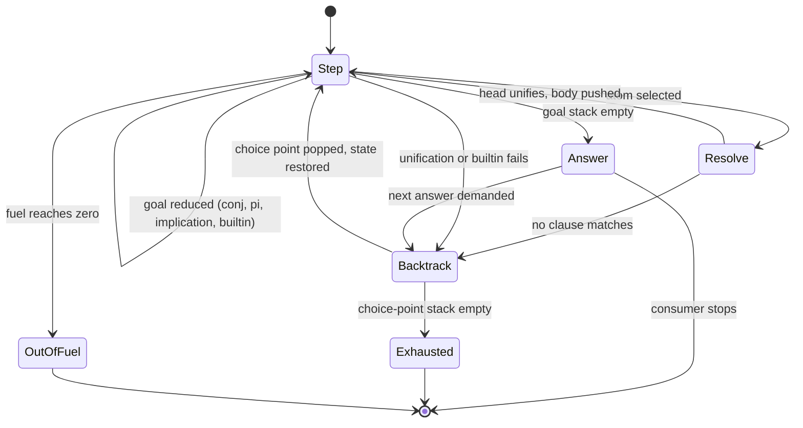

# A Persistent Abstract Machine for Lambda Prolog

This paper describes the LeanElpi engine: how terms are represented, how higher-order unification works, how goals are solved, and why the machine keeps its state in persistent data structures.

## Overview

The engine is a loop over an explicit machine state. Its substitution is a persistent map, so a choice point is just a saved value and backtracking is restoring it.

Four decisions shape the engine. [[decisions#Native Lean engine]] makes it Lean code. [[decisions#Explicit abstract machine]] makes control a data structure instead of the Lean call stack. [[decisions#Persistent store]] makes backtracking cheap and safe with effectful host monads. [[decisions#Monad-generic core and packaging]] makes the same code run in `Id`, `IO` and `MetaM`. The modules are the [[components#Term store]], [[components#Unifier]], [[components#Persistent substitution]], [[components#Clause index]], [[components#Abstract machine]], [[components#Constraint store]] and [[components#CHR engine]]. Their classes appear in [[uml#Core class diagram]].

The sections follow a goal's life: representing it, unifying it with clause heads, resolving it, backtracking, and finally suspending it as a constraint.

## Term representation

Terms use de Bruijn levels for bound variables and give every unification variable a scope level. These two numbers implement λProlog's scoping rules with integer comparisons.

A sketch of the core type (`elpi-core-engine › Term representation`):

```lean
inductive Term where
  | const  (c : ConstId)                         -- global constant
  | bound  (lvl : Nat)                           -- de Bruijn level: λ- or pi-bound name
  | app    (hd : Term) (args : Array Term)       -- spine application
  | lam    (body : Term)                         -- binds level = current depth
  | uvar   (u : UVarId) (scope : Nat) (args : Array Term)  -- X a1 ... an
  | int    (n : Int)
  | str    (s : String)
  | float  (f : Float)
```

### Bound variables use de Bruijn levels

A level counts binders from the outside in, so a variable keeps the same number wherever it is used. The machine never shifts a term when it moves under another binder.

With de Bruijn indices, a term moved under one more binder must have its free indices shifted. ELPI's machine moves terms under binders constantly: every `pi x\` adds a name, every clause head is matched at the current depth. With levels, the eigenvariable introduced by the n-th `pi` is `bound n`, and it is `bound n` everywhere in the goal. Lean's own `Expr` uses indices; [[components#Expr reflection]] converts them to levels when it builds the HOAS `term`, and hash-conses terms that come from `Expr` so shared subterms stay shared.

β-reduction is where levels cost something: substituting an argument into a λ-body at a different depth needs a re-levelling pass (ELPI calls it "move"). The [[components#Term store]] fuses that pass with substitution, so a redex such as `F x` is reduced in one traversal.

### Unification variables carry their scope level

Each unification variable records the depth at which it was created. It may only be assigned a term whose bound names are all below that depth, which is exactly the rule that an [[glossary#Eigenvariable]] cannot escape its `pi`.

```elpi
pred bad.
bad :- pi c\ X = c.          % fails: X was created outside pi c\
pred ok.
ok :- pi c\ sigma Y\ Y = c.  % succeeds: Y is created under pi c\
```

In `bad`, `X` has scope 0 and `c` is `bound 0`, created at depth 0 and visible only from depth 1, so the assignment `X := c` is rejected by one comparison. In `ok`, `Y` has scope 1 and may mention `c`. This is the scenario "Unification variables carry their scope level", and it is why a [[glossary#Unification variable]] in LeanElpi is a triple of identity, scope and argument spine.

## Higher-order pattern unification

Unification is first order on rigid terms and higher order on variables applied to arguments. LeanElpi solves Miller's pattern fragment completely and suspends everything outside it.

A problem is in the [[glossary#Pattern fragment]] when every unification variable is applied to distinct bound variables that are outside its scope. In that fragment, unification is decidable and produces a most general unifier ([[constraints#Pattern unification is decidable]]). This is `elpi-core-engine › Higher-order pattern unification`, implemented by [[components#Unifier]].

### A most general unifier

When a variable is applied to distinct eigenvariables, its solution is found by abstracting those eigenvariables out of the other side. Here is the canonical example.

```elpi
pi a\ pi b\ X a b = f b a
```

`X` has scope 0; `a` and `b` are levels 0 and 1. The left side is a pattern: `X` applied to two distinct bound variables, neither in its scope. The unifier abstracts the right side over the arguments, in argument order:

```elpi
X = x\ y\ f y x
```

Check: `X a b` β-reduces to `f b a`. No other solution is more general, which is the scenario "Pattern problem has a most general unifier". If the right side mentioned a bound name that is neither an argument nor in scope, say `pi a\ pi b\ X a = f b`, there would be no solution and unification fails.

### Occurs check

A variable cannot be assigned a term that contains it, because no finite term would satisfy the equation. The unifier checks this during the same traversal that abstracts arguments.

```elpi
X = f X                    % fails
pi a\ X a = g (X a)        % fails
```

Each would require an infinite term. Unlike many Prologs, ELPI always performs the occurs check, and so does LeanElpi (scenario "Occurs check rejects cyclic solution").

### Pruning

When a variable meets another variable whose arguments include names the first cannot see, the unifier prunes those arguments by introducing a fresh, narrower variable. Pruning keeps problems inside the fragment.

```elpi
pi a\ pi b\ X a = g (Y a b)
```

`X` may depend only on `a`, but the right side contains `Y a b`, which may depend on `b`. Any solution must make `Y` ignore its second argument. The unifier creates a fresh `Z` and assigns:

```elpi
Y = x\ y\ Z x
X = x\ g (Z x)
```

Scope pruning works the same way with scope levels instead of arguments: a variable created at depth 2 that meets one created at depth 0 is narrowed to depth 0.

### Outside the fragment: suspension

Some problems have no most general unifier, or several incomparable ones. Instead of guessing, the engine suspends them and retries when more is known.

```elpi
X (f a) = g
```

`X` is applied to `f a`, which is not a bound variable, so the problem is not a pattern. Both `X = x\ g` and, if `g` were `f a`, `X = x\ x` might be solutions. LeanElpi records the equation as a suspended unification problem attached to `X` and continues (scenario "Problem outside the pattern fragment is suspended"). If `X` is later assigned, the equation is woken and checked. If it is still suspended when the query ends, it is reported with the answer, as ELPI 1.18 does. M1 implements this one kind of suspension; M2 generalises it to arbitrary [[glossary#Delayed goal|delayed goals]].

## Resolution with hereditary Harrop goals

The engine solves goals by resolution, extended with the two hereditary Harrop connectives. Both are local: `pi` scopes a name, `=>` scopes a clause.

A goal is one of: an atom `p t1 ... tn`, a conjunction `G1, G2`, a disjunction `G1 ; G2`, `true`, `fail`, cut `!`, a universal `pi x\ G`, an implication `H => G`, an existential `sigma X\ G`, or a builtin call. This is `elpi-core-engine › Hereditary Harrop goals`; the logic is described in [[glossary#Hereditary Harrop formula]].

- **Atoms** are solved by selecting, in order, the clauses of `p` whose heads match, unifying, and replacing the atom by the clause body.
- **`pi x\ G`** increases the depth by one and solves `G` with `x` bound to the new level (scenario "Universal goal introduces a fresh constant"). Any variable created before cannot mention `x`, which is enforced by scope levels.
- **`H => G`** solves `G` with clause `H` added to the program for that goal only (scenario "Implication extends the program locally"). Each goal frame carries its own program, a persistent list of local clauses on top of the global database, so leaving the scope needs no undo.
- **`G1 ; G2`** tries `G1` and pushes a choice point that will try `G2` (scenario "Disjunction backtracks into the second branch").

The type checker example shows all three at work:

```elpi
of (lam A F) (arr A B) :- pi x\ of x A => of (F x) B.
```

Solving `of (lam nat (x\ succ x)) T` matches the head with `A = nat`, `F = x\ succ x`, `T = arr nat B`; then `pi` introduces level 0 as `x`; `=>` adds `of x nat` to the local program; and `of (succ x) B` is solved by the `succ` clause, which calls `of x nat`, found in the local program. The answer is `T = arr nat nat`.

### Modes and matching

A predicate's mode declaration says which arguments are inputs. Input arguments are matched, not unified: the clause head may not instantiate variables in the caller's input.

```elpi
pred of i:tm, o:ty.
```

With this mode, calling `of X T` with an unassigned `X` does not enumerate terms; heads such as `of zero nat` fail to match because matching cannot assign `X`. Modes make predicates behave like functions on their inputs and enable the [[components#Clause index]] to use input arguments safely.

## The explicit machine

Control lives in data: a goal stack, a choice-point stack and cut barriers, all on the heap. Execution is a loop of small steps, so recursion depth is limited by memory, not by the native stack.

This is `elpi-core-engine › Abstract machine` and [[components#Abstract machine]]. The machine state:

```lean
structure Frame where
  goal    : Goal
  program : LocalProgram      -- clauses added by `=>` in scope
  depth   : Nat               -- number of enclosing `pi`
  cutTo   : Nat               -- choice-point stack height to cut back to

structure MachineState (m : Type → Type) [Backtrackable m] where
  goals   : List Frame                    -- goal stack
  choices : List (ChoicePoint m)          -- choice-point stack
  store   : Store                         -- persistent substitution + constraints
  fuel    : Nat
```

Each step pops the top frame and handles it. An atom whose predicate has several matching clauses pushes a choice point holding the remaining candidates. Failure pops the top choice point and resumes from it. Success, an empty goal stack, yields an answer.

### Cut barriers

When a predicate is called, the machine records the current height of the choice-point stack in the new frames. A `!` in the clause body truncates the stack back to that height.

That one number gives cut its meaning ([[glossary#Cut]], `elpi-core-engine › Cut`). It removes the remaining clauses of the predicate and any choice points created by goals to the left of the cut in the same body (scenario "Cut prunes remaining clauses of the predicate"). It cannot remove choice points older than the call, so a cut inside a called predicate does not reach its caller (scenario "Cut inside a called predicate does not escape it").

### Machine states

The diagram shows the loop. The same diagram, with module annotations, is [[uml#Machine state diagram]].



Because the loop is a tail-recursive function over this state, a predicate that recurses a million times uses a million heap frames and no native stack (scenario "Deep recursion does not overflow the native stack"). The rejected alternative, a recursive interpreter in continuation-passing style, is discussed in [[alternatives#Recursive CPS interpreter]].

## Persistent store and backtracking

The substitution is a persistent hash map from variable identities to terms. Old versions stay valid after updates, so a choice point keeps the version current when it was made, and backtracking restores it.

This is [[decisions#Persistent store]], `elpi-core-engine › Persistent store`, and [[components#Persistent substitution]].

### Why persistence

Prolog machines traditionally update variables in place and keep a trail of bindings to undo on backtracking. A persistent map turns the trail into "drop the newer version".

The [[components#Persistent substitution]] is built on `Lean.PersistentHashMap`. Assigning a variable returns a new map that shares almost all structure with the old one. A [[glossary#Choice point]] stores the map that was current when it was created. Backtracking discards the newer map and resumes with the stored one, in constant time (scenario "Backtracking restores the substitution").

The rejected design, a mutable heap with a trail ([[alternatives#Mutable heap with trail]]), is faster per binding in OCaml. In Lean it would mean `ST` or `IO` references threaded through the core, making the pure `Id` mode awkward. More importantly it would need a second, separate undo mechanism for the host monad's own state. With persistence, the substitution and the host state are restored the same way: by putting back a saved value.

### Choice points capture host state

Under `MetaM`, a builtin such as `lean.defeq` can assign Lean metavariables. Those assignments must be undone on backtracking just like ELPI bindings, so choice points also save the host monad's state.

The core is generic over a class that says how to save and restore the host state (`elpi-core-engine › Monad-generic engine`):

```lean
class Backtrackable (m : Type → Type) where
  Snapshot : Type
  save     : m Snapshot
  restore  : Snapshot → m Unit

instance : Backtrackable Id where
  Snapshot  := Unit
  save      := pure ()
  restore _ := pure ()

instance : Backtrackable IO where
  Snapshot  := Unit            -- IO effects (printing) are not undone, as in ELPI
  save      := pure ()
  restore _ := pure ()

open Lean Meta in
instance : Backtrackable MetaM where
  Snapshot  := Meta.SavedState
  save      := saveState
  restore s := s.restore

structure ChoicePoint (m : Type → Type) [Backtrackable m] where
  goals   : List Frame                      -- goal stack to resume
  alts    : List Clause                     -- remaining candidate clauses
  store   : Store                           -- substitution and constraint store
  host    : Backtrackable.Snapshot m        -- e.g. Meta.SavedState
  depth   : Nat
```

When the machine pushes a choice point it calls `save`; when it backtracks into one it calls `restore` and reinstates `store`. Under `MetaM` this rewinds metavariable assignments made after the choice point (scenarios "Choice point restores host monad state" and "MetaM instance rewinds metavariable assignments"). In `Id` the snapshot is `Unit` and costs nothing, which is why "Core runs without MetaM" holds. `Meta.SavedState` is itself built from persistent structures, so saving it is cheap too. The [[glossary#Host monad]] concept explains which effects are rewound and which, like printing, are not.

## Search order, fuel and lazy answers

ELPI's search is depth-first, left to right, in clause order. LeanElpi keeps that order exactly, bounds work with fuel, and produces answers only on demand.

### Depth-first order

Answers come in the order an ELPI programmer expects: the first clause's answers first, and within a body, the leftmost goal first. That order is part of the semantics, since cut depends on it.

Programs rely on this (`elpi-core-engine › Depth-first search order`, scenario "Answers follow clause order"), and the oracle checks it answer by answer ([[constraints#Oracle is ELPI 1.18]]). The search strategy is therefore fixed for ELPI programs. A pluggable strategy exists only in the LF extension, where proof search for meta-theorems may need iterative deepening ([[components#LF strategies]]).

### Fuel

Every machine step consumes one unit of [[glossary#Fuel]]. When fuel runs out, the query stops with a resource error instead of hanging.

Fuel matters most for the pure runtime library, where a query is an ordinary function and must return (scenario "Fuel exhaustion reports a resource error"). In commands and tactics, fuel also keeps a looping program from freezing the editor. The default is generous and can be set per query.

### Lazy solution streams

A query returns a stream. Asking for the next answer resumes the machine from its latest choice point; answers never asked for are never computed.

```lean
-- in Id: the stream is a pure value
let answers := Elpi.solve prog "append X Y [1,2,3]"
answers.take 2      -- computes exactly two answers, then stops
```

The machine state at an answer is a value, so the stream's tail is just "backtrack from this state" (scenario "Solutions are produced lazily"). The same property gives `elpi-runtime-library › Pure lazy queries` its meaning.

## Indexing

Clause selection uses first-argument indexing: clauses are grouped by the head symbol of their first argument, so a call skips clauses that cannot match.

The [[components#Clause index]] maps each predicate to buckets keyed by the outermost constructor of the first argument (`elpi-core-engine › First-argument indexing`). A call whose first argument is `cons _ _` looks only at the `cons` bucket plus the clauses whose first argument is a variable. Candidates are returned in original clause order, because order is semantics. For `append` above, a call with a non-empty first list never tries the `[]` clause and never pushes a useless choice point (scenario "Clauses with a non-matching first argument are skipped"). Deep and multi-argument `:index` directives are deferred ([[decisions#Staged language surface]]); the index accepts them syntactically and falls back to first-argument indexing.

## Spilling and grafting

Two ELPI conveniences are handled at load time rather than in the machine: spilling rewrites clause bodies, and grafting decides where a clause goes in the database.

### Spilling

A goal written in braces inside a term, `{p X}`, is "spilled": it is called first, with a fresh output variable that takes its place in the term. This avoids naming intermediate results.

```elpi
pred size i:list A, o:int.
size L N :- std.length L N.

main :- print {size [a,b,c]}.
% compiles to:  main :- size [a,b,c] N, print N.
```

The loader moves each spilled call to just before the goal that contains it, adding the output as a last argument ([[glossary#Spilling]], `elpi-core-engine › Spilling`, scenario "Spilled call is solved before the enclosing goal"). Spilling under a binder places the call under the same `pi`, so the call can see the bound name.

### Clause names and grafting

A clause can be named with `:name`, and a later clause can be inserted `:before` or `:after` it. This lets one file extend a predicate defined in another at a precise position.

```elpi
:name "of-app"
of (app M N) B :- of M (arr A B), of N A.

% in another file, accumulated later:
:before "of-app"
of (app (lam A F) N) B :- of N A, of (F N) B.
```

The [[components#Clause index]] keeps a position for each clause so that grafting preserves the order seen by depth-first search ([[glossary#Clause grafting]], `elpi-core-engine › Clause names and grafting`). Grafting is how Lean modules extend a shared `elpi_db` downstream without editing it. `accumulate` loads a file once and namespaces qualify predicate names (`elpi-core-engine › Accumulate and namespaces`).

## Constraints and CHR

In M2 the engine gains a constraint store: goals can be suspended on unassigned variables, woken when those variables are assigned, and rewritten by Constraint Handling Rules.

This is the `elpi-constraints` capability, delivered by [[changes#add-elpi-constraints]] and implemented by [[components#Constraint store]] and [[components#CHR engine]]. The "Writing Your Own Solver" paper shows how to build solvers on it.

### Delayed goals and wake-up

`declare_constraint G [X]` suspends goal `G` until variable `X` is assigned. Assigning `X` wakes the goal, which is pushed onto the goal stack before execution continues.

```elpi
pred even i:int.
even X :- var X, !, declare_constraint (even X) [X].
even X :- 0 is X mod 2.

main :- even X, X = 4.     % suspends, then wakes and succeeds
```

The store maps each variable to the goals waiting on it ([[glossary#Delayed goal]], `elpi-constraints › Delayed goals`). Assignment in the [[components#Unifier]] checks this map and collects woken goals; the machine runs them right after the unification that woke them.

The constraint store is part of the same persistent `Store` value as the substitution. A choice point saves it, and backtracking removes constraints added after the choice point (`elpi-constraints › Backtrackable constraint store`). No extra undo code is needed.

### CHR rules

CHR rules rewrite the set of suspended constraints. A rule matches some constraints, keeps or removes them, checks a guard and runs a new goal.

ELPI 1.18 syntax: heads before `\` are kept, heads after it are removed, `|` introduces the guard, and `<=>` the new goal.

```elpi
constraint leq {
  rule \ (leq X X).                          % simplification: remove trivial
  rule (leq X Y) \ (leq Y X) <=> (X = Y).    % simpagation: antisymmetry
  rule (leq X Y) (leq Y Z) <=> (leq X Z).    % propagation: transitivity
}
```

The three rule kinds ([[glossary#Constraint Handling Rules]], `elpi-constraints › CHR rules`):

| Kind | Shape | Effect |
|---|---|---|
| Simplification | `rule \ (H1) ... <=> G` | removes matched constraints, runs `G` |
| Propagation | `rule (H1) ... <=> G` | keeps matched constraints, runs `G` |
| Simpagation | `rule (K1) ... \ (R1) ... <=> G` | keeps the `K`s, removes the `R`s, runs `G` |

A rule fires only if its guard succeeds without assigning variables in the matched constraints; a failing guard prevents firing. Rules are tried when a constraint is added or woken.

### Scoped constraints

A constraint declared under `pi` mentions eigenvariables and may depend on hypotheses added by `=>`. ELPI records both with the constraint, and CHR rules can match on that context.

A suspended goal remembers its depth and local program. A CHR head written `(Ctx ?- leq X Y)` binds `Ctx` to the hypotheses in force when the constraint was declared. When rules combine constraints from different depths, the engine relates their eigenvariables through the levels, so a constraint under `pi x\` can never be made to mention a name it could not see (`elpi-constraints › Scoped constraints`). Constraints still suspended when a query ends are returned with the answer (`elpi-constraints › Residual constraints`).

Beyond CHR written in ELPI, the [[decisions#Tiered solver API]] lets Lean code plug in [[glossary#Constraint handler|native constraint handlers]] and [[glossary#Unification hook|unification hooks]] that run on the same store.

## Performance expectations

The first implementation is expected to run 3 to 10 times slower than OCaml ELPI. The design leaves room to close that gap without changing the machine.

The slowdown has known sources: persistent maps cost a logarithmic factor where OCaml ELPI writes a mutable reference; terms are boxed Lean values with reference counting; and the first version interprets clause bodies instead of compiling them. For the intended uses (tactics, derivers, rule engines inside programs) that is acceptable, and correctness against the oracle comes first.

Optimisations planned behind the `Store` interface, in rough order:

1. **Hash-consing and sharing** of ground terms, already used for reflected Lean terms.
2. **Path compression** in variable dereferencing, cached in the persistent map.
3. **A mutable store for pure queries** that never backtrack across a host-state boundary, built on `ST` and selected per query. The machine sees the same `Store` interface.
4. **Clause precompilation**: heads compiled to matching code, and indexing beyond the first argument once `:index` is supported.
5. **Benchmarks from the conformance corpus**, run against the oracle for timing as well as answers.

Because the machine talks to the substitution only through the `Store` interface, each of these can land without touching resolution, cut or constraints, and the oracle keeps every step honest.

## As built in M1

The M1 engine follows the design above with a handful of concrete choices worth knowing when reading the code in `Elpi/Core/`.

**Terms.** `Term` has one constructor beyond the design, `cvar i args`, a clause-level variable. A stored clause is closed over its `cvar`s and over its own binders; selecting the clause at depth `d` renames every `cvar` to a fresh unification variable at level `d` and moves every bound level by `d` (`Machine.rename`). Because levels are absolute, `shiftUp` (the "move" of the design) is the only relocation primitive: it is used when an assigned variable is dereferenced deeper than its level, when a λ is η-expanded, and when a local clause is used deeper than where it was added. Substitution of a level lowers the levels above it and re-normalises applications, so terms stay β-normal.

**Unification.** `Unify.loop` is a tail-recursive worklist over pairs of terms, so unifying two 10^6-element lists does not grow the native stack. Flex–rigid problems go through `inv`, which maps the pattern spine to the binders of the abstraction, keeps levels below the variable's, fails on any other eigenvariable and prunes variables met on the way (`Y` becomes `Y'` at the lower level with only the surviving arguments). Out-of-fragment problems are pushed to `Store.delayed` and re-examined once, when the goal stack is empty; ELPI 1.18 instead approximates such problems, which is the one registered divergence (`tests/conformance/divergences.md`).

**Machine.** A frame carries its goal, depth, hypothetical clauses and cut barrier. Hypothetical clauses added by `=>` are tried before the static ones, newest group first, as in the oracle. A choice point keeps the store, the continuation and the host snapshot; `not G` is `(G, !, fail) ; true` with the cut local to the construct; `findall_solutions` runs a nested machine over the current store and copies the instances out with fresh variables.

**Answers.** The machine returns `Step.yield` with the final store and a resumable machine whose `resume` flag makes the next step backtrack. `Elpi.solve` unfolds this into a `LazyList` in `Id`; `solveIO` and `runIn` run the same loop in `IO` or any `Backtrackable` monad.
