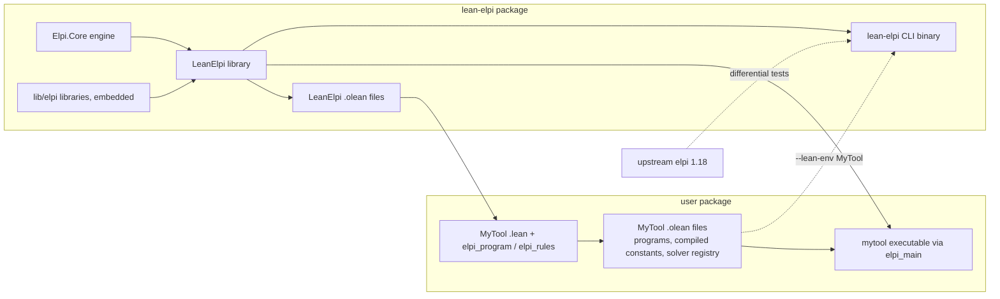
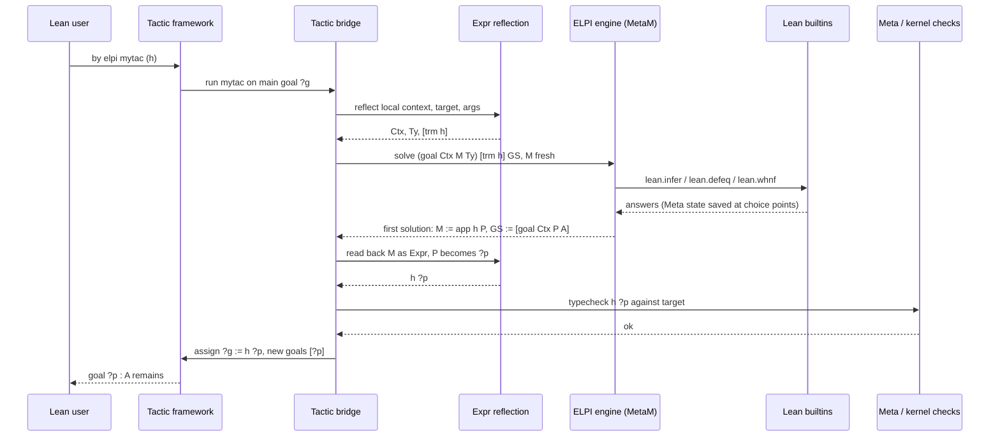

# Using Lean and ELPI Together

A user's guide to the four ways LeanElpi meets Lean: as a meta-language inside Lean files, as a library for ordinary Lean programs, as a command-line tool, and as compiled executables.

LeanElpi is one engine with several faces ([[decisions#Monad-generic core and packaging]]). Inside Lean, ELPI programs run in `MetaM` and manipulate reflected Lean terms, in the style of Coq-Elpi ([[decisions#Coq-Elpi style integration surface]]). In an ordinary Lean program, the same engine runs as a pure function returning a lazy list of answers. On the command line, `lean-elpi` behaves like the upstream `elpi` binary. And an ELPI program can be compiled into its own executable. This paper shows each face with complete examples; the overall layering is in [[architecture#Layers]] and the engine itself in [[engine]].

| Face | Entry points | Host monad | Component |
|------|--------------|------------|-----------|
| meta-level | `elpi_program`, `#elpi`, `elpi_tactic`, `elpi_command`, `Elpi.query` | `MetaM` / `CommandElabM` | [[components#Commands]], [[components#Tactic bridge]] |
| runtime library | `Elpi.solve`, `solveIO`, `solveAs`, `elpi_rules` | `Id` / `IO` | [[components#Runtime API]], [[components#Rule DSL]] |
| CLI | `lean-elpi FILE... -exec P` | `IO` (optionally a loaded environment) | [[components#CLI]] |
| executables | `elpi_main` | `IO` | [[components#CLI]], [[components#Runtime API]] |

## The meta-level surface

Lean commands declare ELPI programs and databases, feed them source code, run queries, and turn programs into tactics and commands.

All of these are milestone M3 ([[changes#add-lean-integration]]) and are specified in `lean-integration`. Programs are values stored in a Lean environment extension, so they persist across imports and can be extended downstream, as Coq-Elpi programs are.

### Programs, databases and source accumulation

`elpi_program` declares a named program, `elpi_db` declares a database of clauses shared between programs, and `elpi_accumulate` adds ELPI source from a file or inline.

```lean
import Elpi
open Elpi

elpi_db known_lemmas lp%{
  pred known o:term.
}%

elpi_program hello
elpi_accumulate hello lp%{
  pred greet i:string, o:string.
  greet Name Msg :- Msg is "hello, " ^ Name.
}%
elpi_accumulate hello file "lib/elpi/hello_extras.elpi"
elpi_accumulate hello db known_lemmas
```

A program declared in one module is visible in every module that imports it (scenario "Program persists across imports" of `lean-integration › Program and database declarations`). A database can be extended by any downstream module with another `elpi_accumulate known_lemmas lp%{ ... }%`, and every program that accumulated the database sees the new clauses from that point of the import graph on (scenario "Database extended downstream").

Inline source between `lp%{` and `}%` is parsed by the ELPI [[components#Parser]] and typechecked by the [[components#Type checker]] at elaboration time. Every ELPI position is offset by the position of the quotation, so a type error on the third line of the block is underlined on that line in the Lean editor (scenario "Inline source error maps to the Lean position" of `lean-integration › Source accumulation`). File accumulation resolves its path with the same rules as ELPI's own `accumulate` (see the library section below) and records the file as a dependency of the module, so Lake rebuilds the module when the file changes.

### Queries with #elpi

`#elpi` runs a query against a program and shows the answers, residual constraints and printed output in the infoview.

```lean
#elpi hello lp%{ greet "Lean" M. }%
-- info: M = "hello, Lean"
```

Answers are printed with Lean's pretty printer for reflected terms (scenario "Solutions are shown in the infoview"); a failing query is reported as an error at the command (scenario "Failure is reported"). `#elpi` is also the workhorse of golden tests, wrapped in `#guard_msgs`.

### Tactics and the solve convention

`elpi_tactic` turns a program into a tactic invoked as `by elpi name args`; the program must define `solve (goal Ctx MVar Ty) Args NewGoals`.

The [[components#Tactic bridge]] reflects the main goal into ELPI ([[glossary#Reflection]], [[components#Expr reflection]]):

- `Ctx` is the local context as a list of `decl X Name Ty`, where `X` is the reflected free variable, `Name` its user name and `Ty` its type;
- `MVar` is a fresh ELPI unification variable that stands for the goal's Lean metavariable;
- `Ty` is the goal's target type;
- `Args` are the tactic's arguments as `str S`, `int N` or `trm T`;
- `NewGoals` is the output list of goals that remain.

When `solve` succeeds, the bridge reads back the instantiation of `MVar` as a Lean `Expr`. Any ELPI variables still unassigned inside it become new Lean metavariables, the term is typechecked against the goal, and only then is the Lean metavariable assigned (scenario "solve assigns the goal metavariable"). A term that does not typecheck makes the tactic fail with Lean's type error (scenario "Ill-typed proof is rejected"). The `goal` terms in `NewGoals` are mapped back to the corresponding Lean metavariables and returned to the tactic framework (scenario "Remaining goals are returned to Lean"). The full exchange is drawn in [[uml#Tactic sequence]] and in the diagram below.

### Commands and export

`elpi_command` turns a program into a command whose `main Args` predicate runs at the command level, and `elpi_export` gives it its own top-level syntax.

```lean
elpi_command hello_cmd
elpi_accumulate hello_cmd db known_lemmas
elpi_accumulate hello_cmd lp%{
  main [str Name] :- greet Name M, lean.say M.
}%
```

The command is run as `#elpi_run hello_cmd "Lean"` until it is exported. `elpi_export hello_cmd` registers a Lean syntax `hello_cmd <args>` that parses identifiers, string and numeric literals and terms in parentheses into `str`, `int` and `trm` arguments (scenario "Exported command parses its arguments" of `lean-integration › ELPI commands and export`). Commands run in `CommandElabM`, which is the only phase allowed to add declarations; see [[glossary#Phase restriction]] and the section on phases below.

## Worked example: an assumption and apply tactic

This tactic closes a goal with a hypothesis whose type is definitionally equal to it, or applies a hypothesis of shape `A → Goal` and continues on `A`.

The ELPI side uses the `lean` library for terms and builtins and `lean.ltac` for tactic combinators ([[components#Standard library]], `elpi-libraries › Tactic combinator library`). A tactic in `lean.ltac` is a predicate of type `goal -> list goal -> prop`.

```elpi
accumulate lean.
accumulate lean.ltac.

% close the goal with a hypothesis of a definitionally equal type
pred assumption i:goal, o:list goal.
assumption (goal Ctx M Ty) [] :-
  std.mem Ctx (decl H _ T),
  lean.defeq T Ty, !,
  M = H.

% use a hypothesis H : A -> Ty, leaving A as a new goal
pred apply-hyp i:goal, o:list goal.
apply-hyp (goal Ctx M Ty) [goal Ctx P A] :-
  std.mem Ctx (decl H _ T),
  lean.whnf T (forallE _ A (_\ B) _),   % non-dependent arrow A -> B
  lean.defeq B Ty,
  M = app H P.                          % P is a fresh hole: the new goal

% apply an explicit lemma given as an argument: lemma : A -> Ty
pred apply-term i:term, i:goal, o:list goal.
apply-term L (goal Ctx M Ty) [goal Ctx P A] :-
  lean.infer L LTy,
  lean.whnf LTy (forallE _ A (_\ B) _),
  lean.defeq B Ty,
  M = app L P.

% the entry point required by elpi_tactic
solve G [] GS :-
  lean.ltac.repeat (lean.ltac.orelse assumption apply-hyp) G GS.
solve G [trm L] GS :-
  lean.ltac.then (apply-term L) (lean.ltac.repeat assumption) G GS.
```

`lean.whnf`, `lean.defeq` and `lean.infer` are builtins that call `Meta.whnf`, `Meta.isDefEq` and `Meta.inferType` on the reflected terms (`lean-integration › Lean builtins`, scenarios "lean.infer returns the type" and "lean.defeq decides definitional equality"). `lean.ltac.then T1 T2` runs `T1` and then `T2` on every resulting goal; `lean.ltac.orelse T1 T2` tries `T1` and falls back to `T2` if it fails; `lean.ltac.repeat T` applies `T` until it fails, returning the goals it could not close (scenarios "then composes two tactics" and "orelse falls back on failure"). The cut in `assumption` commits to the first matching hypothesis, as Lean's `assumption` does; drop it and the tactic backtracks into other hypotheses when a later step fails.

The Lean side declares the tactic and uses it:

```lean
elpi_tactic auto_apply
elpi_accumulate auto_apply file "lib/elpi/auto_apply.elpi"

example (p q r : Prop) (hp : p) (hpq : p → q) (hqr : q → r) : r := by
  elpi auto_apply

theorem two_steps (p q : Prop) (hp : p) : (p → q) → q := by
  intro h
  elpi auto_apply (h)
```

In the first example, `apply-hyp` uses `hqr` and leaves goal `q`, then uses `hpq` and leaves `p`, then `assumption` closes `p` with `hp`. The proof term is `hqr (hpq hp)`, assembled in ELPI as nested `app` terms, typechecked by the bridge and assigned to the Lean metavariable. A metavariable assignment made by `lean.defeq` during a branch that later fails is rewound when ELPI backtracks, because choice points capture the `Meta.SavedState` ([[decisions#Persistent store]], [[glossary#Host monad]]).

## Worked example: deriving BEq with a command

A command can inspect an inductive type, build an instance as a reflected term, and add it to the environment with `lean.add_decl`.

```lean
elpi_command derive_beq
elpi_accumulate derive_beq lp%{
  accumulate lean.
  accumulate lean.derive.

  main [trm (const TyName _)] :-
    lean.inductive TyName Info,                     % constructors, parameters, indices
    lean.derive.beq-body Info Body,                 % fun a b => match a, b with ...
    lean.infer Body BodyTy,                         % sanity check: elaborates and types
    lean.name.append TyName "instBEq" InstName,
    lean.add_decl (defn InstName BodyTy Body),
    lean.add_instance InstName,
    lean.say "derived" InstName.
}%
elpi_export derive_beq

inductive Color where
  | red | green | blue

derive_beq (Color)

#eval Color.red == Color.green   -- false
```

`lean.derive.beq-body` comes from the `lean.derive` library and builds, for every pair of constructors, a match arm that compares fields with `==` for equal constructors and returns `false` otherwise. The command then hands the declaration to the kernel through `lean.add_decl`; the kernel accepts it or the command fails with the kernel's error (scenario "Derived BEq instance is accepted by Lean" of `elpi-libraries › Derive library`). Because the instance is an ordinary declaration, it is saved in the module's `.olean` and later modules see it like a hand-written instance.

## Phase restrictions

Effects that change the environment are allowed only in commands; tactics and programmatic queries may read the environment and assign metavariables, but may not add declarations.

`lean.add_decl` and `lean.add_instance` called from a tactic or from `Elpi.query` fail with a phase error (scenario "Declaration added from a tactic is rejected" of `lean-integration › Phase-restricted effects`). There are three reasons. A tactic runs while elaborating someone else's declaration: Lean may elaborate proofs asynchronously and re-run tactic blocks incrementally in the editor, so a declaration added mid-proof could be added twice, or be invisible to code that elaborated in parallel. Second, ELPI search backtracks: the engine rewinds metavariable assignments through `Meta.SavedState`, but an added kernel declaration is a global commitment that no failing branch should leave behind. Third, it keeps the surface honest about what can happen where, which is the idea of [[glossary#Phase restriction]].

| Builtin | Effect | `#elpi` / command | tactic | `Elpi.query` | CLI with `--lean-env` |
|---------|--------|:-:|:-:|:-:|:-:|
| `lean.infer T Ty` | type inference | yes | yes | yes | yes |
| `lean.defeq A B` | definitional equality, may assign mvars | yes | yes | yes | yes |
| `lean.whnf T R` | weak head normal form | yes | yes | yes | yes |
| `lean.unify A B` | `isDefEq` with mvar assignment | yes | yes | yes | yes |
| `lean.const-type N Ty` | type of a constant | yes | yes | yes | yes |
| `lean.inductive N Info` | inductive type information | yes | yes | yes | yes |
| `lean.elab S T` | elaborate a term quotation | yes | yes | yes | no |
| `lean.new-mvar Ty M` | create a metavariable | yes | yes | yes | no |
| `lean.say ...` | log to the infoview or stdout | yes | yes | yes | yes |
| `lean.add_decl D` | add a declaration | yes | no | no | no |
| `lean.add_instance N` | register an instance | yes | no | no | no |

The table is enforced by the [[components#Lean builtins]] component, which consults the phase recorded in the host context before running each effectful builtin.

## Calling ELPI from Lean metaprograms

`Elpi.query` runs a program inside any `MetaM` code and returns a lazy list of solutions, so ELPI can serve as a search engine for macros, simprocs or other tactics.

```lean
open Lean Meta Elpi

def findLemma (goal : Expr) : MetaM (Option Expr) := do
  let sols ← Elpi.query known_lemmas.program
                (.call "find_lemma" #[← toElpiM goal, .var "L"])
  match sols.head? with
  | some s => some <$> s.getExpr "L"
  | none   => pure none
```

`Elpi.query : Program → Query → MetaM (LazyList Solution)` (`lean-integration › Programmatic meta API`, scenario "Elpi.query is usable from MetaM"). Only the solutions you force are computed; the rest of the search stays suspended in the list. The query shares the caller's `MetaM` state, so metavariables it assigns are visible to the caller unless the caller wraps the call in `saveState`/`restore` itself.

## The runtime library for ordinary programs

Ordinary Lean programs, with no `MetaM` anywhere, can load ELPI programs, run queries as pure lazy functions, decode answers to Lean types, and extend programs persistently.

This is the `elpi-runtime-library` capability, provided by the [[components#Runtime API]]. Because the core is generic over a `Backtrackable` monad, the runtime library instantiates it at `Id` for pure queries and at `IO` for queries whose builtins perform IO.

### The API at a glance

Programs are immutable values; every operation returns a new program or a lazy list of solutions.

| Function | Type (simplified) | Requirement |
|----------|-------------------|-------------|
| `Elpi.solve` | `Program → Query → LazyList Solution` | `elpi-runtime-library › Pure lazy queries` |
| `Elpi.solveIO` | `Program → Query → IO (LazyList Solution)` | `elpi-runtime-library › IO queries` |
| `Elpi.solveAs` | `[FromElpi α] → Program → Query → String → LazyList (Except DecodeError α)` | `elpi-runtime-library › Typed query decoding` |
| `prog.compiled` | `Program`, built at compile time | `elpi-runtime-library › Compiled program constants` |
| `Elpi.Program.load` | `String → Except LoadError Program` | `elpi-runtime-library › Runtime program loading` |
| `Program.assert` | `Program → Clause → Program` | `elpi-runtime-library › Persistent program extension` |
| `Program.withBuiltin` | `Program → String → String → Builtin → Program` | `elpi-runtime-library › Runtime builtins` |

`Elpi.solve` is a pure function: the same program and query always give the same list (scenario "Query is a pure function"), and evaluating `(solve p q).take 3` runs the machine exactly as far as needed for three answers (scenario "Only demanded solutions are computed"). Every `elpi_program` named `graph` also yields a constant `graph.compiled` whose parsed, typechecked and indexed form is computed when the module is compiled and stored in the `.olean`, so a binary using it does no parsing at start-up (scenario "Program constant needs no parsing at runtime"). `Program.load` parses source at run time and returns a syntax or type error as a value, never a panic (scenario "Syntax error is returned as a value"). `assert` returns an extended program and leaves the original unchanged (scenario "Asserting a clause leaves the original program unchanged"); it is cheap because programs share structure, like the [[components#Persistent substitution]].

### The typed rule DSL

`elpi_rules` writes ELPI clauses over Lean types directly in a Lean file; the rules are checked against the types' `Elpi` instances at compile time and become a program constant.

Types used in rules derive `Elpi`, which emits the ELPI `kind` and `type` declarations and the `ToElpi`/`FromElpi` instances ([[components#Marshalling]], [[type-bridge]]).

```lean
import Elpi
open Elpi

inductive Node where
  | a | b | c | d | e
  deriving Elpi, Repr, BEq

elpi_rules graph
  pred edge  i:Node, o:Node
  pred reach i:Node, o:Node
  rule edge .a .b
  rule edge .b .c
  rule edge .c .a          -- a cycle
  rule edge .c .d
  rule reach X Y :- edge X Y
  rule reach X Z :- edge X Y, reach Y Z

/-- All nodes reachable from `x` in program `p`, without duplicates. -/
def reachableIn (p : Elpi.Program) (x : Node) (limit : Nat := 100) : List Node :=
  let answers := Elpi.solveAs (α := Node) p
                   (.call "reach" #[toElpi x, .var "Y"]) "Y"
  (answers.take limit).toList.filterMap (·.toOption) |>.eraseDups

def reachable (x : Node) : List Node := reachableIn graph x

#eval reachable .a    -- [Node.b, Node.c, Node.a, Node.d]
#eval reachable .e    -- []
```

A rule mentioning an undeclared constructor or applying `edge` to a `String` is a compile-time error at that rule (scenario "Ill-typed rule is rejected at compile time" of `elpi-runtime-library › Typed rule DSL`), and `graph` is an ordinary `Elpi.Program` constant (scenario "Rules compile to a program constant"). The cycle `a → b → c → a` makes `reach .a Y` have infinitely many answers in depth-first order; laziness is what makes the program usable anyway, since `take limit` stops the machine after `limit` answers. A real application would add a visited list or use tabling-free memoisation; the point here is that infinite search spaces are values you can consume partially.

Extending at run time is equally direct:

```lean
def graph2 : Elpi.Program :=
  graph.assert (.fact "edge" #[toElpi Node.d, toElpi Node.e])

#eval (reachableIn graph2 .a).contains .e   -- true, while graph is unchanged
```

## Binaries

The same engine ships as the `lean-elpi` command-line tool and as precompiled executables of individual ELPI programs, both built by Lake.

### The lean-elpi CLI

`lean-elpi` accepts the flags of upstream `elpi` 1.18 so it can replace the oracle in scripts, and adds `--lean-env` for programs that use Lean builtins.

```text
lean-elpi [OPTIONS] FILE... [-- ARGS...]

  -exec PRED       run PRED, passing ARGS as a list of strings
  -test            run the predicate main and report success or failure
  -I DIR           add DIR to the accumulate search path (repeatable)
  -D NAME          define NAME for conditional compilation
  -no-tc           skip type checking
  --lean-env MOD   import Lean module MOD (and its dependencies) so lean.* builtins work
  (no -exec/-test) interactive REPL: read queries, print answers, ';' for more
```

`lean-elpi -exec main prog.elpi -- a b` behaves like `elpi -exec main prog.elpi -- a b` (scenarios "Exec runs a predicate with arguments" and "Test flag runs the main predicate" of `elpi-cli › Upstream-compatible command line`); with `-test` (which runs a nullary `main`) the [[components#Conformance harness]] runs each corpus file through both binaries the same way. `-I` affects `accumulate` resolution (`elpi-cli › Include paths`). A program that calls a `lean.*` builtin without `--lean-env` fails with a message naming the flag, while with `--lean-env MyProject.Basic` the CLI loads the `.olean` files through Lean's `importModules` and runs the engine in `MetaM` (`elpi-cli › Lean environment loading`). With neither `-exec` nor `-test`, the tool enters a REPL over the loaded files, as upstream `elpi` does (`elpi-cli › Interactive REPL`).

### Precompiled executables with elpi_main

`elpi_main` turns a compiled program constant into the `main` of a Lean executable, so the program starts without parsing and links only the solvers it uses.

```lean
-- MyTool/Main.lean
import Elpi
import MyTool.Rules       -- defines elpi_program mytool (or elpi_rules mytool)

elpi_main mytool "main"   -- expands to: def main (args : List String) : IO UInt32
```

The generated `main` runs `mytool.compiled` through `solveIO` with the predicate `main` and the command-line arguments, prints residual constraints if any, and exits with 0 on success and 1 on failure (scenario "Executable starts without parsing the program" of `elpi-cli › Compiled program executables`). Standard libraries are embedded in the binary, so `accumulate std` works with no files on disk (`elpi-libraries › Embedded libraries`).

### Depending on LeanElpi with Lake

A project adds LeanElpi as a Lake dependency and declares its own executables as usual.

```lean
-- lakefile.lean
import Lake
open Lake DSL

package mytool

require «lean-elpi» from git "https://github.com/OWNER/lean-elpi" @ "main"

lean_lib MyTool

@[default_target]
lean_exe mytool where
  root := `MyTool.Main
```

The toolchain must match LeanElpi's, Lean 4.35.0 ([[constraints#Lean toolchain 4.35]]). LeanElpi has no Mathlib dependency, so it adds little to a project's build.

### What gets built

One Lake build produces the library and its `.olean` files, the CLI, and any user executables; all share the same engine code.



The [[uml#Deployment diagram]] shows the same artifacts as a UML deployment view.

## ELPI-side libraries

LeanElpi ships five ELPI libraries, accumulated by name, and resolves `accumulate` through embedded libraries, include paths and Lake packages.

| Library | Contents | Requirement |
|---------|----------|-------------|
| `std` | lists, maps, sets, strings, `std.mem`, `std.map`, `std.fold`, `std.assert!` with upstream behaviour | `elpi-libraries › Standard library` |
| `lean` | the `term` type and constructors of reflected `Expr`, names, levels, the `lean.*` builtin signatures | `elpi-libraries › Lean API library` |
| `lean.ltac` | tactic type and combinators: `then`, `orelse`, `repeat`, `all`, `try`, `first` | `elpi-libraries › Tactic combinator library` |
| `lean.derive` | derivers for `BEq`, `Repr`, `Hashable`, `DecidableEq` | `elpi-libraries › Derive library` |
| `lf` | support predicates for LF files: derivation inspection and export helpers | see [[certified-lf]] |

The `lean` library declares the `term` type that the tactic bridge reflects goals into (scenario "lean library declares the term type"). `std` reproduces the upstream standard library's observable behaviour, and is part of the conformance corpus (scenarios "std list predicates behave like upstream" and "std map operations").

### Lake-aware accumulate

An `accumulate` directive is resolved by the [[components#Library resolver]] in a fixed order that makes ELPI files in Lake dependencies findable without configuration.

`accumulate foo.bar.` looks for `foo/bar.elpi` in this order:

1. the embedded libraries compiled into LeanElpi (`std`, `lean`, `lean.ltac`, `lean.derive`, `lf`);
2. the directory of the accumulating file;
3. each `-I` directory, in command-line order (CLI only);
4. the `lib/elpi/` directory of the current Lake package and then of each package in the Lake workspace, in dependency order.

Step 4 means that a package `foo` which ships `lib/elpi/foo/tactics.elpi` can be used by any dependent with `accumulate foo.tactics.` (scenario "Library from a dependency package is resolved" of `elpi-libraries › Lake-aware library resolution`). Every file is loaded once even if accumulated several times, as `elpi-core-engine › Accumulate and namespaces` requires.

## How by elpi mytac runs

The sequence below shows the tactic bridge reflecting a goal, running `solve`, and assigning the Lean metavariable from the ELPI answer.



The same exchange at the component level is [[uml#Tactic sequence]]; a query from `#elpi` follows [[uml#Query sequence]].

## Summary

The engine is shared and only the host monad and entry point change between a tactic, a pure Lean function, the CLI and a compiled executable.

That uniformity is the payoff of [[decisions#Native Lean engine]] and [[decisions#Monad-generic core and packaging]]: a predicate tested with `lean-elpi -test` against the oracle behaves the same inside a tactic, and a solver registered once ([[solvers]]) is available everywhere. Lean terms enter ELPI as plain data ([[decisions#Plain types with reflected Lean terms]]), so dependent typing stays Lean's job, through `lean.infer` and `lean.defeq` at run time and through the kernel when a proof is assigned. For proof search whose results Lean certifies independently, see [[certified-lf]].
