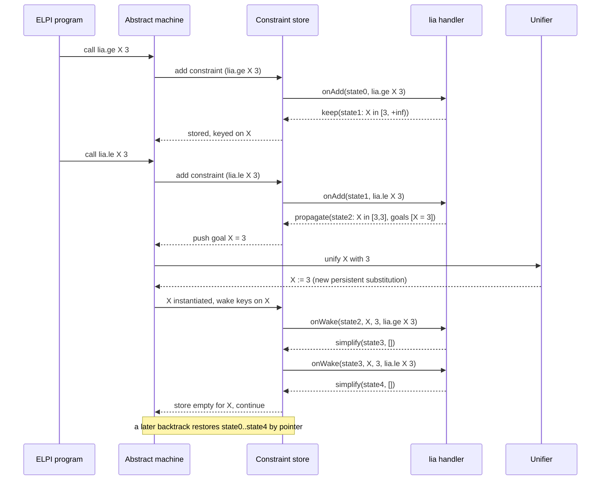

# Writing Your Own Solver

A tutorial paper on extending LeanElpi with domain solvers, from rewrite rules written in ELPI itself down to native Lean code that the unifier consults when it gets stuck.

LeanElpi exposes four solver tiers, fixed by [[decisions#Tiered solver API]]. Each tier trades convenience for power: the higher the tier number, the closer your code sits to the engine and the more of its invariants you are responsible for. This paper walks through all four with a complete worked example each, then covers registration, choosing a tier, the responsibilities of solver authors, and testing. It assumes you know basic λProlog; the [[glossary#Lambda Prolog]] and [[glossary#ELPI]] entries are enough to start. The engine internals referred to here are explained in [[engine]], and the meta-level surface in [[lean-together]].

| Tier | What you write | Where it runs | Typical use |
|------|----------------|---------------|-------------|
| T1 | CHR rules in ELPI | [[components#CHR engine]] | algebraic laws over suspended goals |
| T2 | a Lean function | [[components#Abstract machine]] builtin call | computation, foreign data, Lean `MetaM` |
| T3 | a Lean constraint handler | [[components#Constraint store]] | incremental numeric or finite-domain propagation |
| T4 | a Lean unification hook | [[components#Unifier]] | equational theories, Lean definitional equality |

## The running vocabulary

Four engine concepts recur in every tier, so we fix their meaning before the examples start.

A [[glossary#Delayed goal]] is a goal that cannot make progress yet because some [[glossary#Unification variable]] is unassigned; it sleeps in the constraint store and is resumed when one of its key variables is instantiated. [[glossary#Constraint Handling Rules]] are multiset rewrite rules over those sleeping goals. A [[glossary#Builtin predicate]] is a predicate implemented in the host language. A [[glossary#Constraint handler]] is a native Lean object that owns a family of constraints and their private state. A [[glossary#Unification hook]] is a native fallback for equations the pattern unifier cannot decide.

All four live inside the persistent machine state described in [[decisions#Persistent store]]. That one fact explains most of what follows: because every piece of solver state is an immutable value reachable from the current machine state, a [[glossary#Choice point]] restores it by keeping a pointer, and solver authors never write undo code.

## Tier 1: CHR in ELPI

The first tier needs no Lean at all: you suspend goals with `declare_constraint` and write rules in an ELPI `constraint` block that rewrite the set of suspended goals.

This tier is milestone M2 ([[changes#add-elpi-constraints]]) and realises `elpi-solver-api › CHR solvers in ELPI` on top of `elpi-constraints › Delayed goals` and `elpi-constraints › CHR rules`. Because it is plain ELPI 1.18, every T1 solver also runs unchanged on the upstream `elpi` binary, which makes it the best-tested tier: the [[glossary#Oracle]] checks it for free.

### Suspending goals

A predicate becomes a constraint by refusing to run while its inputs are unknown and parking itself in the store instead.

We build a solver for `leq`, a partial order over integers. When both arguments are numbers, `leq` is ordinary arithmetic comparison. When either is an unassigned variable, the goal is suspended with `declare_constraint Goal Keys`, where `Keys` lists the variables whose instantiation should wake it.

```elpi
pred leq i:int, i:int.

leq X Y :- var X, var Y, !, declare_constraint (leq X Y) [X,Y].
leq X Y :- var X, !,        declare_constraint (leq X Y) [X].
leq X Y :- var Y, !,        declare_constraint (leq X Y) [Y].
leq X Y :- X =< Y.
```

The `i:` modes say both arguments are inputs: clause heads are matched, not unified, so calling `leq A 3` with `A` unassigned never binds `A` by accident. When `A` is later assigned, the suspended `leq A 3` is resumed, that is, called again from the top, and now reaches the arithmetic clause. This is exactly the behaviour of `elpi-constraints › Delayed goals`, scenarios "Goal suspends on an unassigned variable" and "Suspended goal resumes on assignment".

### Rule syntax

A `constraint` block names the predicates its rules may inspect and lists rules of the form kept-heads, backslash, removed-heads, guard, new goal.

In ELPI 1.18 a rule reads:

```elpi
rule Kept1 ... KeptN \ Removed1 ... RemovedM | Guard <=> NewGoal.
```

The heads to the left of `\` must be present in the store and are **kept**; the heads to the right of `\` must be present and are **removed** when the rule fires. A rule with no `\` keeps all of its heads (a propagation rule); a rule that starts with `\` removes all of them (a simplification rule). The optional `| Guard` is an ordinary ELPI goal that must succeed for the rule to fire; it must not bind variables of the matched constraints. The optional `<=> NewGoal` is a goal run after the removal; leaving it out means `true`.

Two details matter when reading rules. First, matching is one-way: the unification variables inside stored constraints are frozen during matching, so a head `(leq X X)` only matches a constraint whose two arguments are the *same* variable, and a guard such as `not (X = Z)` is a purely syntactic test. Second, the variables are thawed again in `NewGoal`, so `X = Y` there really unifies the program's variables and wakes whatever sleeps on them. Heads may also carry a context, written `(Ctx ?- leq X Y)`, which matters for constraints created under `pi`; see `elpi-constraints › Scoped constraints` and the [[glossary#Eigenvariable]] entry.

### The leq solver

Four rules give reflexivity, idempotence, antisymmetry and transitivity; antisymmetry is what turns a cycle of `leq` constraints into equalities.

```elpi
constraint leq {
  % reflexivity: X =< X carries no information
  rule \ (leq X X).

  % idempotence: keep one copy of a duplicated constraint
  rule (leq X Y) \ (leq X Y).

  % antisymmetry: X =< Y and Y =< X force X = Y
  rule \ (leq X Y) (leq Y X) <=> (X = Y).

  % transitivity: derive X =< Z, unless it would be X =< X
  rule (leq X Y) (leq Y Z) | not (X = Z) <=> (leq X Z).
}
```

Rule order is significant: the engine tries rules top to bottom whenever a constraint is added or resumed, with the new constraint as the active one. Placing idempotence before transitivity keeps the store a set, so transitivity can only ever add finitely many distinct constraints over the finitely many variables in play, and the solver terminates. The guard keeps transitivity from manufacturing `leq X X`, which reflexivity would remove anyway; the guard simply avoids the wasted step.

### Cycle detection

A cycle of `leq` constraints collapses its variables into one; if the cycle meets distinct numbers, the collapse fails, and that failure is the detected cycle.

```elpi
main :-
  leq A B, leq B C, leq C A,     % a three-cycle
  print "collapsed:" A B C,
  (A = 1, C = 2 -> print "unexpected" ; print "cycle rejects 1 and 2").
```

Adding `leq C A` fires transitivity on `leq B C, leq C A` to give `leq B A`, and antisymmetry on `leq A B, leq B A` unifies `A = B`. Resuming the remaining constraints on the merged variable leaves `leq A C, leq C A`, which antisymmetry merges again. The store ends empty and `A`, `B`, `C` are one variable, so the subsequent `A = 1, C = 2` fails. With ground bounds the failure is direct: `leq 1 B, leq B 0` makes transitivity call `leq 1 0`, whose arithmetic clause fails. This is scenario "leq solver detects a cycle" of `elpi-solver-api › CHR solvers in ELPI`.

For a strict order one adds a second predicate `ltn` to the block header, `constraint leq ltn { ... }`, with `rule \ (ltn X X) <=> fail.`, `rule (ltn X Y) (leq Y X) <=> fail.` and the three mixed transitivity rules; any cycle that contains a strict edge then fails instead of collapsing.

### Tier 1 as built in M2

The shipped T1 solver is `lib/elpi/leq.elpi`, loaded with `accumulate leq.`.

It provides reflexivity, idempotence, antisymmetry and transitivity rules over `leq`, with the user-facing clause `leq A B :- declare_constraint (leq A B) [A, B]`. The corpus program `constraints/leq_cycle.elpi` runs it against the oracle: a cycle `leq A B, leq B C, leq C A` unifies `A`, `B` and `C` with no residual constraints. Several solvers coexist because each rule only sees the predicates of its own `constraint` header.

## Tier 2: Lean builtins

The second tier implements a predicate as a Lean function that the abstract machine calls directly, with an ELPI signature that the type checker enforces.

Builtins are the right tool when a predicate is really a *function*: arithmetic on big numbers, string processing, a lookup in a Lean data structure, or a call into `MetaM` such as type inference. They realise `elpi-solver-api › Lean builtin predicates` (milestone M1, [[changes#add-elpi-core]]) and live next to the [[components#Core builtins]]; the Lean-specific ones are collected in [[components#Lean builtins]].

### A deterministic builtin

A builtin is declared with an attribute carrying its ELPI name and signature; the body receives the input arguments and returns the outputs.

```lean
open Elpi in
@[elpi_builtin "lean.nat_add" "pred lean.nat_add i:int, i:int, o:int."]
def natAdd : Builtin := Builtin.det fun
  | #[.int a, .int b] =>
      if a < 0 || b < 0 then Builtin.fail          -- not natural numbers: plain failure
      else pure #[.int (a + b)]
  | _ => Builtin.instantiationError "lean.nat_add: inputs must be ground integers"
```

The signature string is parsed and checked by the [[components#Type checker]] when the builtin is registered (scenario "Builtin signature is typechecked"); a program that calls `lean.nat_add` with a string is rejected at load time, before the builtin ever runs. Modes decide the calling convention: the function receives the `i:` arguments, already dereferenced through the [[components#Persistent substitution]], and returns one term per `o:` argument. The machine then unifies each returned term with the caller's output argument, so `lean.nat_add 2 3 5` succeeds as a check and `lean.nat_add 2 3 X` binds `X`.

`Builtin.det` wraps a function that yields at most one answer. Three outcomes are possible: a result array, `Builtin.fail` (ordinary logical failure, which backtracks), and an error such as `instantiationError` or `typeError` (which aborts the query with a message, matching upstream behaviour for misuse). Typed helpers built on [[components#Marshalling]] remove the pattern matching for common shapes:

```lean
@[elpi_builtin "lean.nat_mul" "pred lean.nat_mul i:int, i:int, o:int."]
def natMul : Builtin := Builtin.fn₂ fun (a b : Nat) => a * b
```

Here `FromElpi Nat` decodes the inputs (failing on negative integers) and `ToElpi Nat` encodes the result; see [[type-bridge]] for the marshalling classes.

### A non-deterministic builtin

A builtin may return a lazy stream of answers; each element becomes an alternative that the machine explores on backtracking.

```lean
@[elpi_builtin "between" "pred between i:int, i:int, o:int."]
def between : Builtin := Builtin.nondet fun
  | #[.int lo, .int hi] =>
      pure <| (LazyList.iota lo hi).map fun k => #[.int k]
  | _ => Builtin.instantiationError "between: bounds must be ground"
```

`Builtin.nondet` expects a `LazyList (Array Term)` in the host monad. The machine takes the first element and pushes a choice point holding the *rest of the stream*, not a precomputed list, so `between 1 1000000000 X, X > 3, !` forces only four elements. This is scenario "Builtin returns a stream of solutions", and it follows from the lazy machine described in [[decisions#Explicit abstract machine]].

### Builtins and the host monad

A builtin runs in whatever host monad the engine was instantiated at, so the same declaration can be pure in a compiled binary and call `MetaM` inside Lean.

The core is generic over a `Backtrackable` monad ([[decisions#Monad-generic core and packaging]], [[glossary#Host monad]]). A builtin that needs Lean services is written against `MetaM` and is only offered when the engine runs there (scenario "Builtin runs in the host monad"); for example `lean.infer` calls `Meta.inferType`. Choice points capture the host state as a `Meta.SavedState`, so if a builtin assigns a Lean metavariable and the search later backtracks past it, the assignment is rewound too. A builtin must therefore keep all of its effects inside the host monad; writing to an `IO.Ref` or a file escapes backtracking and is the author's responsibility.

### As built in M1

The M1 registry (`Elpi/Solver/Registry.lean`) uses plain Lean functions instead of the `Builtin.det` wrappers sketched above.

An implementation has the type `Array Term → LazyList (Array Term)`, optionally in `IO` or `MetaM`; the effect is read off the declaration's type when `@[elpi_builtin "name" "pred …"]` is applied. The array holds the call's arguments, input positions dereferenced and output positions unassigned. Each element of the returned stream lists the values of the output-mode arguments only, in order, and the machine fills in the full tuple and unifies it with the call, so a builtin never sees the modes. An empty stream is failure; the stream is forced one element ahead, so demanding one solution calls the implementation once. The signature is parsed and typechecked against the prelude when the attribute is applied (a malformed string is an elaboration error), a duplicate name is an error at the second registration, and `Registry.loadIn env src` loads a program that sees exactly the builtins registered in `env`. `Registry.metaBuiltins env` offers the same entries to the engine running in `MetaM`, which is what `lean-elpi --lean-env` does.

## Tier 3: native constraint handlers

The third tier lets Lean code own a family of constraints and an incremental private state, reacting when constraints are added and when their variables are instantiated.

CHR is expressive but interpretive: every step is a match over the store. When a domain has a good incremental algorithm, such as bounds propagation, union-find or a simplex tableau, a native handler runs it directly. This realises `elpi-solver-api › Native constraint handlers` (milestone M2) and sits in the [[components#Constraint store]].

### The handler interface

A handler declares the predicate names it owns, an initial state, and two callbacks; each callback returns one of four results.

```lean
namespace Elpi

inductive HandlerResult (σ : Type) where
  | simplify  (st : σ) (goals : List Term)   -- constraint consumed, replaced by goals
  | propagate (st : σ) (goals : List Term)   -- constraint kept, goals added
  | keep      (st : σ)                       -- constraint stored, nothing to add
  | fail                                     -- inconsistent: backtrack

structure ConstraintHandler where
  State     : Type
  init      : State
  signature : String                          -- ELPI declarations of the owned predicates
  keys      : List Name                       -- predicates routed to this handler
  onAdd     : State → Constraint → HandlerM (HandlerResult State)
  onWake    : State → UVar → Term → Constraint → HandlerM (HandlerResult State)

end Elpi
```

When the machine calls a predicate listed in `keys`, it does not search clauses; it builds a `Constraint` (predicate, arguments, the variables it mentions and the scope it was created in) and hands it to `onAdd`. If the handler answers `keep`, `simplify` or `propagate`, the store records the constraint (unless simplified away), keys it on the unassigned variables it mentions, and stores the new state. When one of those variables is later assigned, the store calls `onWake` with the variable, its new value and the affected constraint. Goals returned by `simplify` or `propagate` are pushed onto the goal stack and run like any other ELPI goal, which is how a handler binds variables: it returns `X = 5` rather than writing the substitution itself.

### Why backtracking is free

The handler state lives inside the persistent constraint store, so restoring a choice point restores the state by pointer without any undo code.

The store is a field of the machine state, built from `Lean.PersistentHashMap` ([[decisions#Persistent store]], [[components#Persistent substitution]]). Each handler's state is a value in that store, indexed by handler name. A callback returns a *new* state; the old one is untouched and still referenced by any choice point created earlier. Backtracking pops a choice point and reinstates its machine state, and with it the old handler state. This is scenario "Handler state backtracks with the store" and the reason [[alternatives#Mutable heap with trail]] was rejected: a trail would oblige every handler to log and undo its own mutations. The price is a rule for handler authors: `State` must be a persistent value. Arrays updated in place, `IO.Ref`s or caches outside the state are bugs.

### Worked example: integer bounds propagation

The `lia` handler keeps an interval per variable, tightens it on every new bound, fails on an empty interval and fixes a variable whose interval shrinks to a point.

The owned predicates are `lia.ge X N` (X ≥ N), `lia.le X N` (X ≤ N) and `lia.leq X Y` (X ≤ Y between two variables).

```lean
open Elpi

structure Bounds where
  lo : Lean.PersistentHashMap UVar Int := {}
  hi : Lean.PersistentHashMap UVar Int := {}

def Bounds.check (b : Bounds) (x : UVar) (extra : List Term := []) : HandlerResult Bounds :=
  match b.lo.find? x, b.hi.find? x with
  | some l, some h =>
      if l > h then .fail
      else if l == h then .propagate b (Term.eq (.uvar x) (.int l) :: extra)
      else .propagate b extra
  | _, _ => .propagate b extra

@[elpi_constraint_handler "lia"]
def liaHandler : ConstraintHandler where
  State     := Bounds
  init      := {}
  signature := "pred lia.ge i:int, i:int.  pred lia.le i:int, i:int.  pred lia.leq i:int, i:int."
  keys      := [`lia.ge, `lia.le, `lia.leq]
  onAdd b c := pure <| match c.pred, c.args with
    | `lia.ge,  #[.uvar x, .int n] => (b.tighten x (lo := n)).check x
    | `lia.le,  #[.uvar x, .int n] => (b.tighten x (hi := n)).check x
    | `lia.leq, #[.uvar x, .uvar y] =>
        -- propagate: lo(y) ≥ lo(x) and hi(x) ≤ hi(y); keep the relational constraint
        let b' := b.tighten y (lo := b.lo.find? x) |>.tighten x (hi := b.hi.find? y)
        match b'.check x, b'.check y with
        | .fail, _ | _, .fail => .fail
        | _, _ => .keep b'
    | _, #[.int m, .int n] => if m ≤ n then .simplify b [] else .fail   -- ground: decide now
    | _, _ => .keep b
  onWake b x v c := pure <| match v with
    | .int n =>
        if (b.lo.find? x).all (· ≤ n) && (b.hi.find? x).all (n ≤ ·)
        then .simplify b [c.reinstantiate]       -- re-run the constraint with x := n
        else .fail
    | _ => .fail                                  -- lia variables only hold integers
```

(`tighten` takes the max of lower bounds and the min of upper bounds; `reinstantiate` rebuilds the constraint's goal so that, for `lia.leq`, the other side can now be tightened.) A session shows all four results:

```elpi
main :-
  lia.ge X 3, lia.le X 7,      % keep: X in [3,7]
  lia.le X 3,                   % interval [3,3]: propagate X = 3
  print X,                      % prints 3
  lia.ge Y 10, lia.leq Y Z,     % Z inherits lower bound 10
  (lia.le Z 9 -> print "impossible" ; print "Z >= 10 enforced").
```

The second line shows scenario "Handler simplifies a new constraint" in its propagating form; assigning `X` through the returned goal triggers `onWake` for `X`'s other constraints (scenario "Handler wakes on variable instantiation"); and the failing `lia.le Z 9` inside the if-then-else is undone together with the interval update it caused.

### Tier 3 as built in M2

A handler is a `ConstraintHandler` value registered with `@[elpi_constraint_handler "name"]`.

`keys` names the predicates it owns, `init` is its private state (a `Dynamic` kept in `Store.cstore.handlerState`), and `onAdd c view` and `onWake x view` return a `HandlerResult`. The `view` (`HStore`) gives the constraints the handler owns, its state and a dereferencing function. Callbacks are pure, so a handler works in the runtime library, the CLI and `MetaM` alike. The tests use a `"lia"` fixture that keeps the stronger of two upper bounds and fails when a variable is instantiated beyond its bound. A CHR block over a predicate a handler owns is rejected at load time.

## Tier 4: unification hooks

The fourth tier is a native fallback inside the unifier, consulted only for equations that higher-order pattern unification cannot settle on its own.

ELPI unification is syntactic, extended to the [[glossary#Pattern fragment]], which keeps it decidable with most general unifiers ([[constraints#Pattern unification is decidable]]). Some domains want a richer equality: associativity and commutativity of an operator, or Lean definitional equality between reflected terms. A [[glossary#Unification hook]] adds such a theory without touching the core algorithm. This realises `elpi-solver-api › Unification hooks` (milestone M2) and lives in the [[components#Unifier]].

### When a hook is consulted

A hook sees an equation only when pattern unification is stuck on it, and it can never turn a syntactic success into anything else.

The unifier first runs its ordinary algorithm. If that succeeds, the result stands and no hook is asked (scenario "Hook cannot override syntactic success"). A hook is consulted only in two stuck situations (scenario "Hook is consulted only when unification is stuck"):

- a flexible-rigid or flexible-flexible equation outside the pattern fragment, such as `F a = g a a` where `a` is a constant, which would otherwise become a delayed unification problem;
- a rigid-rigid clash where one side's head is a symbol the hook has declared **interpreted**; declaring `plus` interpreted tells the unifier that `plus a b` versus `plus b a` is not a definite failure but a question for the theory.

The hook answers with `solved goals` (the equation holds provided the returned equations, which may themselves be a lazy stream of alternatives, one per unifier), `suspend` (still undecided; the equation becomes a delayed goal keyed on its variables and is retried when they are instantiated), or `fail` (the equation is false in the theory). Without any registered hook, the clash fails and the non-pattern equation suspends, exactly as in upstream ELPI 1.18.

### Worked example: AC unification for plus

The hook flattens both sides into multisets of summands, cancels common ones and decides what remains.

```lean
open Elpi

@[elpi_unif_hook "ac_plus"]
def acPlus : UnifHook where
  interpreted := [`plus]
  onStuck lhs rhs := do
    let l ← flattenAC `plus lhs           -- multiset of summands, dereferenced
    let r ← flattenAC `plus rhs
    let (l', r') := Multiset.cancel l r   -- remove syntactically identical summands
    match l'.toList, r'.toList with
    | [], []                 => pure (.solved (LazyList.singleton []))  -- equal up to AC
    | [.uvar x], rest        => pure (.solved (LazyList.singleton [Term.eq (.uvar x) (mkAC `plus rest)]))
    | rest, [.uvar x]        => pure (.solved (LazyList.singleton [Term.eq (.uvar x) (mkAC `plus rest)]))
    | ls, rs =>
        if ls.all Term.isRigid && rs.all Term.isRigid then pure .fail
        else pure .suspend                -- several unknowns: wait for more information
```

With the hook registered, `plus a (plus X b) = plus b (plus a c)` is a rigid-rigid clash on `plus`, so the unifier asks the hook; cancelling `a` and `b` leaves `X` against `c`, and the hook returns the single equation `X = c`. `plus a b = plus b a` is solved with no equations, `plus a b = plus a c` fails, and `plus X Y = plus a b` suspends, because AC unification has two most general answers here and this simple hook prefers to wait rather than enumerate them. A full AC hook would return both alternatives as a stream, and the machine would explore them as choice points.

### Worked example: a Lean definitional equality bridge

The same interface lets reflected Lean terms be compared up to definitional equality by asking `Meta.isDefEq` when syntax alone is stuck.

A hook in `MetaM` declares the reflected head `app` of selected constants interpreted and, when stuck, reflects both sides back to `Expr` and calls `Meta.isDefEq`. Success returns `solved []` (Lean metavariable assignments made by `isDefEq` are part of the host state and backtrack with the choice point), and a postponed problem returns `suspend`. This is the optional defeq bridge mentioned in [[decisions#LF as the dependent extension]] and kept off the main path by [[alternatives#Defeq suspension as the dependent mechanism]]; the LF use of it is described in [[certified-lf]].

### Tier 4 as built in M2

A `UnifHook` has `interpreted` symbols and `onStuck deref a b depth`, returning `solved θ`, `suspend`, `fail` or `decline`.

`Unify.loop` consults the registered hooks, in order, only when pattern unification is stuck: for a problem outside the pattern fragment, or a rigid clash on an interpreted symbol. A `solved θ` is fed back as equations `x = t`, so the occurs and scope checks of core unification apply to it; with no hook, a stuck problem is suspended.

## Registering solvers

Attributes record every solver in a Lean environment extension, so a solver defined in any imported module is available to `#elpi`, ELPI tactics and compiled binaries alike.

The three attributes `elpi_builtin`, `elpi_constraint_handler` and `elpi_unif_hook` (T1 needs none: its rules are ELPI source) each add an entry to the [[components#Solver registry]], a persistent environment extension. An entry holds the ELPI name, the parsed signature, the tier and the Lean declaration name. Because environment extensions are saved in `.olean` files, importing a module imports its solvers (scenario "Solver from an imported module is available" of `elpi-solver-api › Attribute registration`).

The registry is consumed in three places:

- **Inside Lean** (`#elpi`, `elpi_tactic`, `elpi_command`, `Elpi.query`): when a program is instantiated at `MetaM`, the registry entries visible in the current environment are turned into callable values and installed in the program's builtin table. See [[lean-together]].
- **In compiled binaries** (`elpi_main`): the macro expands to code that references each registered declaration by name, so the Lean compiler links the solver code into the executable and no environment lookup happens at run time.
- **In the CLI**: `lean-elpi` ships the registry of LeanElpi's own modules; solvers that need `MetaM` become available when a Lean environment is loaded with `--lean-env` ([[components#CLI]]).

A name clash between two registered solvers is an error at attribute time, reported at the second declaration.

### Runtime registration

Ordinary Lean programs can attach a builtin to a program value at run time, without an attribute, using `withBuiltin`.

```lean
def graphWithBetween : Elpi.Program :=
  graph.withBuiltin "between" "pred between i:int, i:int, o:int." between
```

`withBuiltin` returns a new program and leaves the original untouched, like every other program operation in the [[components#Runtime API]] (`elpi-runtime-library › Runtime builtins`, scenario "Builtin attached with withBuiltin is callable"). The signature is typechecked against the program at attach time. Handlers and hooks have the analogous `withHandler` and `withUnifHook`.

## Choosing a tier

Start at the lowest tier that can express your solver; move up only for performance, for access to Lean, or for a theory that changes what equality means.

| You need | Tier | Why |
|----------|------|-----|
| laws relating suspended goals (order, disequality, typing constraints) | T1 CHR | pure ELPI, runs on the oracle, no Lean |
| a function of ground inputs, or a call into `MetaM` | T2 builtin | simplest native code; deterministic or a lazy stream |
| incremental propagation with private state | T3 handler | persistent state, wakes on instantiation |
| a different notion of equality (AC, defeq) | T4 hook | only place that can influence unification |
| portability to upstream `elpi` | T1 only | T2 to T4 are LeanElpi extensions |
| proof-producing search over LF | T1 or T2, T4 only via the defeq bridge | hooks bypass proof-term recording |

## A constraint's life cycle

The sequence below follows one `lia` constraint from creation through simplification to the wake-up caused by instantiating its variable.



## Responsibilities of solver authors

The engine guarantees backtracking, scoping and typing at the boundary; soundness and termination of the theory you add are yours.

**Soundness.** A solver must only fail when the constraint set is unsatisfiable in your intended model, and must only add goals that follow from it. T1 rules are easy to review because they are logical equivalences or implications; for T3 and T4 a unit test per rule is the minimum. A T4 hook additionally must agree with syntactic unification on the cases where that succeeds, which the engine enforces by never asking, and must return complete answers if programs rely on finding every unifier.

**Termination.** Propagation rules and handlers can loop. Make propagation monotone over a finite lattice (sets of constraints over the variables present, intervals that only shrink) and keep the store free of duplicates. The machine's [[glossary#Fuel]] turns a runaway solver into a resource error rather than a hang, but fuel is a safety net, not a termination argument.

**Scoping.** Constraints created under `pi x\` mention [[glossary#Eigenvariable]]s. Handlers receive the constraint's scope level and must not move an eigenvariable into a term bound outside its scope; `Term.eq` goals returned to the machine are checked by the unifier, so returning goals instead of writing substitutions is the safe default.

**Effects.** Keep effects in the host monad and state in the store. Anything else survives backtracking and breaks the persistence guarantee from [[decisions#Persistent store]].

**Residuals.** Constraints still in the store when a query succeeds are reported with the answer (`elpi-constraints › Residual constraints`). Give owned constraints a readable printed form, since users will see them.

**Certification.** Solvers are outside the trust base. When results matter for Lean proofs, they are re-checked by the kernel ([[constraints#Kernel is the trust anchor]]); see [[certified-lf]].

## Testing solvers

Solvers are tested like the rest of LeanElpi: T1 solvers join the differential conformance corpus, native tiers get Lean golden tests, and each test is annotated with the scenario it proves.

**Conformance corpus.** A T1 solver is plain ELPI 1.18, so its test programs go into `tests/conformance/` and run on both engines through the [[components#Conformance harness]]; the answers, including residual constraints, must match the oracle's. The `leq` cycle example above is exactly such a corpus program.

**Golden tests for native tiers.** T2 to T4 have no upstream counterpart, so they are tested with Lean `#guard_msgs` tests under `tests/`, which pin the printed answers of `#elpi` queries:

```lean
/-- info: X = 3 -/
#guard_msgs in
#elpi liaDemo lp%{ lia.ge X 3, lia.le X 3. }%
```

**Traceability.** Directly above each test, put a `@tg: verifies::` comment whose double-bracketed target names the scenario, using the `openspec:` prefix, for example `openspec:elpi-solver-api#Native constraint handlers#Handler simplifies a new constraint`; above the solver itself, put a `@tg: implements::` comment naming the requirement. `tg trace --gaps` then lists the solver requirements in `elpi-solver-api` and `elpi-constraints` that still lack an implementation or a verifying test. Each scenario named in this paper (from "leq solver detects a cycle" to "Hook cannot override syntactic success") should end up with at least one verifying test.
