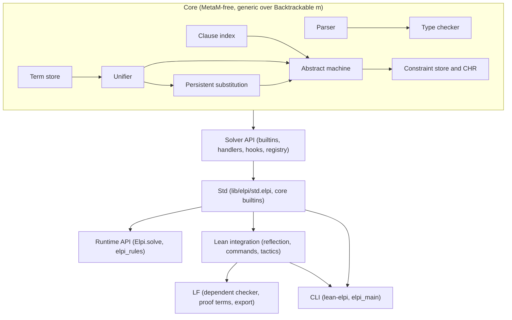
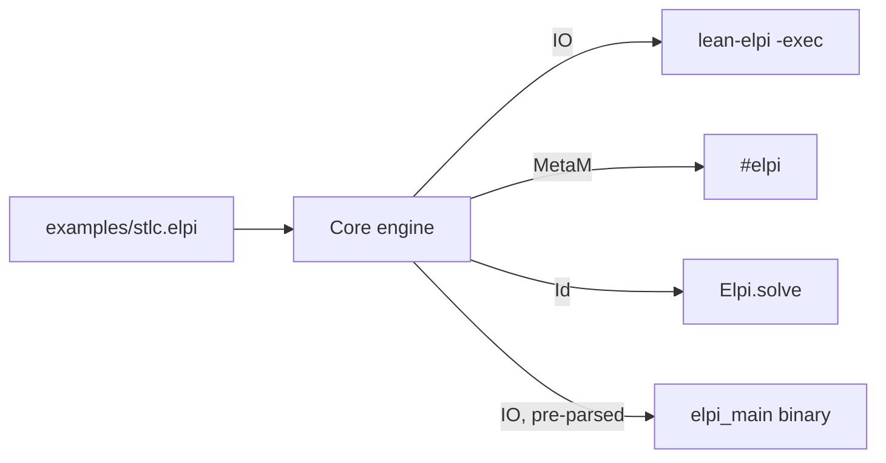

# LeanElpi: Embedding Lambda Prolog in Lean 4

This paper introduces LeanElpi, a clean-room Lean 4 implementation of the ELPI dialect of λProlog, and explains how its parts fit together and why they were designed this way.

## Abstract

LeanElpi brings higher-order logic programming into Lean 4 as a native library, a set of meta-level commands and tactics, a command-line tool, and a compiler target for standalone executables.

The engine implements the ELPI 1.18 dialect of [[glossary#Lambda Prolog]]: [[glossary#Hereditary Harrop formula|hereditary Harrop formulas]], higher-order pattern unification, cut, spilling, clause grafting and, in a second milestone, [[glossary#Constraint Handling Rules]]. It is written in Lean itself rather than bound to the OCaml implementation ([[decisions#Native Lean engine]]), uses a persistent substitution so that backtracking is "forget the newer state" ([[decisions#Persistent store]]), and runs as an explicit abstract machine with fuel and lazy answer streams ([[decisions#Explicit abstract machine]]). Lean terms are reflected into ELPI as higher-order abstract syntax while dependent typing stays with Lean ([[decisions#Plain types with reflected Lean terms]]). Faithfulness to upstream is measured, not assumed: every program in a shared corpus is run against the OCaml `elpi` 1.18 binary as an [[glossary#Oracle]]. An opt-in LF extension lets ELPI search for proofs whose derivations are exported to Lean and checked by the kernel ([[decisions#LF as the dependent extension]]).

## Introduction

Proof assistants are good at checking and weak at searching; logic programming is the reverse. Putting a logic language inside Lean lets each side do what it is good at.

Much of the code around a proof assistant is search: finding instances, synthesising boilerplate, deriving `BEq` or `Repr`, translating between encodings, or proving side conditions by trying rules in order. In Lean today this code is usually written as `MetaM` programs that thread state by hand, re-implement backtracking with `try`/`catch` and `saveState`, and encode binders with de Bruijn indices and `instantiate1`. That is workable but verbose, and the plumbing obscures the rules.

A rule-based language with binders built in makes that code shorter and closer to its specification. The precedent is [[glossary#ELPI]] inside Coq (Coq-Elpi), where commands, tactics and derivers such as `derive.eq` are written as λProlog clauses over a reflected Coq term type. Lean has no equivalent: it has excellent tactic frameworks and a fast elaborator, but no embedded logic language with higher-order unification, local hypotheses (`=>`) and fresh-name introduction (`pi`).

LeanElpi fills that gap with four constraints in mind:

- **Native**: no OCaml in the build, so the engine runs wherever Lean runs and can call `MetaM` directly ([[constraints#MetaM is not callable from C]]).
- **Faithful**: programs written for upstream ELPI 1.18 behave the same ([[decisions#ELPI 1.18 dialect]], [[constraints#Oracle is ELPI 1.18]]).
- **Safe**: anything ELPI produces about Lean is re-checked by Lean, and the kernel stays the trust anchor ([[constraints#Kernel is the trust anchor]]).
- **Clean-room**: Apache-2.0, written from the published semantics without porting the LGPL sources ([[decisions#Clean-room Apache license]], [[constraints#Upstream ELPI is LGPL]]).

The rest of the paper gives just enough background, describes the architecture, walks one example through every way of running it, and explains how faithfulness and traceability are maintained. Companion papers go deeper: "A Persistent Abstract Machine for Lambda Prolog" (the engine), "Plain Types and Independent Types" (the type bridge), "Writing Your Own Solver", "Using Lean and ELPI Together" and "Certified Proof Search with LF".

## Background

This section introduces λProlog, hereditary Harrop formulas, higher-order abstract syntax and ELPI's extensions, using one small example throughout.

### Lambda Prolog in one page

λProlog is Prolog with typed λ-terms as data and two extra goal forms; ELPI is a fast, extended implementation of it. A program is a set of typed clauses.

Every constant has a declared type, and predicates declare argument modes (`i` for input, matched; `o` for output, unified):

```elpi
pred append i:list A, i:list A, o:list A.
append [] L L.
append [X|XS] L [X|R] :- append XS L R.
```

The types are simple types with prenex polymorphism (`list A` for any `A`). They are checked once at load time and never consulted during search. The "Plain Types and Independent Types" paper explains why this restriction matters: it keeps unification decidable ([[constraints#Pattern unification is decidable]]).

### Hereditary Harrop formulas

Hereditary Harrop goals add universal quantification and implication to Horn clauses, giving logic programs local names and local assumptions. Both forms are scoped to the subgoal they govern.

- `pi x\ G` solves `G` for a fresh constant `x`, an [[glossary#Eigenvariable]] that no existing unification variable may capture.
- `H => G` solves `G` with the clause `H` temporarily added to the program.

Together they give the standard way to walk under a binder: introduce a fresh name, assume a fact about it, recurse.

### Higher-order abstract syntax

[[glossary#HOAS]] represents object-language binders with metalanguage binders, so substitution and α-equivalence come free. An object-level `λx. M` becomes an ELPI term `lam (x\ M)`.

Here is a type checker for the simply typed λ-calculus, which we reuse throughout the paper:

```elpi
kind ty type.
type nat ty.
type arr ty -> ty -> ty.

kind tm type.
type zero tm.
type succ tm -> tm.
type app tm -> tm -> tm.
type lam ty -> (tm -> tm) -> tm.

pred of i:tm, o:ty.
of zero nat.
of (succ N) nat :- of N nat.
of (app M N) B :- of M (arr A B), of N A.
of (lam A F) (arr A B) :- pi x\ of x A => of (F x) B.
```

The last clause reads: "`lam A F` has type `arr A B` if, for a fresh `x` assumed to have type `A`, the body `F x` has type `B`." No context list, no variable lookup, no index shifting. `F x` is a β-redex the engine reduces on the fly.

### ELPI and its extensions

ELPI extends λProlog with constraint programming over unassigned variables and other practical features. LeanElpi targets the ELPI 1.18 set of them.

- **Delayed goals**: `declare_constraint G [X]` suspends `G` until `X` is assigned ([[glossary#Delayed goal]]).
- **Constraint Handling Rules**: rewrite rules over the store of suspended goals ([[glossary#Constraint Handling Rules]]).
- **Spilling**: `{p X}` inside a term calls `p X Y` first and uses `Y` in place ([[glossary#Spilling]]).
- **Clause names and grafting**: `:name "n"`, `:before "n"`, `:after "n"` put clauses at precise positions, so other files can extend a program ([[glossary#Clause grafting]]).
- **Modes and first-argument indexing**, namespaces, `accumulate`, and a library of builtins.

Unification goes beyond first order: ELPI solves problems in Miller's [[glossary#Pattern fragment]] and suspends the rest.

## Design overview

LeanElpi is one engine with four ways to use it, organised as a stack of layers in which only the top layers know about Lean's elaborator.

### Four ways to use it

The same programs and the same engine serve four audiences: Lean metaprogrammers, Lean application developers, ELPI users at the shell, and people shipping ELPI programs as binaries.

| Mode | Entry point | Host monad | Typical use |
|---|---|---|---|
| Meta tool | `elpi_program`, `elpi_accumulate`, `#elpi`, `elpi_tactic`, `elpi_command` | `MetaM` / `TacticM` / `CommandElabM` | derivers, tactics, custom commands |
| Runtime library | `Elpi.solve`, `Elpi.solveIO`, typed decoding, `elpi_rules` | `Id` / `IO` | rule engines inside ordinary Lean programs |
| CLI | `lean-elpi -exec main prog.elpi` | `IO` (or `MetaM` with `--lean-env`) | running upstream ELPI programs, REPL |
| Compiled executable | `elpi_main` | `IO` | ship a program as a binary with no parse step |

The integration surface follows Coq-Elpi closely so that its documentation and idioms carry over ([[decisions#Coq-Elpi style integration surface]]). The packaging decisions behind the table are in [[decisions#Monad-generic core and packaging]].

### Layered architecture

Each layer depends only on the layers below it, and the core is generic over the host monad so the same code runs in `Id`, `IO` and `MetaM`. The diagram mirrors [[architecture#Layers]].



From bottom to top:

1. **Core**: the [[components#Term store]], [[components#Parser]], [[components#Type checker]], [[components#Unifier]], [[components#Persistent substitution]], [[components#Clause index]], [[components#Abstract machine]], [[components#Constraint store]] and [[components#CHR engine]]. Nothing here imports `Lean.Meta`; the monad is a parameter constrained by a `Backtrackable` class.
2. **Solver API**: the four extension tiers of [[decisions#Tiered solver API]]: CHR in ELPI, Lean [[glossary#Builtin predicate|builtin predicates]], native [[glossary#Constraint handler|constraint handlers]] and [[glossary#Unification hook|unification hooks]], all registered by attribute in the [[components#Solver registry]].
3. **Std**: [[components#Core builtins]] and the [[components#Standard library]] (`lib/elpi/std.elpi`), embedded in the binary so nothing needs to be on disk. Other ELPI libraries are found by Lake-aware `accumulate` resolution, which searches the `lib/elpi/` folder of every Lake package ([[components#Library resolver]], `elpi-libraries › Lake-aware library resolution`).
4. **Top layers**: the [[components#Runtime API]] and [[components#Rule DSL]] for ordinary programs; [[components#Expr reflection]], [[components#Marshalling]], [[components#Lean builtins]], [[components#Commands]], [[components#Tactic bridge]] and [[components#Library resolver]] for Lean integration; the [[components#CLI]]; and the LF layer ([[components#LF checker]], [[components#LF proof terms]], [[components#LF export]], [[components#LF strategies]]).

A query's path through these layers is drawn in [[uml#Query sequence]] and the deployment of the four artefacts in [[uml#Deployment diagram]]. [[architecture#Data flow]] follows a term from Lean source to ELPI answer and back.

## A worked tour

This section follows the λ-calculus type checker from the Background through all four ways of running it. The ELPI source stays the same; only the host changes.

Assume the program above is saved as `examples/stlc.elpi` with one extra clause:

```elpi
main :- of (lam nat x\ succ x) T, print T.
```

The concrete Lean syntax below is the planned surface; the specs in the `lean-integration` and `elpi-runtime-library` capabilities fix the details.

### From the command line

The CLI accepts upstream ELPI's flags, so an existing ELPI user can swap `elpi` for `lean-elpi` and keep their scripts. This is `elpi-cli › Upstream-compatible command line`.

```console
$ lean-elpi -exec main examples/stlc.elpi
arr nat nat
$ elpi -exec main examples/stlc.elpi      # the oracle agrees
arr nat nat
```

`-I dir` adds include paths for `accumulate` (`elpi-cli › Include paths`), `-test` runs `main` and reports success, and running with no file starts a REPL (`elpi-cli › Interactive REPL`). Behind the command is the `IO` instance of the engine: the [[components#Parser]] reads the file, the [[components#Type checker]] rejects ill-typed clauses with source positions, and the [[components#Abstract machine]] runs the query.

### From Lean with `#elpi`

Inside a Lean file the same program becomes a named, persistent object that later files can import and extend. Queries are run by a command, and answers appear in the infoview.

```lean
import Elpi

elpi_program stlc
elpi_accumulate stlc file "examples/stlc.elpi"

#elpi stlc lp%{ of (lam nat x\ succ x) T }%
-- infoview:  T = arr nat nat
```

`elpi_program` stores the parsed and type-checked program in an environment extension, so it survives `import` ([[components#Commands]]). Other modules can add clauses with `elpi_accumulate`, for example a grafted clause for a new term former. The query runs in `MetaM`, so the program could also call [[components#Lean builtins]] such as `lean.infer`; this one does not need them. "Using Lean and ELPI Together" builds tactics and commands on the same pattern.

### As a pure function in a Lean program

The runtime library lets an ordinary Lean program call ELPI as a pure function. No `MetaM`, no environment, no file I/O: the program is a compiled constant and answers arrive as a lazy list.

```lean
import Elpi

inductive Ty where
  | nat
  | arr (a b : Ty)
  deriving Repr, Elpi          -- emits: kind ty type. type nat ty. type arr ty -> ty -> ty.

elpi_program stlc                                 -- defines the constant stlc.compiled
elpi_accumulate stlc file "examples/stlc.elpi"    -- parsed and type-checked at compile time

def typeOf (term : String) : Except Elpi.ElpiError (Option Ty) := do
  let q ← Elpi.Query.parse stlc.compiled s!"of ({term}) T"
  -- pure and lazy: only the first solution is computed; FromElpi decodes T
  return (Elpi.solveAs (α := Ty) stlc.compiled q (var := "T")).head?

#eval typeOf "lam nat x\\ succ x"     -- Except.ok (some (Ty.arr Ty.nat Ty.nat))
```

Four requirements meet here. `elpi-runtime-library › Pure lazy queries`: `Elpi.solveAs` is a pure function returning a `LazyList`, and only the first answer is computed because only `head?` is demanded. `elpi-runtime-library › Compiled program constants`: `stlc.compiled` needs no parsing at run time. `elpi-runtime-library › Typed query decoding`: `deriving Elpi` writes the ELPI signature for `Ty` and the `FromElpi Ty` instance that turns the answer back into a Lean value, as explained in "Plain Types and Independent Types". And because the core is monad-generic, this is the very same machine the `#elpi` command used, instantiated at `Id` ([[decisions#Monad-generic core and packaging]]).

### As a compiled executable

`elpi_main` turns an ELPI program into a Lean `main` function, so `lake build` produces a native binary that embeds the pre-parsed program and the standard library.

```lean
import Elpi

elpi_program stlc
elpi_accumulate stlc file "examples/stlc.elpi"
elpi_main stlc                     -- defines `main : List String → IO UInt32`
```

```console
$ lake build stlc && .lake/build/bin/stlc
arr nat nat
```

The binary starts without a parse step (`elpi-cli › Compiled program executables`) and resolves `accumulate std` from the embedded copy (`elpi-libraries › Embedded libraries`). It is the fourth face of the same engine, here in `IO`.

### What stayed the same

Across the four runs the ELPI source, parser, type checker and machine were identical; only the host monad and the entry point changed. That is the payoff of a MetaM-free core.



## Faithfulness: the oracle

LeanElpi is a reimplementation, so its main risk is quietly differing from upstream. The defence is differential testing against the real ELPI 1.18 binary.

The [[components#Conformance harness]] runs every program in a shared corpus through both `lean-elpi` and the OCaml `elpi` installed on the machine, then compares the answers (`elpi-conformance › Shared conformance corpus`, `elpi-conformance › Differential answer comparison`). Answers are normalised (variable names, constraint order) before comparison; a mismatch fails the suite and prints a diff. The corpus grows with each milestone: list and arithmetic basics for M1, CHR solvers for M2, and the upstream test programs that do not need Coq.

Two rules keep the oracle honest:

- **Version pinning**: the harness checks `elpi -version` and refuses to compare against anything but 1.18 (`elpi-conformance › Oracle version pinning`). A newer upstream changes the semantics we are measuring against ([[constraints#Oracle is ELPI 1.18]], and see [[alternatives#ELPI 2.x dialect]] for why we do not chase 2.x).
- **Known divergence register**: a deliberate difference, such as an error message worded differently or a resource error where upstream overflows its stack, is listed with a reason and does not fail the suite (`elpi-conformance › Known divergence register`). Everything not in the register must match.

The oracle is also why we did not need to port upstream code to get its semantics: the specification is "what `elpi` 1.18 prints", and we can ask it as often as we like. The rejected alternatives, linking OCaml through C or talking to an `elpi` process, are recorded in [[alternatives#OCaml FFI engine]] and [[alternatives#Out-of-process engine]].

## Traceability

The design is written before the code, and the code will point back to the design. OpenSpec holds requirements and scenarios; `tg.md/` holds the decisions, concepts and papers; typed edges connect them.

The workflow follows [[decisions#Specs before code]]:

1. **Requirements** live in OpenSpec changes, one per milestone ([[changes#add-elpi-core]], [[changes#add-elpi-constraints]], [[changes#add-lean-integration]], [[changes#add-elpi-lf]]). Each requirement says what the system SHALL do, and each has scenarios with WHEN/THEN steps. For example `elpi-core-engine › Persistent store` has the scenarios "Backtracking restores the substitution" and "Choice point restores host monad state".
2. **Design intent** lives here: [[decisions#Persistent store]] says why, [[glossary#Choice point]] says what the words mean, [[components#Persistent substitution]] says where it will live.
3. **Code** will carry a `@tg: implements::` comment above the declaration that realises a requirement, whose wiki-link target is `openspec:elpi-core-engine#Persistent store`. **Tests** will carry `@tg: verifies::` above the test that proves a scenario, with targets of the form `openspec:<capability>#<Requirement>#<Scenario>`.
4. **Checking**: `tg check` fails on any dangling link, and `tg trace --gaps` lists requirements that nothing implements and scenarios that nothing verifies.

Because the graph is queryable, design questions become queries. Which decisions does each paper rely on?

```cypher
MATCH (p:Section)-[:references]->(d:Decision)
WHERE p.file STARTS WITH 'tg.md/papers/'
RETURN p.title, collect(DISTINCT d.title)
```

Which requirements are built but have no test? Run with `tg cypher --code annotated`:

```cypher
MATCH (s:Requirement)<-[:implements]-(c)
OPTIONAL MATCH (t)-[v:verifies]->(s)
WITH s, count(v) AS n WHERE n = 0
RETURN DISTINCT s.section
```

Which rejected alternatives disagree with which accepted decisions?

```cypher
MATCH (a:Decision)-[:contradicts]->(d:Decision)
RETURN a.title AS rejected, d.title AS accepted
```

The vocabulary for these edges (`implements`, `verifies`, `motivated_by`, `-contradicts`) is fixed by [[code-ontology]], so a query means the same thing to every reader. [[overview#How to read this graph]] is the entry point for navigating it.

## Status and roadmap

Milestone M1 is implemented: the engine, type checker, runtime library, CLI, standard library and conformance suite exist and pass. Work is staged in milestones so that each one yields something usable and testable against the oracle.

| Milestone | Change | Delivers |
|---|---|---|
| M1 (delivered) | [[changes#add-elpi-core]] | core engine, type checker, Lean builtin API, runtime library, std, CLI, conformance harness |
| M2 | [[changes#add-elpi-constraints]] | delayed goals, CHR, scoped and residual constraints, native handlers, unification hooks |
| M3 | [[changes#add-lean-integration]] | Expr reflection, marshalling and `deriving Elpi`, quotations, commands, tactics, Lean builtins, `lean`/`lean.ltac`/`lean.derive` libraries, typed rule DSL |
| LF | [[changes#add-elpi-lf]] (proposed) | dependent signatures, proof terms, export to inductive families, kernel-checked certificates, search strategies, mode and totality checking |

The staging decision, and the features deliberately deferred (macros, deep and multi-argument `:index`, ELPI 2.x `func` and determinacy checking, the tracing protocol), are in [[decisions#Staged language surface]] and [[overview#Milestones]]. The project targets the Lean toolchain 4.35 without Mathlib ([[constraints#Lean toolchain 4.35]]).

## Delivery in M1

M1 ships four ways to run a program, all on the same engine core.

- **Runtime library.** `Elpi.Program.load` parses, resolves `accumulate` against the embedded libraries, typechecks and compiles a program to an immutable `CompiledProgram`. `Elpi.solve` is a pure function returning a `LazyList` of solutions, `Elpi.solveIO` runs the same machine in `IO`, and `Elpi.solveAs` decodes answer variables into Lean values through `FromElpi`. `assert` and `withBuiltin` return new programs that share structure with the original.
- **Compiled programs.** `elpi_program foo "…"` runs the pipeline at elaboration time and stores the lowered clauses as plain data (`ToExpr`), so `foo.compiled` is rebuilt without any parsing; `elpi_main foo` makes it an executable.
- **CLI.** `lean-elpi FILE… [-test | -exec P -- ARGS] [-I DIR] [--lean-env M1,M2] [--fuel N]`, or a REPL. With `--lean-env` the registered Lean builtins run in `MetaM` ([[decisions#Monad-generic core and packaging]]).
- **Libraries.** `lib/elpi/builtin.elpi` (types of the control constructs and builtins) and `lib/elpi/std.elpi` are written clean-room and embedded with `include_str`; the resolver searches the accumulating file's directory, `-I` paths, the package's `lib/elpi/`, the dependencies' `lib/elpi/` in manifest order, then the embedded copies.

The conformance harness (`lake run conformance`) runs the corpus under the ELPI 1.18 oracle and under `lean-elpi` and compares output and exit status. Its findings so far are recorded rather than hidden: the oracle approximates non-pattern unification where the spec suspends, it declares `std.append`'s first two arguments as inputs, and `size`/`substring` are evaluable functions rather than predicates ([[decisions#Oracle wins over spec examples]]).

## Related work

LeanElpi borrows its language from ELPI, its integration style from Coq-Elpi and its dependent extension from the LF family. It differs from search tactics in being a general programming language.

- **Coq-Elpi** embeds the OCaml ELPI into Coq with a HOAS term type, quotations, `coq.typecheck`-style builtins, commands, tactics and derivers. LeanElpi follows its surface closely ([[decisions#Coq-Elpi style integration surface]]) but reimplements the engine natively, because Lean's `MetaM` cannot be driven from C ([[constraints#MetaM is not callable from C]]).
- **Twelf** is the reference implementation of LF with logic-programming search, mode checking and totality checking. The LF milestone takes its object theory and meta-theorem checks, with Lean as the metatheory that checks the certificates ([[glossary#LF]], [[glossary#Certificate]]).
- **Beluga** adds contextual types and first-class contexts to LF for programming with proofs over HOAS. LeanElpi does not adopt contextual types; Beluga is a reference point for what a richer dependent layer could offer.
- **Makam** is a λProlog dialect for rapid prototyping of type systems and languages. It shows how far plain simple types with HOAS go, which supports [[decisions#Plain types with reflected Lean terms]].
- **Aesop and Duper** are search-based Lean tactics: Aesop does best-first rule-based proof search, Duper is a superposition prover. Both are specialised provers with fixed strategies. LeanElpi is a programming language in which such searches can be written, with backtracking and binders built in.
- **miniKanren embeddings** put relational programming inside a host language as a library. LeanElpi shares the embedded-library idea (see the pure `Elpi.solve` above) but provides λ-tree syntax, hereditary Harrop goals and CHR, which miniKanren lacks.

## Conclusion

LeanElpi gives Lean an embedded higher-order logic language with one engine, four hosts, and a type discipline that keeps search decidable while Lean keeps the final word.

The key choices reinforce each other. A native engine ([[decisions#Native Lean engine]]) makes calling `MetaM` possible. A persistent store ([[decisions#Persistent store]]) makes backtracking over `MetaM` state as simple as restoring a saved value. An explicit machine ([[decisions#Explicit abstract machine]]) makes answers lazy and execution bounded. Plain types with reflection ([[decisions#Plain types with reflected Lean terms]]) keep unification in the decidable pattern fragment and leave dependent checking to Lean. The oracle keeps the reimplementation honest, and the traceability graph keeps the design and the code in step as both grow.
