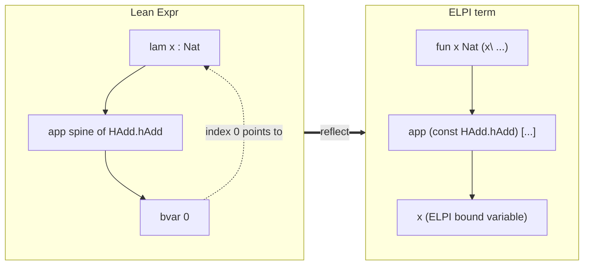
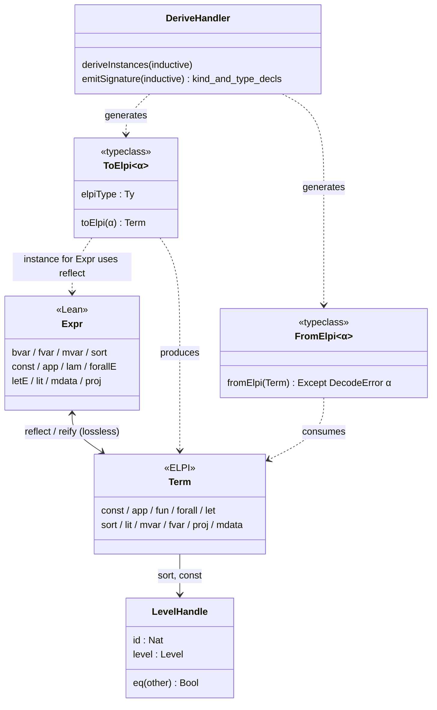

# Plain Types and Independent Types

This paper explains how LeanElpi connects two very different type systems: ELPI's simple types, used to run programs, and Lean's dependent types, used to check what those programs produce.

## The question

Should ELPI programs that manipulate Lean terms be typed with Lean's dependent types, or with ELPI's own simple types? LeanElpi answers: plain ELPI types for the program, Lean types checked by Lean.

We call the two sides **plain types** and **independent types**. Plain types are what the ELPI [[components#Type checker]] sees: `term`, `list term`, `name`. Independent types are the Lean types of the reflected terms, such as `Nat → Nat` or `∀ n, n + 0 = n`. They are independent of the ELPI program in the sense that ELPI never reasons about them; it only asks Lean. That is [[decisions#Plain types with reflected Lean terms]].

The answer has three parts:

1. ELPI programs are typed with simple types and prenex polymorphism, exactly as in ELPI 1.18 (`elpi-typechecker › Prenex polymorphism`).
2. Lean `Expr` values are reflected as data of one ELPI type, `term`, using higher-order abstract syntax ([[glossary#Reflection]], [[glossary#HOAS]]).
3. Whenever a program needs a dependent fact, such as the type of a term or whether two terms are definitionally equal, it calls a Lean builtin (`lean.infer`, `lean.defeq`) and Lean answers.

## Plain types: simple types with prenex polymorphism

ELPI types are simple: base kinds, arrows and type constructors, with type variables quantified only at the outside of a declaration. They are checked once, at load time.

```elpi
kind list type -> type.                 % a type constructor
type nil  list A.
type cons A -> list A -> list A.

pred map i:list A, i:(A -> B -> prop), o:list B.
map [] _ [].
map [X|XS] F [Y|YS] :- F X Y, map XS F YS.
```

`map` is used at many instances of `A` and `B`, but a variable never stands for a type that depends on a term, and a type is never computed. The [[components#Type checker]] rejects ill-typed clauses at load time with a source position (`elpi-typechecker › Load-time type errors with positions`), and after that types play no part in execution.

### Why this keeps unification decidable

Simple types mean unification only has to deal with β-reduction over a fixed type structure. In Miller's pattern fragment that problem is decidable and has most general unifiers.

Search is mostly unification. With simple types, terms are compared up to βη only, and Miller's [[glossary#Pattern fragment]] (a unification variable applied to distinct bound variables) gives a terminating algorithm that returns a most general unifier or fails ([[constraints#Pattern unification is decidable]]). Problems outside the fragment are suspended rather than guessed. The "A Persistent Abstract Machine for Lambda Prolog" paper works through examples.

If ELPI's own types were Lean's types, unification would have to decide definitional equality in the Calculus of Inductive Constructions, which includes evaluating arbitrary programs. That problem is undecidable ([[constraints#CIC unification is undecidable]]), and Lean's own `isDefEq` copes with heuristics, fuel and postponement. A logic programming engine built on it would lose the predictable search order and most general answers that make logic programs readable.

## Independent types: Lean checks Lean

Lean terms enter ELPI as data, and their dependent types stay with Lean. ELPI can build, take apart and compare terms syntactically; anything that depends on typing is a question for Lean.

A tactic written in ELPI builds a candidate proof term and hands it back to Lean, which elaborates and type-checks it before assigning the goal (`lean-integration › ELPI tactics`, scenario "Ill-typed proof is rejected"). The kernel stays the only thing that has to be trusted ([[constraints#Kernel is the trust anchor]]). An ELPI bug can make a tactic fail, but it cannot make Lean accept a false theorem.

## Reflecting Lean terms as HOAS

Every Lean `Expr` maps to an ELPI `term`. Lean's de Bruijn-indexed binders become ELPI λ-abstractions, so ELPI code walks under binders with `pi` instead of shifting indices.

The `lean` library declares the type (`elpi-libraries › Lean API library`). This is the encoding behind `lean-reflection › HOAS term encoding`, implemented by [[components#Expr reflection]]:

```elpi
kind term   type.
kind name   type.      % opaque Lean Name, written as a string "Nat.add"
kind binder type.      % opaque: user name, binder info, let non-dependency flag
kind level  type.      % opaque universe level handle
kind literal type.

type const  name -> list level -> term.
type app    term -> list term -> term.
type fun    binder -> term -> (term -> term) -> term.
type forall binder -> term -> (term -> term) -> term.
type let    binder -> term -> term -> (term -> term) -> term.
type sort   level -> term.
type lit    literal -> term.
type mvar   mvarid -> term.
type fvar   fvarid -> term.
type proj   name -> int -> term -> term.
type mdata  mdatum -> term -> term.

type nat    int -> literal.
type str    string -> literal.
```

### The constructor table

Each Lean `Expr` constructor has exactly one ELPI counterpart, except `bvar`, which has none because a bound variable becomes an ELPI bound variable.

| Lean `Expr` | ELPI `term` | Notes |
|---|---|---|
| `.const n us` | `const N Us` | `Us` is a list of opaque level handles |
| `.app f a` | `app F [A1, ..., An]` | application spines are flattened; the head is never an `app` |
| `.lam n t b bi` | `fun N T (x\ B)` | the body is an ELPI function; binder info travels in the `binder` handle |
| `.forallE n t b bi` | `forall N T (x\ B)` | same shape as `fun` |
| `.letE n t v b nd` | `let N T V (x\ B)` | the non-dependency flag travels in the `binder` handle |
| `.sort u` | `sort U` | `U` is an opaque level handle |
| `.lit l` | `lit (nat K)` / `lit (str S)` | `K` is an arbitrary-precision natural |
| `.mvar m` | `mvar M` | a Lean metavariable, not an ELPI unification variable |
| `.fvar f` | `fvar F` | a hypothesis from the ambient local context |
| `.proj s i e` | `proj S I E` | structure name and field index kept |
| `.mdata d e` | `mdata D E` | metadata kept as an opaque handle |
| `.bvar i` | (none) | replaced by the ELPI variable bound by the enclosing λ |

Two details make the table lossless. Flattening `app` is a bijection as long as the head is never itself an `app`, because `mkAppN` rebuilds the same left-nested tree. And a binder argument is a value of the opaque ctype `binder`, which records the user name, the binder info (default, implicit, strict implicit, instance implicit) and, for `let`, the non-dependency flag. It prints as the user name, so `fun N T F` displays as `fun x ...`. This covers `lean-reflection › HOAS term encoding`, scenario "Constructors cover every Expr form".

### Walking through an example

Take `fun (x : Nat) => x + 1`. After elaboration, `+` is `HAdd.hAdd` applied to three type arguments and an instance, and `1` is `OfNat.ofNat` applied to a literal.

The Lean `Expr` (binary applications, `#0` is the de Bruijn index):

```text
.lam `x (.const `Nat [])
  (.app (.app (.app (.app (.app (.app (.const `HAdd.hAdd [0,0,0]) Nat) Nat) Nat)
          (instHAdd Nat instAddNat))
        (.bvar 0))
     (OfNat.ofNat Nat (lit 1) (instOfNatNat (lit 1))))
  .default
```

The reflected ELPI `term` (`l0` stands for the opaque handle of `Level.zero`):

```elpi
fun "x" (const "Nat" [])
  (x\ app (const "HAdd.hAdd" [l0, l0, l0])
        [ const "Nat" [], const "Nat" [], const "Nat" [],
          app (const "instHAdd" [l0]) [const "Nat" [], const "instAddNat" []],
          x,
          app (const "OfNat.ofNat" [l0])
              [const "Nat" [], lit (nat 1), app (const "instOfNatNat" []) [lit (nat 1)]] ])
```

Pictured, the change is that the de Bruijn pointer is replaced by an ELPI binder:



With a quotation, the same term is written `{{ fun (x : Nat) => x + 1 }}`, or, quoting only the binder type, `fun N {{Nat}} (x\ ...)` with `N` a binder handle. A program that wants the body under a fresh name writes `pi x\ ... (F x) ...`, where `x` is an [[glossary#Eigenvariable]]. Lean's `instantiate1` never appears.

### Hypotheses and eigenvariables

When ELPI code goes under a binder and then asks Lean a question about the body, the bridge must turn the eigenvariable back into a Lean local. It does so through a declaration assumed with `=>`.

```elpi
pred body-type i:term, o:term.
body-type (fun N T F) U :-
  pi x\ lean.decl x N T => lean.infer (F x) U.
```

`lean.decl x N T` tells the bridge that eigenvariable `x` stands for a local of type `T`. When `lean.infer` receives a term containing `x`, the bridge creates a matching local declaration with `withLocalDecl`, runs Lean's `inferType`, and abstracts the local again in the answer. Hypotheses of the goal being solved are already Lean locals and appear as `fvar` handles.

## Lossless round trip and opaque universe levels

Reflection is exact: reflecting an `Expr` and reifying the result gives back the same `Expr`, including universe levels, metadata, projections and binder info.

This is [[decisions#Lossless reflection with opaque levels]] and `lean-reflection › Lossless Expr round trip`. Losslessness matters because ELPI programs often take a term apart, change one subterm and put it back. If reflection dropped `mdata` or projections, a tactic would silently change terms it never meant to touch, and the elaborator's position information and `instance` annotations would be lost.

### Why universe levels are opaque

Universe levels are passed to ELPI as handles that can be stored, compared and passed back, but not taken apart by unification.

Lean levels have their own algebra: `max`, `imax`, `succ`, parameters and level metavariables, with a normalisation and an equality that are not syntactic. If ELPI unified levels as ordinary terms it would reject equal levels (`max u v` against `max v u`) and accept bogus solutions. Making them opaque keeps level reasoning in Lean:

- Two level handles are equal when they are the same handle (`lean-reflection › Opaque universe levels`, scenario "Levels compare by handle identity"). Levels are hash-consed, so syntactically identical levels share a handle.
- Builtins such as `lean.level.zero`, `lean.level.succ` and `lean.level.leq` construct and compare levels with Lean's semantics.
- Most ELPI programs never look at levels at all: they copy them from one `const` to another, which handles do perfectly.

## Typed marshalling for ordinary data

Not every value is a Lean term. Numbers, strings, lists and user-defined inductive types cross the boundary through two type classes, `ToElpi` and `FromElpi`.

This is [[glossary#Marshalling]], implemented by [[components#Marshalling]] (`lean-reflection › Typed marshalling classes`):

```lean
class ToElpi (α : Type) where
  elpiType : Elpi.Ty            -- the ELPI type this Lean type maps to
  toElpi   : α → Elpi.Term

class FromElpi (α : Type) where
  fromElpi : Elpi.Term → Except Elpi.DecodeError α
```

Built-in instances map `Nat` and `Int` to `int` (decoding a negative number at `Nat` fails), `String` to `string`, `List α` to `list A`, `Option α` to `option A`, `α × β` to `pair A B`, and `Lean.Expr` to `term` via reflection. Decoding is checked: a term of the wrong shape gives a `DecodeError`, never a crash (scenario "Decoding a wrong shape fails").

### `deriving Elpi`

For a user's inductive type or structure, `deriving Elpi` generates both the class instances and the ELPI signature, so the ELPI program and the Lean type cannot drift apart.

```lean
inductive Ty where
  | nat
  | arr (a b : Ty)
  deriving Elpi

structure Point where
  x : Nat
  y : Nat
  deriving Elpi
```

generates (`lean-reflection › Deriving Elpi`):

```elpi
kind ty type.
type nat ty.
type arr ty -> ty -> ty.

kind point type.
type point.mk int -> int -> point.
```

The kind is the Lean type name with a lower-case first letter. Constructors keep their short names, except a structure's `mk`, which is qualified because every structure has one. Parameters become kind arguments: `inductive Tree (α : Type)` gives `kind tree type -> type`. The derived declarations are added to the program by `elpi_accumulate` like any other source, and the derived `FromElpi Ty` instance is what turns an answer such as `arr nat nat` into `Ty.arr .nat .nat`. "LeanElpi: Embedding Lambda Prolog in Lean 4" uses exactly this in its worked tour.

Only types that fit plain types can be derived. An indexed family such as `Vec α n` has no simple-type counterpart, and deriving reports an error. Indexed families are the territory of the LF extension.

## Quotations

Writing reflected terms by hand is tedious, so ELPI source can embed Lean syntax between double braces. The quotation is elaborated by Lean and replaced by the reflected `term`.

```elpi
pred is-add i:term.
is-add {{ lp:{{A}} + lp:{{B}} }}.

main :- is-add {{ 2 + 3 }}.
```

`{{ 2 + 3 }}` becomes the reflected `term` of the elaborated expression (`lean-reflection › Quotations`, scenario "Quotation elaborates to a term"). Inside a quotation, `lp:{{X}}` is an antiquotation: it splices an ELPI variable into the Lean term, written as a hole that the reflection fills (scenario "Antiquotation splices an ELPI variable"). The `lp:{{ }}` spelling follows Coq-Elpi; the `lp:X` shorthand is not part of v1. Quotations are elaborated in the Lean environment of the file that accumulates the program, so they can mention any constant in scope there.

## Delegating dependent checks to Lean

Every question that depends on Lean's type theory is answered by a builtin that calls `MetaM`. ELPI provides the search; Lean provides the judgement.

The main [[components#Lean builtins]] (`lean-integration › Lean builtins`):

| Builtin | Lean side | Use |
|---|---|---|
| `lean.infer T Ty` | `inferType` | type of a term |
| `lean.defeq A B` | `isDefEq` | definitional equality, may assign Lean metavariables |
| `lean.whnf T R` | `whnf` | weak head normal form |
| `lean.elab S T` | term elaborator | elaborate a string or quotation |
| `lean.env.const N Ty` | environment lookup | type of a declared constant |
| `lean.hyp H Ty` | local context | enumerate goal hypotheses and their types |

Each is a [[glossary#Builtin predicate]] with a plain ELPI signature (`pred lean.infer i:term, o:term.`), registered through the [[components#Solver registry]] like any user builtin ([[decisions#Tiered solver API]]). They run in the [[glossary#Host monad]], so effects such as metavariable assignments made by `lean.defeq` are captured in [[glossary#Choice point|choice points]] and undone on backtracking ([[decisions#Persistent store]]). Builtins that change the environment are allowed only in command context ([[glossary#Phase restriction]]).

A typical use combines syntactic search with a semantic check:

```elpi
pred find-hyp i:term, o:term.
find-hyp Goal (fvar H) :-
  lean.hyp H Ty,
  lean.defeq Ty Goal.
```

ELPI enumerates hypotheses in order and backtracks; Lean decides whether each type matches the goal up to definitional unfolding.

## Rejected alternatives and the LF route

Three other answers to the type question were considered and rejected. Dependent typing inside the logic language is not abandoned; it comes back, in a decidable form, as LF.

- **Dependent types via CIC** ([[alternatives#Dependent types via CIC]]): make Lean's type theory the object theory of ELPI. Unification becomes CIC definitional equality, which is undecidable ([[constraints#CIC unification is undecidable]]), and search order becomes unpredictable.
- **Static Lean-typed signatures only** ([[alternatives#Static Lean-typed signatures only]]): give ELPI predicates Lean types and check clauses against them, but run untyped. This gives the cost of a dependent checker without any guarantee at run time, and it rejects useful programs.
- **Defeq suspension as the dependent mechanism** ([[alternatives#Defeq suspension as the dependent mechanism]]): suspend every unification problem that needs definitional equality and hand it to Lean later. Kept only as an optional bridge through a [[glossary#Unification hook]], because as the main mechanism it makes failure non-local and hard to debug.

The accepted route for dependently typed search is [[decisions#LF as the dependent extension]]: an opt-in `#lf` file header switches the same engine to [[glossary#LF]] (λΠ) signatures. LF unification stays in the pattern fragment, successful queries record a [[glossary#Proof term]], and the proof term is exported to a Lean inductive family and checked by the kernel as a [[glossary#Certificate]]. The "Certified Proof Search with LF" paper describes it.

## The bridge at a glance

The class diagram shows the main pieces of the bridge and how they depend on each other. The fuller core model is in [[uml#Core class diagram]].



`Expr` and `Term` are related by reflection and reification ([[components#Expr reflection]]); levels inside both are carried by `LevelHandle`; `ToElpi` and `FromElpi` move ordinary data ([[components#Marshalling]]); and `DeriveHandler` writes instances and ELPI signatures for user types.

## As built in M3

The marshalling classes, `deriving Elpi` and the rule DSL as implemented in `Elpi/`.

`ToElpi` and `FromElpi` live in `Elpi/Runtime/Api.lean` with instances for the base types, lists, arrays, options and pairs, and `Elpi/Lean/Marshal.lean` adds `Name`, `Level` and `Expr`. Decoding returns a `DecodeError` naming the expected ELPI type and the offending term. `deriving Elpi` generates `ToElpi`/`FromElpi` for an inductive type or a structure without parameters and registers its `kind` and `type` declarations in an environment extension, so programs loaded in that environment can use them; a field type without an instance or a clashing constant name is an error at the `deriving` clause. `elpi_rules` reuses those declarations to type a rule set against Lean types (`elpi-runtime-library › Typed rule DSL`).
